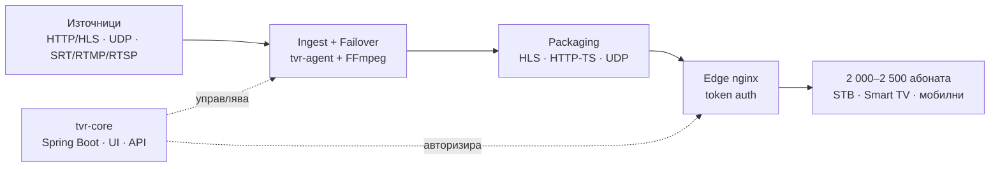

# TvRestream — Продуктова и техническа документация

| Поле | Стойност |
|---|---|
| Продукт | TvRestream — IPTV restream платформа |
| Версия на документа | 0.1 (идеен проект) |
| Дата | 2026-10-05 |
| Собственик | Костадин Длъгнеков |
| Статус | Чернова за преглед |
| Език | Български · [English](../en/00-README.md) |

## Съдържание

| № | Документ | За кого | Какво съдържа |
|---|---|---|---|
| 01 | [Визия и PRD](01-vision-prd.md) | Всички | Проблем, цели, обхват, персони, метрики за успех |
| 02 | [Функционална спецификация](02-functional-spec.md) | PM, Dev, QA | Всички модули и фийчъри с ID, user stories, критерии за приемане |
| 03 | [Архитектура](03-architecture.md) | Dev, DevOps | C4 диаграми, компоненти, потоци на данни, sequence диаграми |
| 04 | [Модел на данните](04-data-model.md) | Dev | ERD, таблици, полета, индекси |
| 05 | [API спецификация](05-api.md) | Dev, интегратори | REST endpoints, auth, webhooks · [openapi.yaml](https://github.com/kocetod/TVRestreamer/blob/main/api/openapi.yaml) |
| 06 | [UI/UX спецификация](06-ui-ux.md) | PM, Design, Frontend | Карта на екраните, wireframes, прототип, състояния |
| 07 | [Нефункционални изисквания и сигурност](07-nfr-security.md) | Dev, DevOps | Производителност, капацитет, наличност, сигурност |
| 08 | [Деплой и експлоатация](08-deployment-ops.md) | DevOps | Хардуер, мрежа, Docker, мониторинг, backup, runbooks |
| 09 | [Тестова стратегия](09-testing-qa.md) | QA, Dev | Нива на тестове, натоварване, тест сценарии |
| 10 | [Roadmap и backlog](10-roadmap-backlog.md) | PM | Етапи, спринтове, епици, Definition of Done |
| 11 | [Рискове, ADR и речник](11-risks-adr-glossary.md) | Всички | Рискове, архитектурни решения, термини |
| 12 | [План за разработка и проследяване](12-development-plan.md) | Всички | Процес, етапи, 109 тикета, борд за прогрес |

## Резюме в 30 секунди

TvRestream приема телевизионни потоци от доставчици и локални източници (HTTP/HLS, UDP/Multicast, SRT/RTMP/RTSP, а по-късно DVB-S/S2). Следи качеството им и при проблем превключва автоматично на резервен източник. Раздава каналите на 2 000–2 500 абоната като HLS и HTTP-TS, със защитени персонални линкове, пакети от канали и лимит на устройствата.

Подобен е на **Cesbo Astra** в частта за приемане, анализ, резервиране и раздаване на потоци, но **без DVR/архив**. Има вградено управление на абонатите (middleware), което Astra няма.

## Ключови решения (накратко)

1. **FFmpeg за I/O на потоците, Java за логиката.** Видеото никога не минава през бизнес логиката. Виж ADR-001.
2. **Собствен TS превключвател и анализатор в Java (Netty)** за бързо превключване към резервен източник (под 3 сек) без рестарт на пакетирането. Виж ADR-003.
3. **HLS е основният изход**, сервиран от nginx от RAM диск. HTTP-TS се раздава от relay в агента. Виж ADR-004.
4. **Без прекодиране в MVP** (само `-c copy`). Прекодирането с GPU е във Фаза 3.
5. **Control plane / data plane разделение.** Един `tvr-core` управлява N сървъра `tvr-agent`.

## Конвенции

- ID на изискванията: `FR-<МОДУЛ>-<№>` (функционални), `NFR-<№>` (нефункционални).
- Приоритет по MoSCoW: **M** (Must), **S** (Should), **C** (Could), **W** (Won't, засега).
- Релийз: **MVP**, **R1** (продукция), **R2** (разширения), **R3** (бъдещи).
- Диаграмите са в Mermaid и се виждат директно в GitHub, GitLab и VS Code. Източниците и SVG файловете са в [../diagrams](../diagrams).
