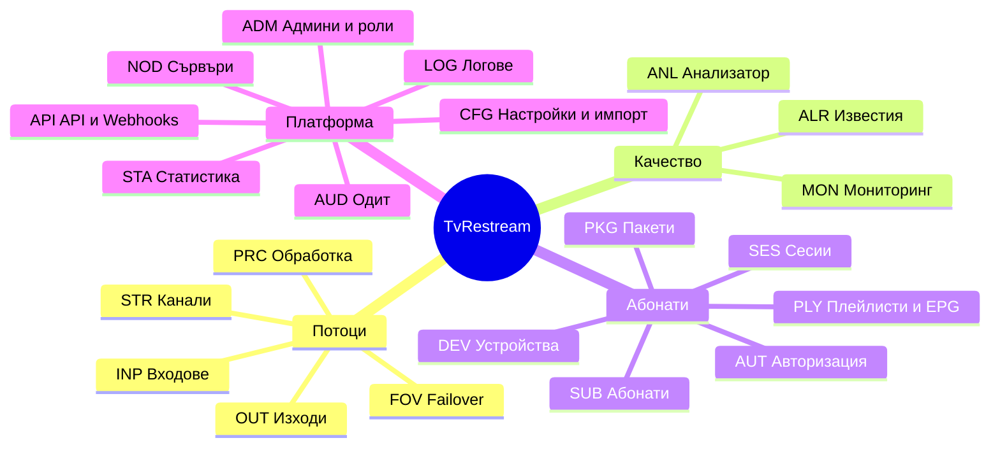
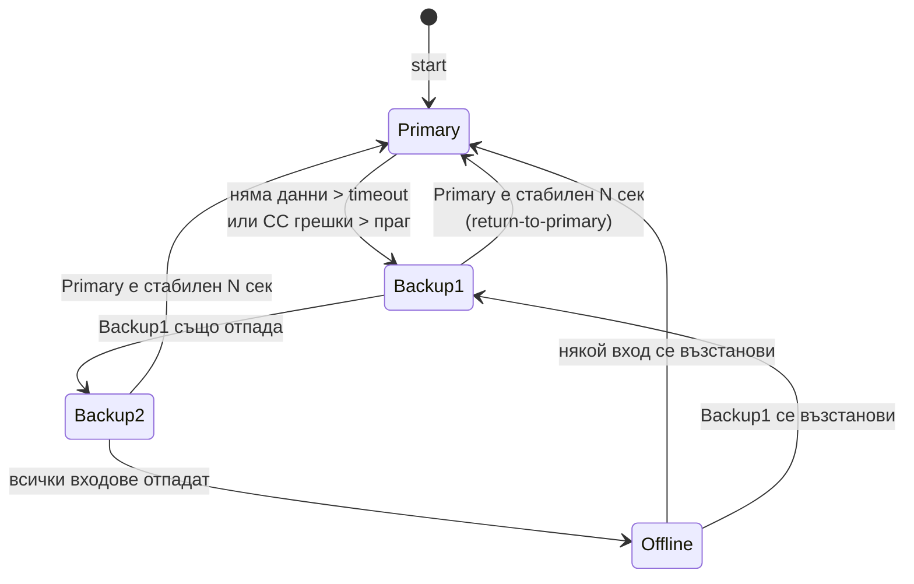
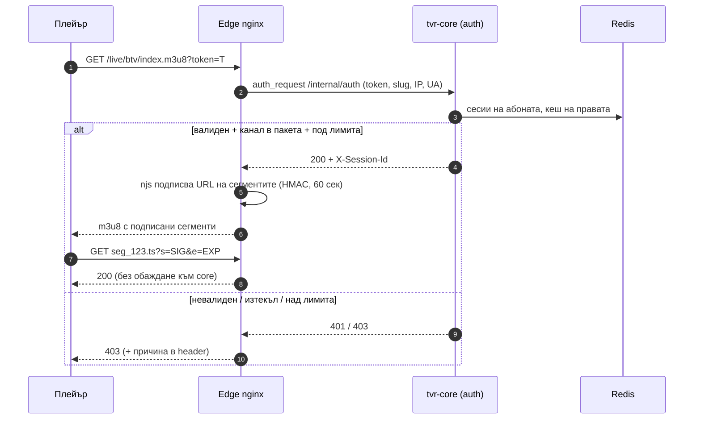
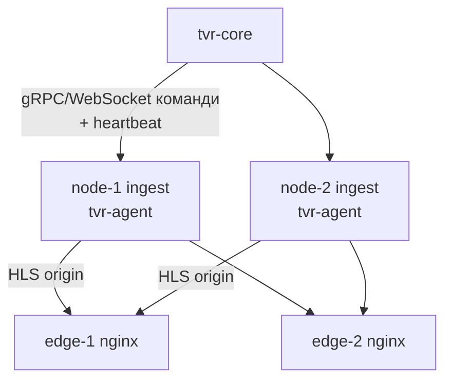

# 02 · Функционална спецификация

[← Индекс](00-README.md) · [English](../en/02-functional-spec.md)

## 1. Карта на модулите

| Код | Модул | MVP | R1 | R2 | R3 |
|---|---|:-:|:-:|:-:|:-:|
| STR | Канали (Streams) | ● | ● | | |
| INP | Входове (Inputs) | ● HTTP/HLS/UDP | ● SRT/RTMP/RTSP | | DVB |
| FOV | Failover | ● cold | ● hot standby | | |
| PRC | Обработка на потока | | ● | ● | транскод |
| OUT | Изходи | ● HLS | ● HTTP-TS, UDP | ● SRT, RTMP | |
| ANL | Анализатор | ● базов | ● пълен | | |
| MON | Мониторинг | ● | ● | | |
| ALR | Известия | | ● | ● | |
| SUB/PKG/DEV | Абонати, пакети, устройства | ● | ● | | |
| AUT | Авторизация за гледане | ● | ● | ● geo | |
| PLY | Плейлисти и EPG | ● | ● | | |
| SES | Сесии | | ● | | |
| NOD | Сървъри (кластер) | ● 1 node | ● N nodes | | |
| ADM | Админи и роли | ● | ● 2FA | | |
| AUD | Одит лог | | ● | | |
| API | REST API и Webhooks | ● | ● | ● webhooks | |
| CFG | Настройки и импорт | ● | ● | | |
| STA | Статистика и отчети | | ● | ● | |
| LOG | Логове | ● | ● | | |

---

## 2. STR · Канали (Streams)

Каналът е логическа единица. Има един или повече **входа** (с приоритет), опционална **обработка** и един или повече **изхода**. Изпълнява се на един сървър (node).

| ID | Изискване | Пр. | Релийз |
|---|---|:-:|:-:|
| FR-STR-01 | Създаване, редакция, клониране и изтриване на канал | M | MVP |
| FR-STR-02 | Полета: име, slug (уникален, използва се в URL), номер (LCN), категория, лого, EPG ID, език, описание, етикети | M | MVP |
| FR-STR-03 | Включване и изключване (enabled). Изключен канал не консумира ресурси и не е в плейлистите | M | MVP |
| FR-STR-04 | Режим **Always-on** (постоянно работи) или **On-demand** (стартира при първи зрител, спира след N сек без зрители, по подразбиране 60) | M | R1 |
| FR-STR-05 | Ръчни действия: Start, Stop, Restart, „Превключи на вход X“ | M | MVP |
| FR-STR-06 | Списък на каналите с филтри (статус, категория, сървър, пакет), търсене, сортиране, масови действия (старт, стоп, преместване, добавяне в пакет) | M | MVP |
| FR-STR-07 | Статус в реално време: `STOPPED`, `STARTING`, `ONLINE`, `DEGRADED` (на резервен вход или с грешки), `OFFLINE` (няма работещ вход), `ERROR` | M | MVP |
| FR-STR-08 | Преглед (preview) на канала в браузъра (HLS плейър в UI) и снимка (thumbnail) на всеки 60 сек | S | R1 |
| FR-STR-09 | Присвояване на сървър (node) и преместване на канал между сървъри без загуба на конфигурацията | M | R1 |
| FR-STR-10 | История на промените по канала (кой, какво, кога) | S | R1 |

**Критерии за приемане (пример FR-STR-01/05):**

- *Given* валиден HTTP-TS източник, *when* Техникът запише нов канал с enabled=true, *then* статусът преминава `STARTING → ONLINE` за ≤ 5 сек, а HLS плейлистът е достъпен на `/live/{slug}/index.m3u8`.
- *Given* канал `ONLINE`, *when* бъде натиснат Stop, *then* FFmpeg процесите спират за ≤ 2 сек и статусът е `STOPPED`.
- Slug трябва да съдържа само `[a-z0-9-]` и да е уникален. Иначе се показва грешка до полето.

---

## 3. INP · Входове (Inputs)

| ID | Изискване | Пр. | Релийз |
|---|---|:-:|:-:|
| FR-INP-01 | **HTTP(S) MPEG-TS** вход с потребител и парола, собствени HTTP headers и User-Agent | M | MVP |
| FR-INP-02 | **HLS** вход (master/media playlist), избор на вариант по bandwidth или резолюция | M | MVP |
| FR-INP-03 | **UDP/RTP** unicast и multicast, избор на мрежов интерфейс, SSM (source-specific multicast), размер на буфера | M | MVP |
| FR-INP-04 | **SRT** caller и listener, passphrase, latency, stream ID | M | R1 |
| FR-INP-05 | **RTMP** pull и приемане на push (с ключ) | S | R1 |
| FR-INP-06 | **RTSP** (TCP/UDP транспорт) | S | R1 |
| FR-INP-07 | Тестване на вход преди запис (бутон „Тествай“): показва кодеци, резолюция, битрейт и програми (ffprobe, до 10 сек) | M | MVP |
| FR-INP-08 | Настройки на вход: timeout за липса на данни (по подразбиране 5 сек), брой опити за свързване, пауза между опитите | M | MVP |
| FR-INP-09 | **Разширяем драйвер модел** (`InputDriver` SPI), за да може да се добави DVB-S/S2 (чрез dvblast/tsp) без промени в ядрото | M | R1 (интерфейс) / R3 (DVB) |
| FR-INP-10 | DVB-S/S2: адаптер, честота, поляризация, symbol rate, LNB, DiSEqC, MPTS → няколко канала | C | R3 |

---

## 4. FOV · Резервиране (Failover)

| ID | Изискване | Пр. | Релийз |
|---|---|:-:|:-:|
| FR-FOV-01 | До 8 входа на канал, подредени по приоритет (drag & drop) | M | MVP |
| FR-FOV-02 | **Cold failover**: при отпадане се стартира следващият вход (цел < 8 сек) | M | MVP |
| FR-FOV-03 | **Hot standby**: резервният вход се приема паралелно, а превключването става в TS превключвателя (цел < 3 сек). Настройва се за всеки вход | M | R1 |
| FR-FOV-04 | Задействане при: липса на данни > timeout, битрейт < праг, CC грешки > N/сек, липса на видео или аудио PID, scrambled поток | M | R1 |
| FR-FOV-05 | **Return to primary**: автоматично връщане към вход с по-висок приоритет, след като е стабилен N сек (по подразбиране 30). Може да се изключи | M | R1 |
| FR-FOV-06 | Ръчно фиксиране на вход (pin), което спира автоматиката до отмяна | S | R1 |
| FR-FOV-07 | Всяко превключване се записва като събитие (от, към, причина) и при нужда изпраща известие | M | MVP |
| FR-FOV-08 | Резервен **слайд/видео** (`slate`) при `OFFLINE`, например „Каналът временно не е достъпен“, за да не се чупят плейърите | S | R2 |

---

## 5. PRC · Обработка на потока (без прекодиране)

| ID | Изискване | Пр. | Релийз |
|---|---|:-:|:-:|
| FR-PRC-01 | Избор на програма (PNR/service ID) от MPTS вход | M | R1 |
| FR-PRC-02 | Избор и филтриране на аудио пътечки по език или PID, премахване на субтитри и teletext | S | R1 |
| FR-PRC-03 | Пренаписване на SDT (service name, provider) и PMT (PNR) за изходите UDP/HTTP-TS | S | R2 |
| FR-PRC-04 | Нормализиране на timestamps и обработка на discontinuity при превключване на вход (HLS `#EXT-X-DISCONTINUITY`) | M | MVP |
| FR-PRC-05 | Транскодиране с профили (H.264, 1080/720/480, NVENC/QSV/CPU) | C | R3 |

---

## 6. OUT · Изходи

| ID | Изискване | Пр. | Релийз |
|---|---|:-:|:-:|
| FR-OUT-01 | **HLS**: продължителност на сегмента (по подразбиране 4 сек), брой сегменти в плейлиста (6), запис в RAM диск (tmpfs), автоматично изтриване на старите | M | MVP |
| FR-OUT-02 | **HTTP-TS** (MPEG-TS по HTTP) за STB/Enigma2/VLC, раздаван от relay в агента | M | R1 |
| FR-OUT-03 | **UDP/RTP multicast**: адрес, порт, TTL, интерфейс, pkt size 1316 | S | R1 |
| FR-OUT-04 | **SRT** listener (pull от партньори) и caller (push) | S | R2 |
| FR-OUT-05 | **RTMP push** към външна платформа | C | R2 |
| FR-OUT-06 | Всеки изход може да е публичен (с авторизация на абонат) или вътрешен (само от доверени IP) | M | R1 |
| FR-OUT-07 | Единна URL схема: `https://{edge}/live/{slug}/index.m3u8` и `https://{edge}/ts/{slug}.ts`, с токен | M | MVP |

---

## 7. ANL · Анализатор на потока

Аналогично на анализатора в Astra. Работи постоянно в TS превключвателя на агента, без допълнителни процеси.

| ID | Изискване | Пр. | Релийз |
|---|---|:-:|:-:|
| FR-ANL-01 | Входящ битрейт (сек/мин), изходящ битрейт | M | MVP |
| FR-ANL-02 | Брояч на **CC грешки** (continuity counter) по PID, **PES грешки**, **PCR jitter/дрейф** | M | R1 |
| FR-ANL-03 | Откриване на **scrambled** PID-ове | M | R1 |
| FR-ANL-04 | Списък на PID-овете: тип, кодек, език, битрейт на PID (PAT/PMT/SDT парсване) | M | R1 |
| FR-ANL-05 | Видео: кодек, резолюция, fps, профил. Аудио: кодек, канали, sample rate | M | MVP |
| FR-ANL-06 | Индикатор за „замръзнала картина“ и тишина (black/freeze/silence detect по thumbnail и аудио нива) | C | R2 |
| FR-ANL-07 | Графики за последните 24 ч (битрейт, грешки, превключвания) в детайла на канала | S | R1 |

---

## 8. MON / ALR · Мониторинг и известия

| ID | Изискване | Пр. | Релийз |
|---|---|:-:|:-:|
| FR-MON-01 | Табло (dashboard): брой канали по статус, онлайн зрители, общ изходящ трафик, натоварване на сървърите (CPU, RAM, NIC) | M | MVP |
| FR-MON-02 | Обновяване в реално време (WebSocket/SSE, ≤ 2 сек закъснение) | M | MVP |
| FR-MON-03 | Prometheus метрики (`/metrics`) за core и агент, готови Grafana табла | S | R1 |
| FR-ALR-01 | Правила за известия: канал OFFLINE > N сек, превключване на failover, CC грешки > праг, node offline, CPU/NIC > праг, абонат над лимит | M | R1 |
| FR-ALR-02 | Канали за известия: **Telegram**, **имейл (SMTP)**, **webhook** | M | R1 |
| FR-ALR-03 | Групиране и заглушаване (dedupe, mute за канал, тихи часове), известие при възстановяване | S | R1 |
| FR-ALR-04 | Списък с активни и исторически инциденти с потвърждаване (acknowledge) | S | R2 |

---

## 9. SUB / PKG / DEV · Абонати, пакети, устройства

| ID | Изискване | Пр. | Релийз |
|---|---|:-:|:-:|
| FR-SUB-01 | CRUD на абонат: потребителско име, парола (за Xtream-подобен достъп), име, телефон, имейл, бележка | M | MVP |
| FR-SUB-02 | Статус: `ACTIVE`, `SUSPENDED`, `EXPIRED`, `BANNED`; дата на изтичане; автоматично изтичане | M | MVP |
| FR-SUB-03 | Един или повече пакети на абонат | M | MVP |
| FR-SUB-04 | **Лимит на едновременните устройства/сесии** (по подразбиране 1) | M | MVP |
| FR-SUB-05 | Персонален **токен** за плейлист; регенериране (старият става невалиден веднага) | M | MVP |
| FR-SUB-06 | Ограничение по IP/подмрежа (allow list) и по държава (GeoIP) | S | R2 |
| FR-SUB-07 | Масово създаване, импорт и експорт (CSV), масово удължаване | S | R1 |
| FR-SUB-08 | Търсене по име, телефон, токен, IP на активна сесия | M | MVP |
| FR-PKG-01 | Пакет (bouquet): име, описание, набор от канали, подредба на каналите в пакета | M | MVP |
| FR-PKG-02 | Канал може да е в няколко пакета; при промяна на пакета плейлистите се обновяват веднага | M | MVP |
| FR-DEV-01 | Регистрирани устройства (по user-agent + IP + device ID, ако има) с „последно видян“; ръчно изтриване на устройство | S | R1 |
| FR-DEV-02 | Режим „заключване към MAC/устройство“ за STB (MAG/Enigma2) | C | R2 |

---

## 10. AUT · Авторизация за гледане

| ID | Изискване | Пр. | Релийз |
|---|---|:-:|:-:|
| FR-AUT-01 | Авторизация на заявката за плейлист (`.m3u8`, `.ts` старт) чрез `auth_request` към core; кеш 10 сек | M | MVP |
| FR-AUT-02 | Сегментите се защитават с HMAC подпис и срок (nginx `secure_link`) без извикване на core | M | MVP |
| FR-AUT-03 | Проверка: токенът е валиден, абонатът е `ACTIVE`, не е изтекъл, каналът е в пакет на абоната, сесиите са ≤ лимита, IP е разрешен | M | MVP |
| FR-AUT-04 | Политика при превишен лимит: **отказ на новото** (по подразбиране) или **изритване на най-старата** сесия | S | R1 |
| FR-AUT-05 | Xtream Codes съвместим API (`/get.php`, `/player_api.php`, `/live/{user}/{pass}/{id}.ts`), за да работят популярните плейъри (TiviMate, IPTV Smarters) | S | R1 |
| FR-AUT-06 | Опционално обвързване на токена с IP (подписът включва IP) | C | R2 |

---

## 11. PLY · Плейлисти и EPG

| ID | Изискване | Пр. | Релийз |
|---|---|:-:|:-:|
| FR-PLY-01 | Персонален M3U: `https://{host}/pl/{token}.m3u` с `#EXTINF` (tvg-id, tvg-name, tvg-logo, group-title, tvg-chno) | M | MVP |
| FR-PLY-02 | Избор на формат на линковете: HLS или HTTP-TS (параметър `?type=hls\|ts`) | M | R1 |
| FR-PLY-03 | `url-tvg` към EPG (XMLTV). Core проксира и кешира XMLTV от външен доставчик и филтрира по каналите на абоната | S | R1 |
| FR-PLY-04 | Лога: качване в системата или външен URL, сервиране през CDN/edge | S | MVP |
| FR-PLY-05 | Категории (group-title) и подредба по LCN | M | MVP |

---

## 12. SES · Сесии

| ID | Изискване | Пр. | Релийз |
|---|---|:-:|:-:|
| FR-SES-01 | Списък на активните сесии: абонат, канал, IP, държава, user-agent, начало, трафик, edge сървър | M | R1 |
| FR-SES-02 | Прекратяване (kick) на сесия или на всички сесии на абонат | M | R1 |
| FR-SES-03 | Сесията е активна, ако има заявка за плейлист или сегмент в последните 30 сек (HLS), или отворена връзка (HTTP-TS) | M | MVP |
| FR-SES-04 | История на сесиите 90 дни (за статистика и спорове) | S | R1 |

---

## 13. NOD · Сървъри (кластер)

| ID | Изискване | Пр. | Релийз |
|---|---|:-:|:-:|
| FR-NOD-01 | Регистрация на сървър чрез еднократен ключ (enrollment token); роли: `INGEST`, `EDGE`, `ALL-IN-ONE` | M | MVP |
| FR-NOD-02 | Heartbeat на всеки 5 сек; `OFFLINE`, ако няма heartbeat 15 сек | M | MVP |
| FR-NOD-03 | Метрики на сървъра: CPU, RAM, диск, NIC in/out, брой процеси, версия на агента и FFmpeg | M | MVP |
| FR-NOD-04 | Режим поддръжка (drain): каналите се преместват на друг ingest, edge спира да приема нови сесии | S | R1 |
| FR-NOD-05 | Автоматично преместване на каналите при отпадане на ingest сървър (ако има свободен капацитет) | S | R2 |
| FR-NOD-06 | Балансиране на edge: DNS round-robin или redirect от core към най-малко натоварения edge (`/pl` връща URL към избрания edge) | S | R1 |

---

## 14. ADM / AUD · Администратори, роли, одит

| Роля | Канали | Абонати | Сървъри | Настройки | Одит |
|---|:-:|:-:|:-:|:-:|:-:|
| **Admin** | RW | RW | RW | RW | R |
| **Operator** | RW | R | R | — | — |
| **Support** | R | RW (без изтриване) | — | — | — |
| **Viewer** | R | R | R | — | — |

> Реализирано в TVR-048: API-то спазва тази матрица (`SecurityConfig`, `Permissions`), а панелът скрива недостъпното. Канали: SUPPORT и VIEWER ги виждат без входовете (адресите носят паролите на доставчиците) и без лога. Абонати: VIEWER — без личния токен и линка към плейлиста. Потребители на панела: страница „Администратори“ (ADMIN).

| ID | Изискване | Пр. | Релийз |
|---|---|:-:|:-:|
| FR-ADM-01 | Вход с имейл и парола (bcrypt/argon2), JWT access (15 мин) + refresh token | M | MVP |
| FR-ADM-02 | Роли по таблицата по-горе (RBAC) | M | MVP |
| FR-ADM-03 | 2FA (TOTP) — задължителна за Admin | S | R1 |
| FR-ADM-04 | Заключване след 5 грешни опита за 15 мин; списък на активните сесии на администратора | M | R1 |
| FR-AUD-01 | Одит лог на всяка промяна: кой, кога, IP, обект, преди/след (JSON diff) | M | R1 |
| FR-AUD-02 | Филтриране и експорт на одит лога; съхранение 1 година | S | R1 |

---

## 15. API · REST API и Webhooks

| ID | Изискване | Пр. | Релийз |
|---|---|:-:|:-:|
| FR-API-01 | Всяка функция в UI е достъпна през REST API `/api/v1` (UI-то използва същия API) | M | MVP |
| FR-API-02 | API ключове за интеграции с права (scopes) и срок на валидност | M | R1 |
| FR-API-03 | OpenAPI 3.1 спецификация + Swagger UI | M | MVP |
| FR-API-04 | Webhooks: `stream.status_changed`, `stream.failover`, `subscriber.created/updated/expired`, `session.limit_exceeded`, `node.status_changed`; HMAC подпис, повторни опити | S | R2 |

---

## 16. CFG · Настройки, импорт, backup

| ID | Изискване | Пр. | Релийз |
|---|---|:-:|:-:|
| FR-CFG-01 | Глобални настройки: домейни на edge, HLS параметри по подразбиране, timeout-и, тайни ключове за подписване | M | MVP |
| FR-CFG-02 | Импорт на канали от **M3U** (с mapping на полетата и преглед преди запис) | M | MVP |
| FR-CFG-03 | Импорт на конфигурация от **Astra** (JSON: `make_stream`, `input`, `output`) | S | R1 |
| FR-CFG-04 | Експорт и импорт на цялата конфигурация (JSON) | S | R1 |
| FR-CFG-05 | Автоматичен ежедневен backup на базата (pg_dump) с ротация 14 дни | M | R1 |
| FR-CFG-06 | SMTP, Telegram бот, GeoIP база, EPG източници | M | R1 |

---

## 17. STA / LOG · Статистика и логове

| ID | Изискване | Пр. | Релийз |
|---|---|:-:|:-:|
| FR-STA-01 | Топ канали по зрители (час, ден, седмица, месец) | S | R1 |
| FR-STA-02 | Пикови едновременни зрители и трафик по ден | S | R1 |
| FR-STA-03 | Uptime отчет по канал (% и брой инциденти) за период | S | R1 |
| FR-STA-04 | Абонати: нови, изтичащи в следващите 7 дни, изтекли | S | R1 |
| FR-STA-05 | Експорт на отчетите в CSV | C | R2 |
| FR-LOG-01 | Лог на канала (FFmpeg stderr + събития на агента) в UI в реално време, последните 1 000 реда | M | MVP |
| FR-LOG-02 | Структурирани логове (JSON) на core и агента, ротация, опционално Loki | S | R1 |

---

## 18. Бизнес правила (обобщение)

| # | Правило |
|---|---|
| BR-01 | Абонат с изтекла дата преминава автоматично в `EXPIRED` в 00:00 (Europe/Sofia) и сесиите му се прекратяват. |
| BR-02 | Изтриване на канал, който е в пакети, изисква потвърждение. Изтриването е „меко“ (30 дни възстановяване). |
| BR-03 | Slug на канал не може да се смени, докато има активни сесии (иначе URL-ите се чупят). Изисква се потвърждение. |
| BR-04 | При регенериране на токен всички сесии на абоната се прекратяват. |
| BR-05 | Канал в режим On-demand се стартира при първата заявка. Първата заявка чака до 6 сек за първия сегмент. |
| BR-06 | Сесиите се броят по уникална двойка (абонат, устройство/IP+UA). Смяната на канал от същото устройство не е нова сесия. |
