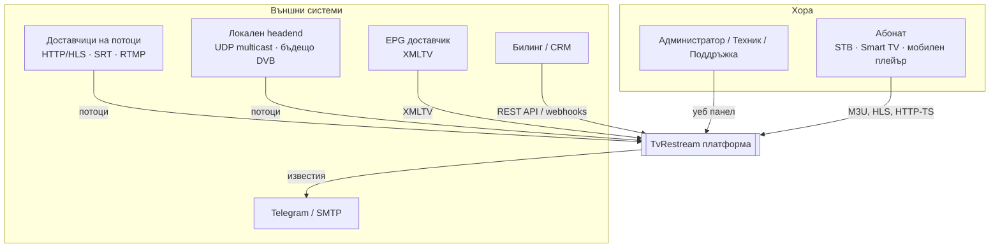
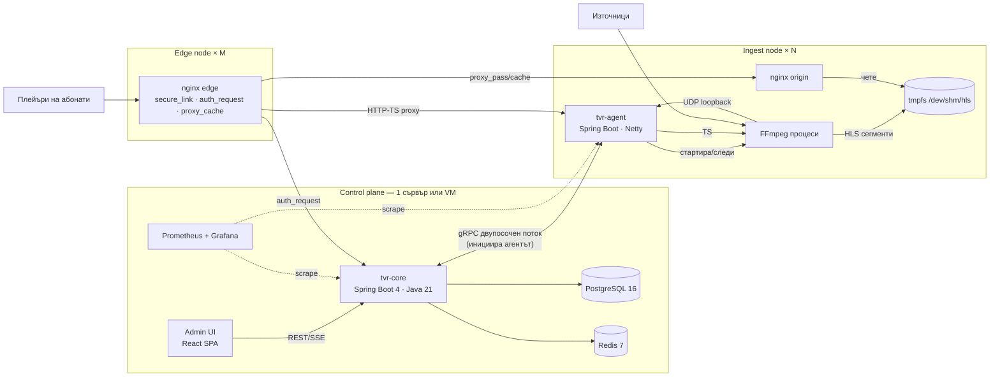
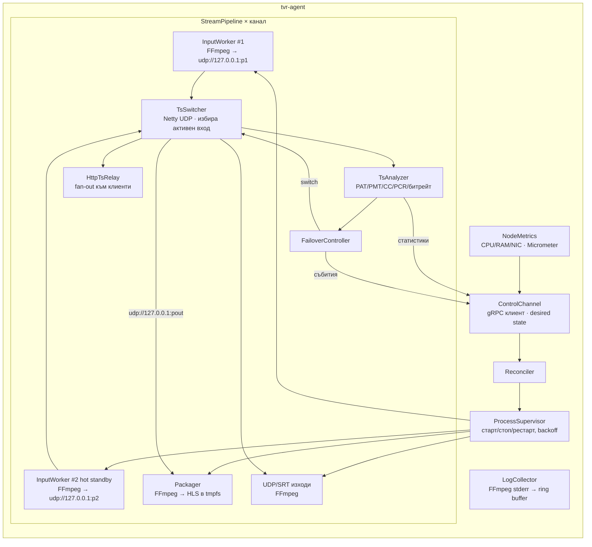
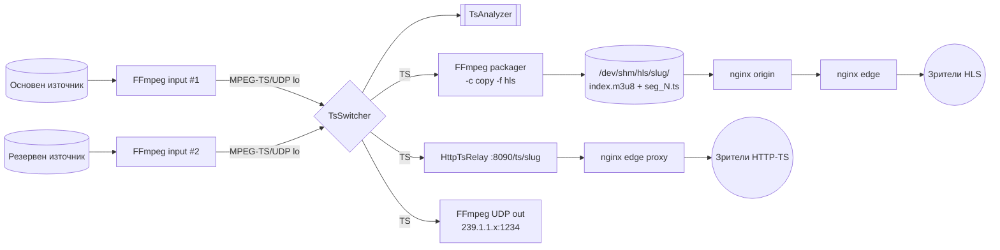
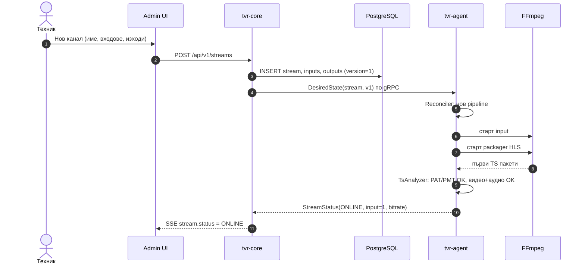
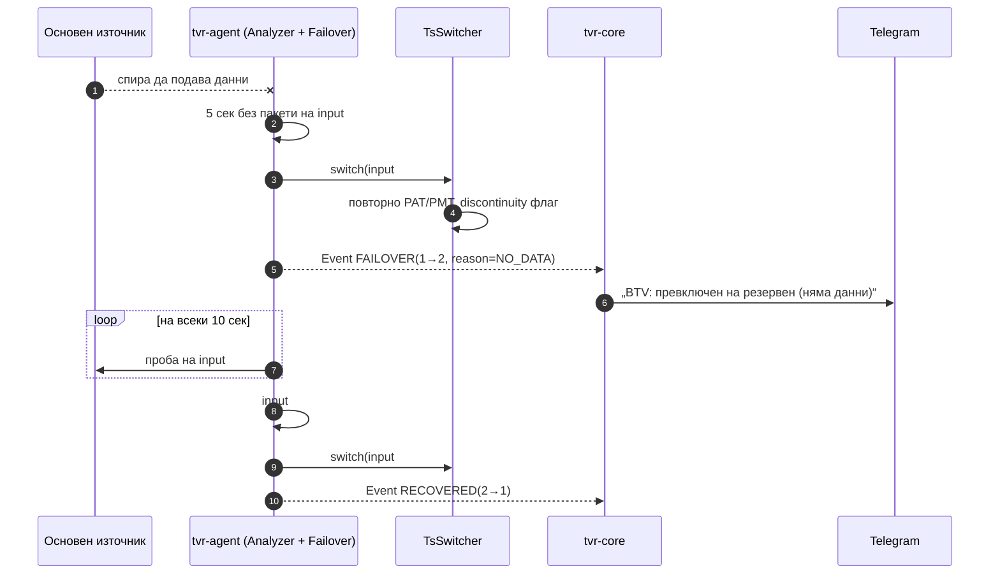
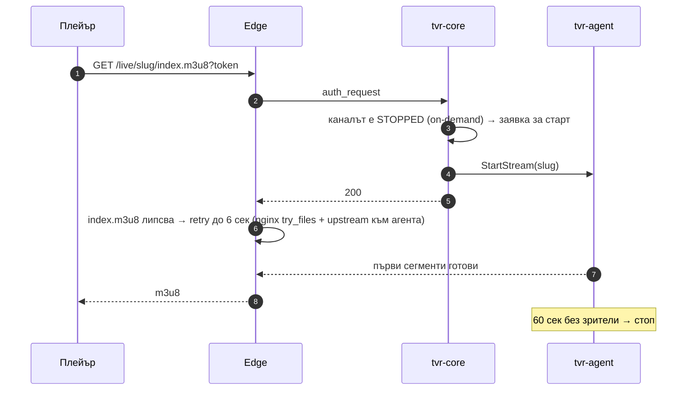

# 03 · Архитектура

[← Индекс](00-README.md) · [English](../en/03-architecture.md)

## 1. Принципи

1. **Control plane ≠ data plane.** `tvr-core` управлява конфигурация, абонати и авторизация. `tvr-agent` и FFmpeg пренасят видеото. Ако core падне, работещите канали и вече авторизираните сесии продължават.
2. **Видеото не минава през бизнес логиката.** Байтовете се движат от FFmpeg → TS превключвател (Netty, zero-copy буфери) → FFmpeg/nginx.
3. **Desired state + reconciliation.** Core изпраща на агента пълното желано състояние. Агентът сам привежда процесите в съответствие (подобно на Kubernetes), затова изгубени команди и рестарти не водят до разминаване.
4. **Един процес FFmpeg на вход и на пакетиране, никога на зрител.**
5. **Stateless edge.** Edge сървърите са само nginx с кеш и могат да се добавят хоризонтално.

## 2. C4 · Ниво 1 — Контекст



## 3. C4 · Ниво 2 — Контейнери



| Контейнер | Технология | Отговорност |
|---|---|---|
| **Admin UI** | React 18, TypeScript, Vite, Ant Design, TanStack Query, hls.js | Уеб панел |
| **tvr-core** | Java 21, Spring Boot 4.1, Spring Security, Spring Data JPA, Flyway, gRPC, Micrometer | REST API, авторизация на абонати, плейлисти, оркестрация на агентите, известия, статистика |
| **PostgreSQL** | 16 | Конфигурация, абонати, одит, история |
| **Redis** | 7 | Активни сесии, кеш на авторизацията, rate limit, pub/sub на статуси |
| **tvr-agent** | Java 21, Spring Boot (без web MVC), Netty, gRPC клиент | Супервизор на FFmpeg, TS превключвател и анализатор, HTTP-TS relay, метрики на node |
| **FFmpeg** | 7.x (+libsrt, openssl) | Приемане на входове, пакетиране в HLS, UDP/SRT/RTMP изходи |
| **nginx origin** | 1.26 | Сервира HLS от tmpfs към edge |
| **nginx edge** | 1.26 | TLS, авторизация, кеш, раздаване към зрителите |
| **Prometheus/Grafana** | — | Метрики и табла |

## 4. C4 · Ниво 3 — Компоненти на tvr-agent



### 4.1 Защо собствен TS превключвател (TsSwitcher)

Ако FFmpeg приема входа директно и прави HLS, при failover трябва да се рестартира целият процес. Това води до 5–10 сек прекъсване и „счупен“ плейлист. С TsSwitcher:

- входовете се приемат от отделни FFmpeg процеси (`-c copy -f mpegts udp://127.0.0.1:PORT`);
- TsSwitcher чете всички активни входове, но препраща само избрания към packager-а;
- при превключване изпраща чист TS (с повторно изпратени PAT/PMT), а packager-ът продължава без рестарт. При нужда се вмъква `EXT-X-DISCONTINUITY`;
- анализаторът работи върху същите пакети без допълнително копиране.

## 5. Потоци на данните за един канал



## 6. Ключови последователности

### 6.1 Създаване и стартиране на канал



### 6.2 Автоматичен failover



### 6.3 On-demand канал



## 7. Комуникация core ↔ agent

| Аспект | Решение |
|---|---|
| Транспорт | gRPC двупосочен поток, **инициира агентът** (работи зад NAT/firewall), mTLS |
| Регистрация | Enrollment token → core издава клиентски сертификат за агента |
| Съобщения core→agent | `DesiredState` (пълен snapshot + версия), `Command` (restart, switch input, kick HTTP-TS клиент) |
| Съобщения agent→core | `Heartbeat` (5 сек), `NodeMetrics` (5 сек), `StreamStatus` (при промяна + на 5 сек), `StreamEvent`, `LogLines` (при абонамент) |
| При загуба на връзка | Агентът продължава с последното известно състояние и се свързва отново с exponential backoff |

## 8. Структура на кода (monorepo)

```
tvrestream/
├── settings.gradle, build.gradle # Gradle multi-project (Java 21)
├── tvr-common/                  # DTO, proto (gRPC), общи утилити
│   └── src/main/proto/agent.proto
├── tvr-core/                    # Spring Boot приложение
│   └── src/main/java/io/tvr/core/
│       ├── stream/              # канали, входове, изходи
│       ├── subscriber/          # абонати, пакети, устройства
│       ├── auth/                # admin auth (JWT) + playback auth
│       ├── playlist/            # M3U, Xtream API, EPG
│       ├── session/             # сесии (Redis)
│       ├── node/                # регистрация и оркестрация на агенти
│       ├── monitoring/          # статуси, SSE, известия
│       ├── audit/               # одит
│       └── config/              # настройки, импорт/експорт
├── tvr-agent/                   # Spring Boot (non-web) + Netty
│   └── src/main/java/io/tvr/agent/
│       ├── control/             # gRPC клиент, reconciler
│       ├── process/             # ProcessSupervisor, FfmpegCommandBuilder
│       ├── ts/                  # TsSwitcher, TsAnalyzer, TsPacket парсер
│       ├── relay/               # HttpTsRelay (Netty HTTP)
│       └── metrics/
├── tvr-ui/                      # React + TypeScript
├── deploy/
│   ├── docker-compose.yml
│   ├── nginx/{origin,edge}.conf
│   └── ansible/                 # инсталация на node
└── docs/                        # тази документация
```

## 9. Технологичен стек и версии

| Слой | Избор | Алтернатива (отхвърлена) | Причина |
|---|---|---|---|
| Език/рамка | Java 21 + Spring Boot 4.1 | Python/FastAPI, Go | Избор на собственика; зрял екосистем; virtual threads |
| Медиа I/O | FFmpeg 7 | GStreamer | По-разпространен, по-лесен за дебъг, всички протоколи |
| TS обработка | Собствена (Netty) | Само FFmpeg | Бърз failover без рестарт, анализатор |
| БД | PostgreSQL 16 | MySQL | JSONB, надеждност |
| Кеш/сесии | Redis 7 | Hazelcast | Прост, TTL ключове, pub/sub |
| Edge | nginx | Varnish, собствен Java сървър | `secure_link`, `auth_request`, ефективен sendfile |
| UI | React + Ant Design | Vaadin, Thymeleaf | Богат админ UI, отделен от бекенда |
| Мониторинг | Micrometer + Prometheus + Grafana | Zabbix | Стандарт, готови табла |
| Деплой | Docker Compose + Ansible | Kubernetes | Достатъчно за 3–6 сървъра, по-лесна поддръжка |

## 10. Мрежови портове

| Порт | Услуга | Достъп |
|---|---|---|
| 443/80 | nginx edge (HLS, HTTP-TS, плейлисти) | Публичен |
| 443 | Admin UI + API (отделен домейн, напр. `admin.`) | Ограничен по IP / VPN |
| 9443 | gRPC core ↔ agent (mTLS) | Само сървърите |
| 8080 | tvr-core HTTP (вътрешен, зад nginx) | localhost |
| 8090 | HttpTsRelay на агента | Само edge |
| 8081 | nginx origin (HLS) | Само edge |
| 9100/9464 | Prometheus exporters | Само мониторинг |
| 20000–29999/udp | Loopback портове за TS между процесите | 127.0.0.1 |
