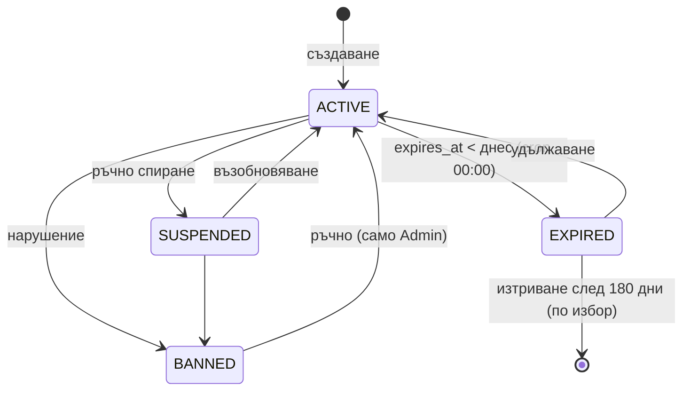
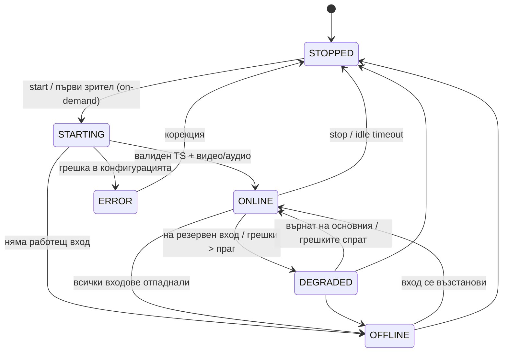

# 04 · Модел на данните

[← Индекс](00-README.md) · [English](../en/04-data-model.md)

## 1. ER диаграма

```mermaid
erDiagram
    NODE ||--o{ STREAM : "изпълнява"
    STREAM ||--|{ STREAM_INPUT : "има"
    STREAM ||--o{ STREAM_OUTPUT : "има"
    STREAM }o--|| CATEGORY : "в"
    STREAM ||--o{ PACKAGE_STREAM : ""
    PACKAGE ||--o{ PACKAGE_STREAM : ""
    PACKAGE ||--o{ SUBSCRIBER_PACKAGE : ""
    SUBSCRIBER ||--o{ SUBSCRIBER_PACKAGE : ""
    SUBSCRIBER ||--o{ DEVICE : "има"
    SUBSCRIBER ||--o{ SESSION_HISTORY : ""
    STREAM ||--o{ STREAM_EVENT : ""
    STREAM ||--o{ SESSION_HISTORY : ""
    ADMIN_USER ||--o{ AUDIT_LOG : "прави"
    ADMIN_USER ||--o{ API_KEY : "притежава"
    ALERT_RULE ||--o{ ALERT_EVENT : "генерира"
    NOTIFICATION_CHANNEL ||--o{ ALERT_RULE : "изпраща чрез"

    NODE {
        uuid id PK
        string name
        string role "INGEST|EDGE|ALL_IN_ONE"
        string public_host
        string status "ONLINE|OFFLINE|DRAIN"
        int max_streams
        string agent_version
        timestamptz last_seen_at
    }
    STREAM {
        uuid id PK
        string name
        string slug UK
        int lcn
        uuid category_id FK
        uuid node_id FK
        string logo_url
        string epg_id
        bool enabled
        string mode "ALWAYS_ON|ON_DEMAND"
        jsonb processing
        int version
        timestamptz deleted_at
    }
    STREAM_INPUT {
        uuid id PK
        uuid stream_id FK
        int priority
        string type "HTTP_TS|HLS|UDP|SRT|RTMP|RTSP|DVB"
        string url
        jsonb options
        bool hot_standby
        int timeout_sec
        bool enabled
    }
    STREAM_OUTPUT {
        uuid id PK
        uuid stream_id FK
        string type "HLS|HTTP_TS|UDP|SRT|RTMP"
        jsonb options
        bool public
        bool enabled
    }
    CATEGORY {
        uuid id PK
        string name
        int sort_order
    }
    PACKAGE {
        uuid id PK
        string name
        string description
        bool active
    }
    PACKAGE_STREAM {
        uuid package_id FK
        uuid stream_id FK
        int sort_order
    }
    SUBSCRIBER {
        uuid id PK
        string username UK
        string password_hash
        string token UK
        string full_name
        string phone
        string email
        string status "ACTIVE|SUSPENDED|EXPIRED|BANNED"
        date expires_at
        int max_connections
        string limit_policy "REJECT_NEW|KICK_OLDEST"
        cidr[] allowed_ips
        string[] allowed_countries
        text note
    }
    SUBSCRIBER_PACKAGE {
        uuid subscriber_id FK
        uuid package_id FK
    }
    DEVICE {
        uuid id PK
        uuid subscriber_id FK
        string fingerprint
        string user_agent
        inet last_ip
        timestamptz last_seen_at
    }
    SESSION_HISTORY {
        bigint id PK
        uuid subscriber_id FK
        uuid stream_id FK
        uuid edge_node_id FK
        inet ip
        string country
        string user_agent
        timestamptz started_at
        timestamptz ended_at
        bigint bytes_sent
        string end_reason
    }
    STREAM_EVENT {
        bigint id PK
        uuid stream_id FK
        timestamptz ts
        string type "STATUS|FAILOVER|PROCESS_EXITED|…"
        uuid node_id
        uuid input_id
        string message
        jsonb data
    }
    ADMIN_USER {
        uuid id PK
        string email UK
        string password_hash
        string role "ADMIN|OPERATOR|SUPPORT|VIEWER"
        string totp_secret
        bool active
    }
    API_KEY {
        uuid id PK
        uuid owner_id FK
        string prefix
        string hash
        string[] scopes
        timestamptz expires_at
    }
    AUDIT_LOG {
        bigint id PK
        uuid actor_id FK
        inet ip
        string action
        string entity_type
        string entity_id
        jsonb diff
        timestamptz ts
    }
    ALERT_RULE {
        uuid id PK
        string name
        string condition
        jsonb params
        uuid channel_id FK
        bool enabled
    }
    ALERT_EVENT {
        bigint id PK
        uuid rule_id FK
        string severity
        string state "FIRING|RESOLVED|ACK"
        jsonb data
        timestamptz ts
    }
    NOTIFICATION_CHANNEL {
        uuid id PK
        string type "TELEGRAM|EMAIL|WEBHOOK"
        jsonb config
    }
```

## 2. Бележки по таблиците

| Таблица | Бележки |
|---|---|
| `stream` | `version` се увеличава при всяка промяна и се изпраща към агента (desired state). `deleted_at` е за меко изтриване (BR-02). Индекси: `slug` (unique), `node_id`, `enabled`. |
| `stream_input.options` | JSON по типа, например `{"headers":{"User-Agent":"..."}, "iface":"eth1", "ssm_source":"10.0.0.1", "srt":{"mode":"caller","latency":200,"passphrase":"***"}, "analyzeduration":1.5}` (`analyzeduration` — секунди за разпознаване на входа, 0,5–30, по подразбиране 1,5; TVR-021). Тайните се шифрират (AES-GCM, ключ от env). |
| `stream.processing` | `{"pnr":101, "audio":{"keep_langs":["bul","eng"]}, "drop_subtitles":true, "service_name":"BTV HD"}` |
| `stream_output.options` | HLS: `{"segment_sec":4, "list_size":6}`; UDP: `{"addr":"239.1.1.10","port":1234,"ttl":4,"iface":"eth1"}` |
| `subscriber.token` | 32 символа base62, генерира се с `SecureRandom`. Индекс unique. |
| `session_history` | Партициониране по месец (`PARTITION BY RANGE (started_at)`), съхранение 90 дни. |
| `stream_event` | Партициониране по месец (UTC, `stream_event_YYYY_MM`, функция `tvr_stream_event_partition`), съхранение 180 дни: всяка нощ се създава следващият месец и се трият целите месеци, изтекли преди 180 дни (TVR-029). `STATUS` = смяна на състоянието (`data.from`/`to`); `FAILOVER` = смяна на входа (`data.from`/`to` — id на входове, `reason`). Индекси: `(stream_id, ts)` за историята на канал и `(ts DESC)` за последните събития на таблото (V4, TVR-034). |
| `audit_log` | Append-only, съхранение 1 година. |

## 3. Данни в Redis

| Ключ | Тип | TTL | Съдържание |
|---|---|---|---|
| `sess:{subscriberId}` | HASH | — | `{sessionKey → JSON(stream, ip, ua, edge, started, last_seen)}` |
| `sess:last:{sessionKey}` | STRING | 30 сек | Heartbeat на сесията (обновява се при всяка заявка за плейлист) |
| `auth:{token}` | STRING (JSON) | 10 сек | Кеш на правата на абоната (статус, изтичане, slug-ове, лимит) |
| `stream:status:{id}` | STRING (JSON) | 30 сек | Последен статус от агента: state, activeInputId, bitrateIn, since, lastError, nodeId, at (TVR-020) |
| `node:metrics:{id}` | STRING (JSON) | 30 сек | Последни метрики на сървъра (агентът ги праща на 5 сек): CPU, RAM, мрежа, диск на work dir, процеси, load (TVR-035); същото като `node.metrics` |
| `rl:auth:{ip}` | STRING | 60 сек | Rate limit за неуспешни опити |
| канал `events` | PUB/SUB | — | Събития към SSE клиентите на UI (TVR-030): съобщение `<тип>\n<JSON>`, напр. `stream.status`; всяка инстанция на core ги праща на своите клиенти |

## 4. Жизнен цикъл на абонат

## 5. Жизнен цикъл на канал

## 6. Миграции

- Flyway, файлове `V{n}__{описание}.sql` в `tvr-core/src/main/resources/db/migration`.
- Изброимите стойности са `varchar` + `CHECK` (не PostgreSQL `ENUM`) — нова стойност се добавя с миграция, без заключване на типа.
- Таблиците имат `created_at`/`updated_at` (тригер `tvr_touch_updated_at`).

| Версия | Тикет | Съдържание |
|---|---|---|
| V1 | TVR-005 | `node`, `category`, `stream` (slug уникален сред неизтритите, меко изтриване), `stream_input` (приоритет 1–8, само мрежови URL — SEC-07), `stream_output` |
| V2 | TVR-006 | `admin_user` (имейл уникален без значение от регистъра, роли ADMIN/OPERATOR/SUPPORT/VIEWER), `admin_refresh_token` (само SHA-256 hash, ротация) |
- Всяка миграция трябва да е обратно съвместима поне с една предишна версия на кода (zero-downtime deploy).
