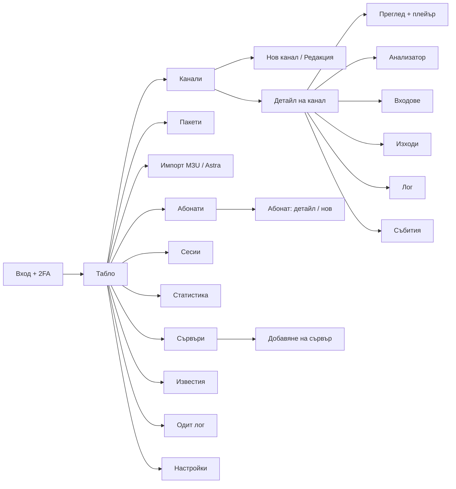
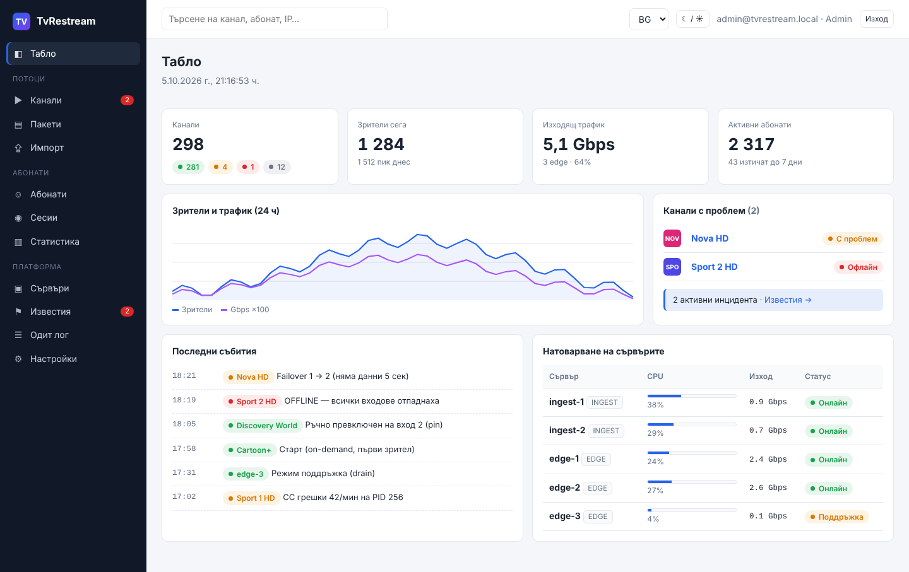
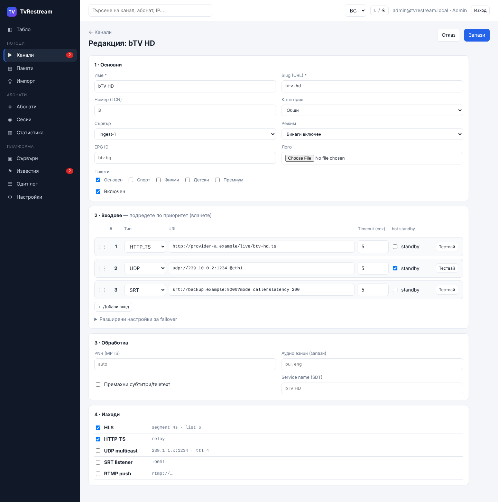
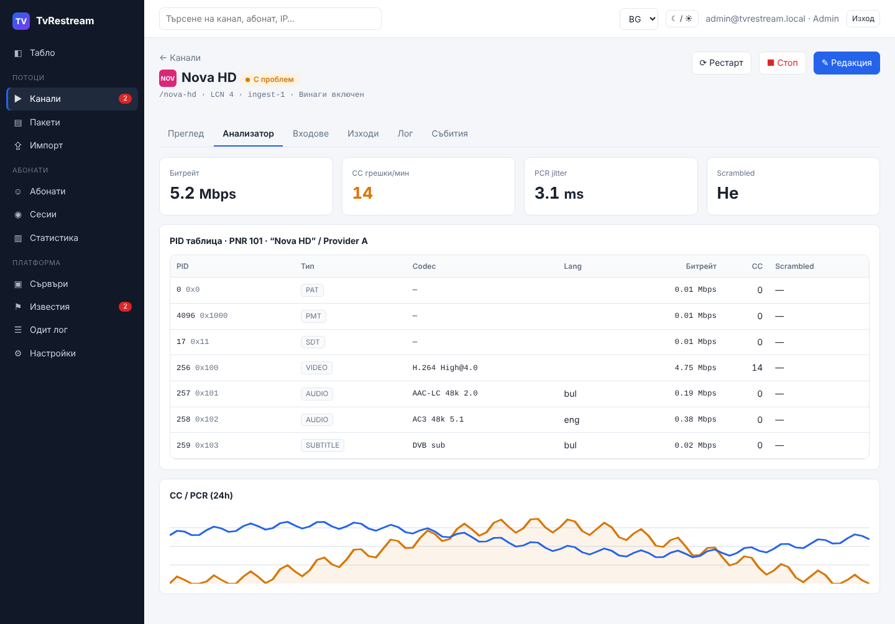
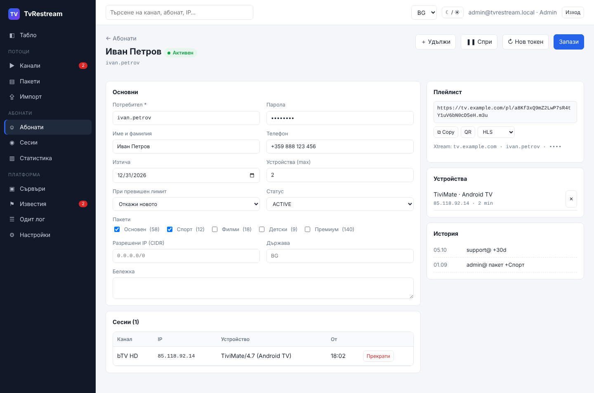

# 06 · UI/UX спецификация

[← Индекс](00-README.md) · [English](../en/06-ui-ux.md)

> **Кликаем прототип:** [ui-prototype/index.html](../../ui-prototype/index.html). Отворете го в браузър. Има превключване BG/EN и светла/тъмна тема. Данните са примерни.
> Параметри на URL: `?lang=en`, `?theme=dark`, а екранът се избира с `#/streams/3/analyzer`.

## 1. Принципи на дизайна

1. **Проблемите първи.** Таблото и списъците показват най-напред какво не работи (OFFLINE, DEGRADED, инциденти).
2. **Един цвят = едно значение** навсякъде: 🟢 ONLINE/ACTIVE · 🟠 DEGRADED/SUSPENDED/DRAIN · 🔴 OFFLINE/ERROR/BANNED · ⚪ STOPPED/EXPIRED · 🔵 STARTING.
3. **Реално време без презареждане.** Статусите, битрейтът и зрителите се обновяват по SSE.
4. **Бързи действия от списъка** (старт, стоп, +30 дни) без отваряне на детайла.
5. **Безопасност:** опасните действия (изтриване, нов токен, ротация на ключ) искат потвърждение и се записват в одита.
6. **Двуезичен интерфейс** (i18n ключове, без текст в кода), формат на дати и числа според езика.
7. **Достъпност:** контраст ≥ 4.5:1, навигация с клавиатура, статусът е текст + цвят (не само цвят).

## 2. Карта на екраните

## 3. Екрани

| № | Екран | Роли | Ключови елементи | Скрийншот |
|---|---|---|---|---|
| 1 | **Вход** | Всички | Имейл, парола, 2FA код, заключване след 5 опита | [bg-01](../ui/screens/bg-01-login.png) |
| 2 | **Табло** | Всички | KPI (канали по статус, зрители, трафик, абонати), графика 24 ч, канали с проблем, последни събития, натоварване на сървърите | [bg-02](../ui/screens/bg-02-dashboard.png) · [тъмна](../ui/screens/bg-02-dashboard-dark.png) |
| 3 | **Канали — списък** | Viewer+ | Филтри (статус, категория, сървър, пакет), търсене, масови действия, статус, активен вход, битрейт, зрители | [bg-03](../ui/screens/bg-03-streams.png) |
| 4 | **Канал — преглед** | Viewer+ | HLS плейър, статус, uptime, видео/аудио, URL-и, пакети, графика битрейт/зрители | [bg-04](../ui/screens/bg-04-stream-overview.png) |
| 5 | **Канал — анализатор** | Viewer+ | Битрейт, CC грешки, PCR jitter, scrambled, PID таблица, графика 24 ч | [bg-05](../ui/screens/bg-05-stream-analyzer.png) |
| 6 | **Канал — входове** | Operator+ | Входове по приоритет, статус (активен, готов, офлайн), ръчно превключване, тест | [bg-06](../ui/screens/bg-06-stream-inputs.png) |
| 7 | **Канал — лог** | Operator+ | Лог на живо (FFmpeg + агент), филтър по процес, оцветяване по ниво | [bg-07](../ui/screens/bg-07-stream-log.png) |
| 8 | **Канал — нов/редакция** | Operator+ | 4 секции: Основни → Входове (drag & drop, тест, hot standby) → Обработка → Изходи; разширени failover настройки | [bg-08](../ui/screens/bg-08-stream-edit.png) |
| 9 | **Пакети** | Operator+ | Списък пакети, канали в пакета с подредба | [bg-09](../ui/screens/bg-09-packages.png) |
| 10 | **Абонати — списък** | Support+ | Филтри (статус, пакет, изтичане), CSV импорт/експорт, бързо +30 дни, подчертаване на изтичащите | [bg-10](../ui/screens/bg-10-subscribers.png) |
| 11 | **Абонат — детайл** | Support+ | Данни, пакети, лимит и политика, IP/държава, плейлист линк (copy/QR), Xtream данни, устройства, активни сесии, история | [bg-11](../ui/screens/bg-11-subscriber.png) |
| 12 | **Сесии** | Support+ | Активни сесии, протокол, edge, трафик, kick | [bg-12](../ui/screens/bg-12-sessions.png) |
| 13 | **Сървъри** | Viewer+ | Карти с CPU/RAM/NIC, роля, версия, heartbeat, drain; модал „Добави сървър“ с команда за инсталация | [bg-13](../ui/screens/bg-13-nodes.png) |
| 14 | **Известия** | Operator+ | Активни инциденти + ack, правила, канали (Telegram, имейл, webhook) с тест | [bg-14](../ui/screens/bg-14-alerts.png) |
| 15 | **Одит лог** | Admin | Филтри, diff преди/след, CSV | [bg-15](../ui/screens/bg-15-audit.png) |
| 16 | **Настройки** | Admin | Общи, HLS по подразбиране, сигурност (TTL на подписа, IP на админ панела, 2FA, ротация на ключ), известия, EPG, backup | [bg-16](../ui/screens/bg-16-settings.png) |
| 17 | **Импорт** | Operator+ | M3U/Astra, преглед, мапинг, поведение при дублиран slug | [bg-17](../ui/screens/bg-17-import.png) |
| 18 | **Статистика** | Admin, Viewer | Топ канали, пикови зрители, uptime, абонати | [bg-18](../ui/screens/bg-18-reports.png) |

### Примерни екрани

| Табло | Редакция на канал |
|---|---|
|  |  |
| **Анализатор** | **Абонат** |
|  |  |

## 4. Състояния на екраните

| Състояние | Поведение |
|---|---|
| Зареждане | Skeleton редове в таблиците, не spinner на цял екран |
| Празно | Обяснение + основно действие („Още няма канали“ → „Нов канал“ / „Импорт“) |
| Грешка (API) | Банер над съдържанието с „Опитай пак“; при 401 → към вход |
| Изгубена SSE връзка | Жълт индикатор „Връзката в реално време е прекъсната, свързване…“ |
| Конфликт при запис (409) | „Каналът е променен от друг потребител“ → покажи разликата / презареди |
| Без права (403) | Бутоните за действия са скрити или изключени с подсказка |

## 5. Валидиране на формата „Канал“

| Поле | Правило | Съобщение |
|---|---|---|
| Име | 1–120 символа | „Въведете име“ |
| Slug | `^[a-z0-9-]{2,64}$`, уникален | „Само малки латински букви, цифри и тире“ / „Вече се използва от …“ |
| LCN | 1–9999, предупреждение при дубликат | „Номер 3 вече е на bTV HD“ (предупреждение, не грешка) |
| Вход URL | Позволени схеми (SEC-07), валиден адрес и порт | „Неподдържан протокол“ |
| Входове | Поне 1 включен | „Добавете поне един вход“ |
| Изходи | Поне 1 включен | „Изберете поне един изход“ |

## 6. Дизайн токени

| Токен | Светла | Тъмна | Употреба |
|---|---|---|---|
| `--accent` | `#2563eb` | `#5b8def` | Основни бутони, линкове, фокус |
| `--ok` | `#16a34a` | `#34c26b` | ONLINE, ACTIVE |
| `--warn` | `#d97706` | `#f0a43a` | DEGRADED, SUSPENDED, DRAIN |
| `--err` | `#dc2626` | `#f06262` | OFFLINE, ERROR, BANNED |
| `--off` | `#6b7280` | `#8b95a5` | STOPPED, EXPIRED |
| `--side` | `#111827` | `#0a0e14` | Странична навигация |
| Шрифт | system-ui 14 px; моноширинен за URL, IP, PID, slug | | |
| Радиус | 7 px (контроли), 10 px (карти) | | |

Реализация: **React + Ant Design** с тема по тези токени (ConfigProvider), **TanStack Table** за големите таблици и **hls.js** за плейъра.
