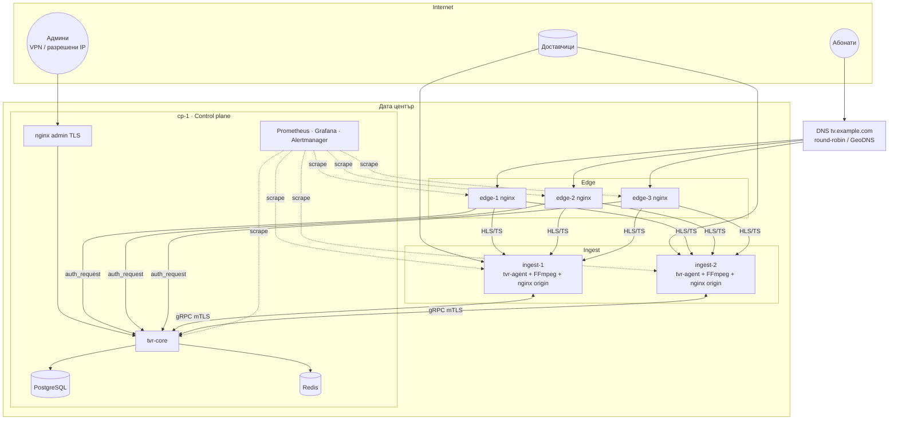
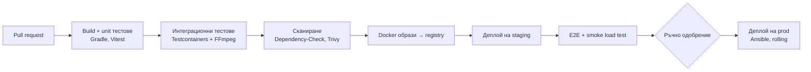

# 08 · Деплой и експлоатация

[← Индекс](00-README.md) · [English](../en/08-deployment-ops.md)

## 1. Топология на инсталацията



## 2. Пакетиране и доставка

| Компонент | Артефакт | Как се инсталира |
|---|---|---|
| tvr-core | Docker образ `tvrestream/core:<ver>` | Docker Compose на control plane |
| tvr-ui | Статични файлове в образа на core (или nginx) | Заедно с core |
| tvr-agent | Docker образ `tvrestream/agent:<ver>` (с FFmpeg 7 static) **или** `.deb` + systemd | `curl https://admin/install-agent.sh \| sudo bash -s -- --token <ENROLL>` |
| **Всичко на един сървър** (MVP) | `tvrestreamer_<ver>_all.deb` (core + agent + UI + nginx сайт + systemd), GitHub Release при tag `v*` | `sudo bash install.sh [--static-ffmpeg]` или `sudo apt install ./tvrestreamer_<ver>_all.deb` — виж `TVRestreamer_Code/packaging/README.md` |
| nginx edge/origin | Docker образ `tvrestream/edge:<ver>` с готова конфигурация | Ansible role `edge` |
| Мониторинг | Prometheus, Grafana, node_exporter, nginx-exporter | Docker Compose |

> Агентът използва `network_mode: host`, за да работят multicast и високите скорости без NAT overhead.

### 2.1 docker-compose (control plane) — скелет

```yaml
services:
  postgres:
    image: postgres:16
    volumes: [pgdata:/var/lib/postgresql/data]
    environment: {POSTGRES_DB: tvr, POSTGRES_USER: tvr, POSTGRES_PASSWORD_FILE: /run/secrets/pg}
  redis:
    image: redis:7
    command: ["redis-server", "--save", "", "--appendonly", "no"]
  core:
    image: tvrestream/core:0.1.0
    depends_on: [postgres, redis]
    environment:
      SPRING_PROFILES_ACTIVE: prod
      TVR_SECRET_KEY_FILE: /run/secrets/master_key
      TVR_SIGNING_KEY_FILE: /run/secrets/signing_key
    ports: ["127.0.0.1:8080:8080", "9443:9443"]
  admin-nginx:
    image: nginx:1.26
    ports: ["443:443"]
    volumes: ["./nginx/admin.conf:/etc/nginx/conf.d/default.conf:ro"]
volumes: {pgdata: {}}
```

### 2.2 nginx edge — ключови части

> В dev (TVR-043) edge-ът е контейнерът `tvr-edge` на :8000 (`TVRestreamer_Code/deploy/nginx/edge.conf.template`): `auth_request` за `/live/{slug}/index.m3u8`, кеш на отговорите 10 сек (`$request_uri|$remote_addr|$http_user_agent` — по устройство, TVR-045), стар разрешен отговор при недостъпен core (NFR-13), 401/403 → 403 + `X-Deny-Reason`, `/pl/` към core. Подписани сегменти (TVR-044): njs (`deploy/nginx/njs/hls.js`) взема плейлиста от origin-а и добавя към всеки сегмент `?s=<подпис>&e=<изтичане>`, където подписът е base64url(HMAC-SHA256(`TVR_SIGNING_KEY`, `"<e>|<slug>"`)) и `e` = сега + `TVR_SIGN_TTL` (60 сек). Сегмент без или с подправен подпис → **403** (`X-Deny-Reason: SIGNATURE`), с изтекъл → **410** (`SIGNATURE_EXPIRED`); core не участва. Ключът е общ за всички edge-ове на инсталацията. Разпределението по ingest сървъри — с TVR-072.

```nginx
# Авторизация на плейлиста през core (с кеш)
location ~ ^/live/(?<slug>[a-z0-9-]+)/index\.m3u8$ {
    auth_request /_auth;
    auth_request_set $sess $upstream_http_x_session_id;
    # njs взема m3u8 от origin и добавя ?s=<HMAC-SHA256>&e=<expires> към всеки сегмент
    js_content hls.signPlaylist;                  # upstream: origin_$slug_node (map slug → ingest)
}
location = /_auth {
    internal;
    proxy_pass http://core/internal/auth;
    proxy_pass_request_body off;
    proxy_set_header X-Original-URI $request_uri;
    proxy_set_header X-Real-IP $remote_addr;
    proxy_set_header X-Internal-Token $tvr_internal_token;   # = TVR_INTERNAL_TOKEN of core (TVR-042)
    proxy_cache auth_cache;
    proxy_cache_key "$arg_token$slug$remote_addr";
    proxy_cache_valid 200 10s;
}
# Сегменти — подписът от плейлиста, проверен локално от njs, без обаждане към core (TVR-044)
location ~ ^/live/(?<slug>[a-z0-9-]+)/(?<seg>seg_[0-9]+\.ts)$ {
    set $tvr_deny $tvr_segment_access;            # js_set hls.segmentAccess: OK | SIGNATURE | SIGNATURE_EXPIRED
    if ($tvr_deny = "SIGNATURE_EXPIRED") { return 410; }
    if ($tvr_deny != "OK")               { return 403; }
    proxy_cache hls_cache;
    proxy_cache_valid 200 30s;
    proxy_cache_lock on;                          # 1 заявка към origin на сегмент
    proxy_pass http://origin_$slug_node;
}
```

> Подписването на плейлиста става на edge (nginx njs), а не в core. Проверката на сегментите също е в njs (HMAC-SHA256), а не с `secure_link_md5`: вграденият `secure_link` поддържа само MD5. Срокът на подписа се смята на edge-а (`TVR_SIGN_TTL`), не от `X-Sign-Expires` на core — кешираният или стар отговор на `/internal/auth` носи старо време и сегментите биха изтекли веднага. Така при отпадане на core гледането продължава до изтичане на кеша на авторизацията, а с режим „grace“ — до 1 ч (NFR-13).
>
> `proxy_cache_lock on` гарантира, че при 500 зрители на един канал edge тегли всеки сегмент от origin само веднъж.

## 3. Подготовка на сървърите (checklist)

- [ ] Ubuntu 24.04 LTS, последни обновления, NTP (chrony)
- [ ] `sysctl`: `net.core.rmem_max=268435456`, `net.core.wmem_max=268435456`, `net.ipv4.udp_mem`, `fs.file-max=2000000`, `net.core.somaxconn=65535`, BBR congestion control
- [ ] `ulimit -n 1048576` за nginx и агента
- [ ] tmpfs: `/dev/shm/hls` с размер 16 GB (ingest)
- [ ] IRQ affinity и `ethtool -G` (ring буфери) за 10G картите
- [ ] Firewall (nftables): само нужните портове от [03 §10](03-architecture.md#10-мрежови-портове)
- [ ] За multicast: IGMP на правилния интерфейс, `rp_filter=0/2` на входящия интерфейс

## 4. Мониторинг и алармиране на инфраструктурата

| Метрика | Праг | Действие |
|---|---|---|
| `tvr_stream_state{state="OFFLINE"}` | > 0 за 60 сек | Telegram до техник |
| `tvr_failover_total` rate | > 5 за 10 мин на канал | Известие „нестабилен източник“ |
| NIC egress на edge | > 80% за 5 мин | Добавяне на edge |
| CPU на ingest | > 80% за 10 мин | Разпределяне на канали |
| `tvr_auth_latency_seconds` p99 | > 50 мс | Проверка на core/Redis |
| Свободен tmpfs | < 20% | Проверка на HLS почистване |
| PostgreSQL backup | неуспешен | Имейл до Admin |

Готови Grafana табла: **Overview**, **Streams**, **Node**, **Edge/nginx**, **Auth & Sessions**.

## 5. Backup и възстановяване

| Какво | Как | Честота | Съхранение |
|---|---|---|---|
| PostgreSQL | `pg_dump -Fc` → шифриран (age) → S3/външен сървър | Ежедневно 03:00 + WAL archive (R2) | 14 дневни, 8 седмични |
| Конфигурация (JSON експорт) | `/config/export` | При всяка промяна (debounce 5 мин) | 30 версии |
| Тайни ключове | Офлайн копие (password manager) | При смяна | — |

**RPO** ≤ 24 ч (R1), ≤ 5 мин с WAL (R2). **RTO** ≤ 1 ч за control plane. Ingest и edge са stateless: възстановяват се за ≤ 15 мин с Ansible.

## 6. Runbooks (извадка)

### RB-01 · Канал е OFFLINE

1. Отвори канала → таб **Анализатор** и **Лог**. Виж последната грешка на FFmpeg (HTTP 403/404, timeout, `Connection refused`).
2. Натисни **Тествай** на всеки вход. Ако всички отпадат, проблемът е при доставчика: свържи се с него.
3. Ако само основният отпада, а резервният не е включен, включи резервния вход или добави нов.
4. Ако входовете са OK, но каналът е OFFLINE, рестартирай канала. Ако не помогне, провери tmpfs и CPU на сървъра.

### RB-02 · Ingest сървър отпадна

1. Таблото показва node `OFFLINE`, а каналите му са `OFFLINE`.
2. R1: маркирай каналите → **Масово преместване** на ingest-2. R2: става автоматично.
3. Провери сървъра (iDRAC/IPMI) и логовете на агента: `journalctl -u tvr-agent`.

### RB-03 · Нова версия (zero-downtime)

1. Миграциите на БД са обратно съвместими → `docker compose pull core && docker compose up -d core`. Edge кешира auth 10 сек, а активните HLS сесии продължават.
2. Агентите се обновяват един по един (drain → update → undrain). Каналите продължават да работят по време на рестарта на агента (FFmpeg процесите са в отделна cgroup), а агентът ги „осиновява“ при старт.

## 7. Среди

| Среда | Цел | Съдържание |
|---|---|---|
| **dev** | Локална разработка | Docker Compose на лаптоп; тестови потоци от FFmpeg (`testsrc`, файлове в loop) |
| **staging** | Интеграция и тестове под натоварване | 1 ALL_IN_ONE сървър + 1 edge, реални тестови канали |
| **prod** | Продукция | Топологията по-горе |

## 8. CI/CD


