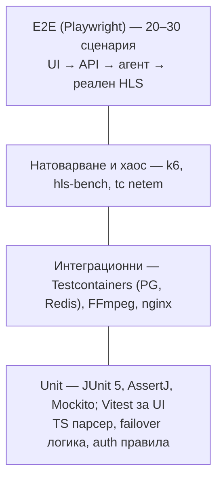

# 09 · Тестова стратегия

[← Индекс](00-README.md) · [English](../en/09-testing-qa.md)

## 1. Пирамида на тестовете

| Ниво | Обхват | Инструменти | Кога |
|---|---|---|---|
| Unit | Domain логика, TS парсер (PAT/PMT/CC/PCR), FailoverController (state machine), правила за авторизация, FfmpegCommandBuilder | JUnit 5, AssertJ, Mockito, jqwik (property-based за TS) | Всеки commit |
| Интеграционни | Repository-та, Flyway миграции, Redis сесии, gRPC core↔agent, реален FFmpeg с тестови потоци | Testcontainers, FFmpeg `testsrc`/`sine`, тестови .ts файлове | Всеки PR |
| Договор (contract) | Admin API спрямо `openapi.yaml` | springdoc + schemathesis | Всеки PR |
| E2E | Ключови потребителски пътеки през UI | Playwright | Nightly + преди релийз |
| Натоварване | Auth RPS, едновременни зрители, брой канали на ingest | k6, собствен HLS симулатор (Go/Java), `wrk` | Преди R1 и всеки голям релийз |
| Хаос | Отпадане на източник, агент, core, edge, мрежови загуби | `tc netem`, `iptables DROP`, `kill -9` | Преди R1 |
| Сигурност | OWASP Top 10, RBAC матрица, command injection в URL | OWASP ZAP, ръчни тестове | Преди R1 |

## 2. Тестови потоци (fixtures)

| Име | Генериране | Цел |
|---|---|---|
| `clean-h264-aac.ts` | `ffmpeg -f lavfi -i testsrc2 -f lavfi -i sine -c:v libx264 -c:a aac` | Базов поток |
| `mpts-3prog.ts` | 3 програми, мултиплексирани | Избор на PNR |
| `cc-errors.ts` | Поток с изрязани пакети | Брояч на CC грешки |
| `scrambled.ts` | TS с вдигнат scrambling флаг | Откриване на scrambled |
| `multi-audio.ts` | bul + eng + subtitles | Филтриране на аудио |
| `hevc-ac3.ts` | H.265 + AC3 | Анализатор на кодеци |
| Live HTTP сървър | `ffmpeg -re ... -f mpegts -listen 1 http://0.0.0.0:9000` | Вход HTTP-TS, отпадане при поискване |
| Локални живи потоци (TVR-009) | `scripts/test-streams.sh start` → HTTP-TS `:9001/a.ts`, `:9002/b.ts`, UDP `:5001`, HLS `:9003/index.m3u8`; `stop a` спира само един поток | Входове, failover / recovery при разработка |

## 3. Ключови тестови сценарии (извадка)

| ID | Сценарий | Очакван резултат | Покрива |
|---|---|---|---|
| TC-01 | Създаване на канал с HTTP-TS вход, HLS изход | ONLINE ≤ 5 сек, m3u8 валиден (`mediastreamvalidator`/hls.js) | FR-STR-01, FR-OUT-01 |
| TC-02 | Спиране на основния източник (hot standby) | Превключване ≤ 3 сек, плейърът не спира > 3 сек, събитие FAILOVER | FR-FOV-03 |
| TC-03 | Основният източник се връща | Връщане след 30 сек стабилност, събитие RECOVERED | FR-FOV-05 |
| TC-04 | Всички входове отпадат | OFFLINE, известие ≤ 30 сек | FR-FOV, FR-ALR |
| TC-05 | Абонат с лимит 1 отваря 2-ро устройство | 403 `LIMIT` (REJECT_NEW) или изритване на първото (KICK_OLDEST) | FR-AUT-04 |
| TC-06 | Абонат изтича в 00:00 | Статус EXPIRED, сесиите прекратени ≤ 60 сек | BR-01 |
| TC-07 | Заявка за канал извън пакета | 403 `NOT_IN_PACKAGE` | FR-AUT-03 |
| TC-08 | Подправен или изтекъл подпис на сегмент | 403 / 410 | FR-AUT-02 |
| TC-09 | URL на вход `file:///etc/passwd` | Валидационна грешка 400 | SEC-07 |
| TC-10 | Core е спрян 10 мин | Активните зрители продължават | NFR-13 |
| TC-11 | Импорт на M3U с 300 канала | Preview, след commit 300 канала, без дубликати по slug | FR-CFG-02 |
| TC-12 | Support опитва да изтрие абонат | 403 | FR-ADM-02 |
| TC-13 | 2 000 едновременни HLS зрители на 3 edge | 0% грешки, p95 време за сегмент < 500 мс, CPU edge < 60% | NFR-02 |
| TC-14 | 250 канала на 1 ingest за 24 ч | Без изтичане на памет, CPU < 70%, 0 нежелани рестарти | NFR-03, NFR-16 |
| TC-15 | Загуба на 5% пакети от UDP вход | CC грешки се отчитат, без failover под прага | FR-ANL-02, FR-FOV-04 |

## 4. Критерии за приемане на релийз

- 0 отворени бъга с приоритет **Blocker/Critical**; ≤ 5 **Major** с известен workaround.
- Всички TC за модулите в релийза са минали.
- Load test (TC-13, TC-14) е минал на staging.
- Хаос тестовете (TC-02, TC-04, TC-10) са минали.
- Release notes и обновена документация.

## 5. Класификация на дефектите

| Ниво | Определение | SLA за поправка |
|---|---|---|
| Blocker | Гледането спира за всички или загуба на данни | Веднага (hotfix) |
| Critical | Канал/функция не работи без workaround | ≤ 24 ч |
| Major | Функция работи частично, има workaround | Следващ спринт |
| Minor | Козметика, текст | Backlog |
