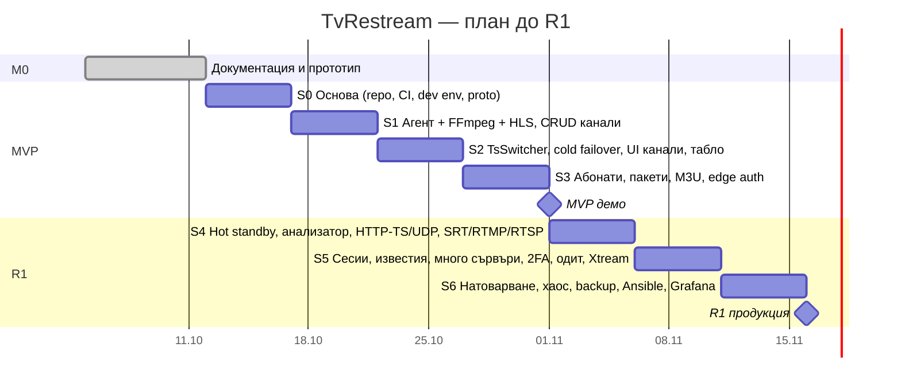

# 10 · Roadmap и backlog

[← Индекс](00-README.md) · [English](../en/10-roadmap-backlog.md)

## 1. Етапи

| Етап | Цел | Срок (ориентировъчно) | Резултат |
|---|---|---|---|
| **M0 · Концепция** | Документация, архитектура, UI прототип | 1 седмица | Този комплект документи |
| **MVP** | Канали с HTTP/HLS/UDP вход, HLS изход, cold failover, абонати, пакети, M3U, токени, 1 сървър | Спринт 0–3 (4 седмици) | Вътрешна демонстрация, 10–20 тестови абоната |
| **R1 · Продукция** | Hot standby, пълен анализатор, HTTP-TS/UDP изходи, SRT/RTMP/RTSP, сесии, известия, много сървъри, 2FA, одит, Xtream API, натоварване | Спринт 4–6 (3 седмици) | Пускане за 2 000–2 500 абоната |
| **R2 · Разширения** | Webhooks, SRT/RTMP изходи, geo/IP, slate, автоматично преместване при отпадане, отчети, HA на control plane | +4 седмици | — |
| **R3 · Бъдеще** | DVB-S/S2, транскод с GPU, билинг, CAS, реселъри | По заявка | — |

## 2. План по спринтове (1 спринт = 1 седмица, 1 разработчик + Claude)

### Детайли по спринтове

| Спринт | Цел (Sprint goal) | Основни задачи | Demo критерий |
|---|---|---|---|
| **S0** | „Празен“ продукт, който се билдва и деплойва | Gradle multi-project, React скелет, Docker Compose dev, GitHub Actions, Flyway V1, `agent.proto`, ADR-и | `docker compose up` → login страница |
| **S1** | Един канал от HTTP-TS → HLS | ProcessSupervisor (старт/стоп/рестарт/backoff), FfmpegCommandBuilder, gRPC връзка + desired state, CRUD канали (API), ffprobe тест | `curl` на m3u8 работи, VLC пуска канала |
| **S2** | Каналът „оцелява“ | TsSwitcher (Netty UDP), базов TsAnalyzer (битрейт, PAT/PMT), cold failover, UI: списък/редакция/детайл на канал, табло + SSE, лог на канала | Спиране на източника → канал на резервния |
| **S3** | Абонат гледа през защитен линк | Абонати, пакети, категории, M3U, `/internal/auth`, nginx edge (auth_request + njs + secure_link), лимит на сесиите, Admin login + RBAC | TiviMate с M3U линк; 2-ро устройство отказано |
| **S4** | Astra-ниво на потоците | Hot standby, return-to-primary, CC/PCR/scrambled, PID таблица, HTTP-TS relay, UDP изход, SRT/RTMP/RTSP входове, MPTS PNR, филтър аудио | Хаос тест TC-02 ≤ 3 сек |
| **S5** | Готово за оператори | Сесии + kick, Telegram/имейл известия, много node-ове + enrollment, одит, 2FA, Xtream API, M3U/Astra импорт, статистика | 2 ingest + 2 edge на staging |
| **S6** | Готово за продукция | Load test 2 000 зрители, 24 ч soak, хаос тестове, backup, Ansible роли, Grafana табла, runbooks, security проверка | Всички критерии от [09 §4](09-testing-qa.md) |

> Подробният план с всички тикети и борда за проследяване е в [12 · План за разработка](12-development-plan.md).

## 3. Епици и user stories (product backlog)

| Епик | User story (примерни) | Модули | SP | Релийз |
|---|---|---|:-:|:-:|
| **E1 Основа** | Като разработчик искам CI и dev среда, за да доставям бързо | — | 8 | MVP |
| **E2 Канали** | Като техник искам да добавя канал за < 1 мин | STR, INP, OUT | 21 | MVP |
| **E3 Failover** | Като техник искам каналът сам да превключва на резервен източник | FOV | 13 (+13 R1) | MVP/R1 |
| **E4 Анализатор** | Като техник искам да виждам CC грешки и PID-ове, за да диагностицирам | ANL | 13 | R1 |
| **E5 Абонати и пакети** | Като поддръжка искам да създам абонат и да му дам пакет | SUB, PKG | 13 | MVP |
| **E6 Защитено гледане** | Като собственик искам линковете да не могат да се споделят | AUT, SES, DEV | 21 | MVP/R1 |
| **E7 Плейлисти и EPG** | Като абонат искам един M3U линк с лога и програма | PLY | 8 | MVP/R1 |
| **E8 Табло и мониторинг** | Като техник искам на един екран да виждам какво не работи | MON | 13 | MVP |
| **E9 Известия** | Като техник искам Telegram съобщение, когато падне канал | ALR | 8 | R1 |
| **E10 Кластер** | Като собственик искам да добавя сървъри при растеж | NOD | 13 | R1 |
| **E11 Админи и одит** | Като собственик искам да знам кой какво е променил | ADM, AUD | 8 | R1 |
| **E12 Интеграции** | Като интегратор искам API и webhooks | API | 8 | MVP/R2 |
| **E13 Импорт и настройки** | Като техник искам да импортирам каналите си от Astra/M3U | CFG | 8 | MVP/R1 |
| **E14 Статистика** | Като собственик искам отчет за гледаемост и uptime | STA | 8 | R1 |
| **E15 Експлоатация** | Като DevOps искам backup, мониторинг и лесна инсталация | — | 13 | R1 |

## 4. Definition of Ready (DoR)

- Story-то има ясна цел („Като… искам… за да…“) и критерии за приемане (Given/When/Then).
- Зависимостите са известни; има макет за UI промени.
- Оценено е (story points) и се побира в 1 спринт.

## 5. Definition of Done (DoD)

- [ ] Кодът е в `main` чрез PR с ревю.
- [ ] Unit и интеграционни тестове, CI е зелен, покритие ≥ целта (NFR-18).
- [ ] API промените са отразени в `openapi.yaml`.
- [ ] UI е преведен на BG и EN.
- [ ] Метрики и логове за новата функция.
- [ ] Документацията (тази папка) е обновена.
- [ ] Демонстрирано на staging.

## 6. RACI

| Дейност | Собственик (PO) | Разработчик | Claude | QA/Тестер |
|---|:-:|:-:|:-:|:-:|
| Приоритети и обхват | **A/R** | C | C | I |
| Архитектура | A | R | **R** | I |
| Писане на код | I | **A/R** | R | I |
| Тестове | I | A | R | **R** |
| Тестова среда, реални потоци | **A/R** | R | I | C |
| Деплой в продукция | A | **R** | C | I |
