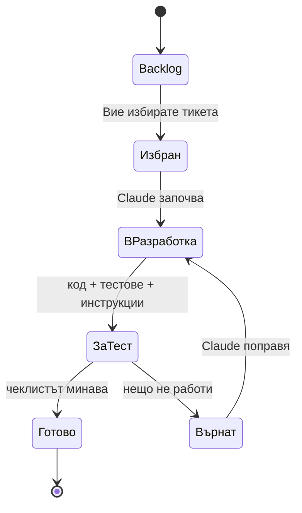
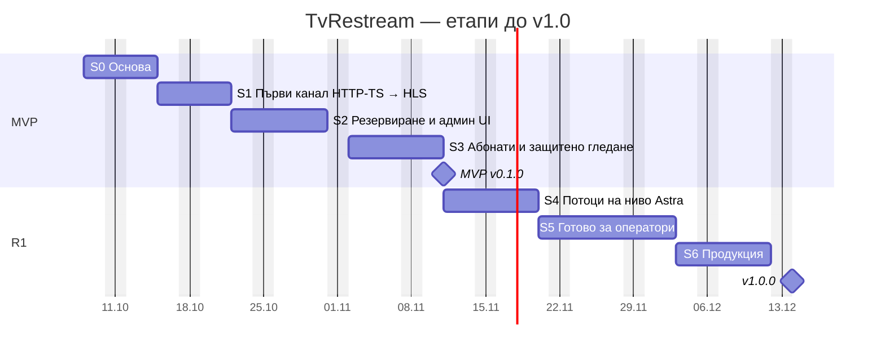
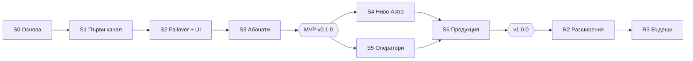

# 12 · План за разработка и проследяване

[← Индекс](00-README.md) · [English](../en/12-development-plan.md)

> **Борд за проследяване:** [TvRestream Board](https://claude.ai/artifact/URXdaur2HqQf2g5okUWsy5) — всички 113 тикета, статуси, тестови чеклисти и бележки. Бордът е източникът на истина за статуса; този документ описва плана и процеса.

## 1. Как работим

| Роля | Кой | Отговорности |
|---|---|---|
| Собственик и тестер (PO/QA) | Костадин | Избира следващия тикет, тества по чеклиста, приема или връща, осигурява тестова среда и реални потоци |
| Разработчик | Claude | Пише кода, тестовете и документацията за тикета, обяснява как се тества, поправя върнатите тикети |

### 1.1 Жизнен цикъл на тикета

### 1.2 Стъпка по стъпка

1. **Избор.** В борда отворете тикет с етикет „готов“ (всички зависимости са завършени) и натиснете **„Избери и копирай“**. Тикетът отива в „Избран за работа“.
2. **Заявка.** Поставете в чата: `Имплементирай TVR-012`. Може и няколко наведнъж: `Имплементирай TVR-012, TVR-013`.
3. **Разработка.** Claude чете тикета от борда, мести го в „В разработка“, пише кода в `TVRestreamer_Code` (клон `feature/TVR-012`), пуска тестовете.
4. **Предаване.** Claude мести тикета в „За тест“ и добавя бележка: какво е направено, кои файлове, как да се пусне и проверки извън чеклиста.
5. **Тест.** Минавате чеклиста „Как да тествам“ и отмятате стъпките.
6. **Решение.** Всичко минава → **Готово**. Нещо не работи → **Върнат** + бележка (какво направихте, какво очаквахте, какво стана, лог). При нов проблем извън тикета → **„+ Бъг“**.
7. **Поправка.** Напишете `Поправи TVR-012` или `Поправи BUG-003` — Claude чете бележките и поправя.

### 1.3 Правила

- Тикетът е **малък**: S ≈ половин работна сесия, M ≈ една сесия, L ≈ две сесии (код + тест). Ако стане по-голям, Claude го разделя на подтикети.
- **Зависимостите** се спазват. Бордът показва „чака N“ на тикет с незавършени зависимости.
- В „В разработка“ има **най-много 2 тикета** едновременно, за да не се трупа нетествана работа.
- Тикет е **Готово** само след вашия тест — Claude не мести тикети в Готово.
- Всеки тикет оставя **работещ продукт** (main винаги се билдва и стартира).

### 1.4 Definition of Done (на тикет)

- [ ] Кодът е в клон `feature/TVR-xxx`, слят в `main` след вашето приемане.
- [ ] Автоматичните тестове минават (`./gradlew build`, `npm test`).
- [ ] Бележката в борда описва как да се тества и какво е променено.
- [ ] Чеклистът „Как да тествам“ е минат от вас.
- [ ] Засегнатата документация (`docs/`) и `openapi.yaml` са обновени.
- [ ] UI текстовете са на BG и EN.

## 2. Среда за разработка и тест

| Какво | Къде | Бележка |
|---|---|---|
| Код | Подпапка `TVRestreamer_Code` (IntelliJ/Gradle проект, Git) | Claude пише директно там; IntelliJ за преглед |
| Инструменти | Java 21, Docker Desktop, FFmpeg 7 (`brew install ffmpeg`), Node 20 | Проверка: `scripts/dev-check.sh` (TVR-002) |
| Локални услуги | PostgreSQL, Redis, Adminer, nginx в Docker Compose | TVR-003 |
| Тестови потоци | `scripts/test-streams.sh` (FFmpeg testsrc) | TVR-009; по-късно реални потоци от доставчика |
| Плейъри | VLC, TiviMate/IPTV Smarters на телефон/TV | За ръчните тестове |
| Staging (от S5) | 1–2 Linux сървъра (Ubuntu 24.04) | Нужни за кластер, multicast и натоварване |

> **Решение (ADR-009):** използваме **Gradle** (вашият съществуващ проект) вместо Maven. Документите са обновени.

## 3. Етапи

| Етап | Име | Цел | Тикети | Обем* | Седмици |
|---|---|---|:-:|:-:|:-:|
| **S0** · MVP | Основа | Проектът се билдва, стартира локално и има вход в админ панела. | 10 | 7 | 1 |
| **S1** · MVP | Първи канал: HTTP-TS → HLS | Канал, създаден през API, тръгва на агента и се гледа във VLC. | 13 | 11 | 1 |
| **S2** · MVP | Резервиране и админ UI | Каналът сам минава на резервен вход; каналите се управляват от уеб панела. | 13 | 16 | 1–1,5 |
| **S3** · MVP | Абонати и защитено гледане | Абонат гледа с личен M3U линк; второ устройство над лимита е отказано. | 14 | 13.5 | 1–1,5 |
| **S4** · R1 | Потоци на ниво Astra | Hot standby < 3 сек, пълен анализатор, всички входове и изходи. | 17 | 19 | 1,5 |
| **S5** · R1 | Готово за оператори | Сесии, известия, няколко сървъра, 2FA, одит, Xtream API, статистика. | 18 | 18 | 1,5–2 |
| **S6** · R1 | Продукция | Минати тестове под натоварване и хаос; инсталация с Ansible; пускане. | 11 | 13 | 1–1,5 |
| **R2** · R2 | Разширения | Webhooks, гео/IP, slate, автоматично преместване, HA. | 12 | 14 | 3–4 |
| **R3** · R3 | Бъдещи | DVB-S/S2, транскод, билинг — по заявка. | 5 | 10 | — |

\* Обем в „сесии“ (S = 0,5, M = 1, L = 2). Реалното темпо зависи главно от скоростта на тестване: при 3–5 тикета на ден S0–S6 (94 тикета) се изпълняват за **≈ 5–7 седмици**, което съвпада с оценката от документ 10.

## 4. Тикети по етапи

### 4.1 S0 · Основа

**Цел:** Проектът се билдва, стартира локално и има вход в админ панела.

| ID | Задача | Тип | Пр. | Разм. | Зависи от |
|---|---|---|:-:|:-:|---|
| `TVR-001` | Gradle multi-project: tvr-common, tvr-core, tvr-agent (Java 21) | Инфра | M | M | — |
| `TVR-002` | Dev среда на Mac: проверка на инструментите | Инфра | M | S | — |
| `TVR-003` | Docker Compose за разработка: PostgreSQL 16, Redis 7, Adminer | Инфра | M | S | TVR-002 |
| `TVR-004` | tvr-core: Spring Boot скелет, health, профили, JSON логове | Инфра | M | M | TVR-001, TVR-003 |
| `TVR-005` | Flyway V1: схема за сървъри, канали, входове, изходи, категории | Инфра | M | S | TVR-004 |
| `TVR-006` | Вход за администратори: JWT, начален admin, /auth/me | Функц. | M | M | TVR-005 |
| `TVR-007` | tvr-ui: React + TypeScript + Ant Design, layout, вход, BG/EN | Функц. | M | M | TVR-006 |
| `TVR-008` | gRPC договор agent.proto в tvr-common | Инфра | M | S | TVR-001 |
| `TVR-009` | Тестови потоци: локален HTTP-TS / UDP / HLS генератор | Инфра | M | S | TVR-002 |
| `TVR-010` | Git, конвенции, CI (GitHub Actions по избор) | Док. | S | S | TVR-001 |

### 4.2 S1 · Първи канал: HTTP-TS → HLS

**Цел:** Канал, създаден през API, тръгва на агента и се гледа във VLC.

| ID | Задача | Тип | Пр. | Разм. | Зависи от |
|---|---|---|:-:|:-:|---|
| `TVR-011` | Домейн на каналите: JPA entities и repositories | Функц. | M | M | TVR-005 |
| `TVR-012` | REST API за канали (CRUD) с валидация | Функц. | M | M | TVR-011, TVR-006 |
| `TVR-013` | API за категории | Функц. | M | S | TVR-011 |
| `TVR-014` | tvr-agent: скелет и конфигурация | Инфра | M | S | TVR-001 |
| `TVR-015` | FfmpegCommandBuilder: входове, packager, изходи | Функц. | M | M | TVR-014 |
| `TVR-016` | ProcessSupervisor: старт, стоп, рестарт с backoff | Функц. | M | M | TVR-015 |
| `TVR-017` | Връзка агент ↔ core по gRPC: регистрация и heartbeat | Функц. | M | M | TVR-008, TVR-014, TVR-004 |
| `TVR-018` | Desired state + Reconciler: core управлява каналите на агента | Функц. | M | L | TVR-017, TVR-016, TVR-012 |
| `TVR-019` | HLS изход и nginx origin в dev | Функц. | M | M | TVR-018 |
| `TVR-020` | Статус на канала от агента към core | Функц. | M | S | TVR-018 |
| `TVR-021` | Действия Start / Stop / Restart | Функц. | M | S | TVR-018 |
| `TVR-022` | Тест на вход (ffprobe) | Функц. | M | S | TVR-012 |
| `TVR-023` | Лог на канала през API | Функц. | M | S | TVR-016, TVR-017 |

### 4.3 S2 · Резервиране и админ UI

**Цел:** Каналът сам минава на резервен вход; каналите се управляват от уеб панела.

| ID | Задача | Тип | Пр. | Разм. | Зависи от |
|---|---|---|:-:|:-:|---|
| `TVR-024` | MPEG-TS парсер: пакети, PAT/PMT, CC | Функц. | M | L | TVR-014 |
| `TVR-025` | TsSwitcher: Netty приемане и препращане на активния вход | Функц. | M | L | TVR-024, TVR-018 |
| `TVR-026` | Базов анализатор: битрейт, кодеци, видео/аудио | Функц. | M | M | TVR-025 |
| `TVR-027` | Cold failover: превключване при липса на данни | Функц. | M | M | TVR-025 |
| `TVR-028` | HLS discontinuity при смяна на вход | Функц. | M | M | TVR-027 |
| `TVR-029` | Събития на канала: съхранение и API | Функц. | M | S | TVR-027 |
| `TVR-030` | Реално време: SSE /api/v1/events | Функц. | M | M | TVR-020 |
| `TVR-031` | UI: списък на каналите | Функц. | M | M | TVR-007, TVR-012, TVR-030 |
| `TVR-032` | UI: нов канал / редакция | Функц. | M | L | TVR-031, TVR-022, TVR-013 |
| `TVR-033` | UI: детайл на канала (преглед, входове, лог, събития) | Функц. | M | L | TVR-031, TVR-023, TVR-029, TVR-026 |
| `TVR-034` | UI: табло | Функц. | M | M | TVR-031 |
| `TVR-035` | Метрики на сървъра и UI „Сървъри“ | Функц. | M | M | TVR-017, TVR-007 |
| `TVR-036` | Ръчно превключване на вход (switch / pin) | Функц. | M | S | TVR-027, TVR-033 |

### 4.4 S3 · Абонати и защитено гледане

**Цел:** Абонат гледа с личен M3U линк; второ устройство над лимита е отказано. **Приемане на етапа:** демонстрацията в тикета-етап.

| ID | Задача | Тип | Пр. | Разм. | Зависи от |
|---|---|---|:-:|:-:|---|
| `TVR-037` | Flyway: абонати, пакети, устройства | Инфра | M | S | TVR-005 |
| `TVR-038` | Пакети: API и UI с подредба на каналите | Функц. | M | M | TVR-037, TVR-031 |
| `TVR-039` | Абонати: API (CRUD, статуси, удължаване, нов токен) | Функц. | M | M | TVR-037 |
| `TVR-040` | UI: абонати (списък и детайл) | Функц. | M | L | TVR-039, TVR-038, TVR-007 |
| `TVR-041` | Персонален M3U плейлист | Функц. | M | M | TVR-039, TVR-038 |
| `TVR-042` | /internal/auth: проверка на достъпа | Функц. | M | M | TVR-039 |
| `TVR-043` | nginx edge в dev: auth_request за плейлистите | Инфра | M | M | TVR-042, TVR-019 |
| `TVR-044` | Подписани сегменти: njs + secure_link | Функц. | M | M | TVR-043 |
| `TVR-045` | Лимит на едновременните устройства | Функц. | M | M | TVR-042 |
| `TVR-046` | Автоматично изтичане на абонатите в 00:00 | Функц. | M | S | TVR-039, TVR-045 |
| `TVR-047` | Лога на каналите: качване и сервиране | Функц. | S | S | TVR-032 |
| `TVR-048` | Роли и права (Admin, Operator, Support, Viewer) | Функц. | M | M | TVR-006, TVR-040 |
| `TVR-049` | Импорт на канали от M3U | Функц. | M | M | TVR-012, TVR-038 |
| `TVR-050` | MVP демо: v0.1.0 | Етап | M | M | TVR-041, TVR-044, TVR-045, TVR-046, TVR-034, TVR-036, TVR-048, TVR-049 |

### 4.5 S4 · Потоци на ниво Astra

**Цел:** Hot standby < 3 сек, пълен анализатор, всички входове и изходи.

| ID | Задача | Тип | Пр. | Разм. | Зависи от |
|---|---|---|:-:|:-:|---|
| `TVR-051` | Hot standby входове (превключване < 3 сек) | Функц. | M | L | TVR-027 |
| `TVR-052` | Връщане към основния вход (return-to-primary) | Функц. | M | M | TVR-051 |
| `TVR-053` | Пълен анализатор: CC по PID, PCR, scrambled, PID таблица | Функц. | M | L | TVR-026 |
| `TVR-054` | Failover тригери: CC грешки, битрейт, липса на видео/аудио, scrambled | Функц. | M | M | TVR-051, TVR-053 |
| `TVR-055` | Графики за 24 ч: битрейт, CC, зрители | Функц. | S | M | TVR-053 |
| `TVR-056` | HTTP-TS изход (relay в агента) през edge | Функц. | M | L | TVR-025, TVR-044 |
| `TVR-057` | UDP multicast изход | Функц. | S | M | TVR-025 |
| `TVR-058` | SRT вход (caller/listener) | Функц. | M | M | TVR-015 |
| `TVR-059` | RTMP вход (pull и push с ключ) | Функц. | S | S | TVR-015 |
| `TVR-060` | RTSP вход | Функц. | S | S | TVR-015 |
| `TVR-061` | MPTS: избор на програма (PNR) | Функц. | M | M | TVR-053 |
| `TVR-062` | Филтър на аудио езици и субтитри | Функц. | S | S | TVR-053 |
| `TVR-063` | Режим при поискване (on-demand) | Функц. | M | M | TVR-043, TVR-018 |
| `TVR-064` | Снимка (thumbnail) на канала | Функц. | S | S | TVR-033 |
| `TVR-065` | Хаос тест на failover (TC-02/03/04) | Тест | M | M | TVR-051, TVR-052, TVR-054 |
| `TVR-112` | Edge в .deb пакета: auth_request, подписани сегменти, лимит на устройства | Инфра | M | M | TVR-043, TVR-044, TVR-045 |
| `TVR-113` | Лесно стартиране на Ubuntu сървър: deploy/.env съветник, проверка на портове, достъп от LAN | Инфра | M | L | TVR-050 |

### 4.6 S5 · Готово за оператори

**Цел:** Сесии, известия, няколко сървъра, 2FA, одит, Xtream API, статистика.

| ID | Задача | Тип | Пр. | Разм. | Зависи от |
|---|---|---|:-:|:-:|---|
| `TVR-066` | Сесии: активни, прекратяване, история 90 дни | Функц. | M | M | TVR-045 |
| `TVR-067` | Устройства и политика „изритай най-старото“ | Функц. | S | M | TVR-066 |
| `TVR-068` | Известия: правила, Telegram и имейл | Функц. | M | M | TVR-029 |
| `TVR-069` | Инциденти: активни, история, потвърждаване | Функц. | S | M | TVR-068 |
| `TVR-070` | Кластер: регистрация на сървъри, mTLS, install-agent.sh | Функц. | M | L | TVR-017 |
| `TVR-071` | Преместване на канали между сървъри и режим поддръжка | Функц. | M | M | TVR-070 |
| `TVR-072` | Балансиране между edge сървъри | Функц. | S | M | TVR-070, TVR-041 |
| `TVR-073` | 2FA (TOTP) и заключване на акаунта | Функц. | M | M | TVR-006, TVR-007 |
| `TVR-074` | Одит лог | Функц. | M | M | TVR-048 |
| `TVR-075` | API ключове с права (scopes) | Функц. | S | S | TVR-048 |
| `TVR-076` | Xtream Codes API съвместимост | Функц. | M | L | TVR-041, TVR-056 |
| `TVR-077` | EPG: XMLTV прокси и филтър по абонат | Функц. | S | M | TVR-041 |
| `TVR-078` | Импорт от Astra JSON | Функц. | S | M | TVR-049 |
| `TVR-079` | Експорт и импорт на цялата конфигурация | Функц. | S | S | TVR-038 |
| `TVR-080` | Статистика и отчети | Функц. | S | M | TVR-066 |
| `TVR-081` | Prometheus метрики | Функц. | S | S | TVR-017 |
| `TVR-082` | UI: Настройки | Функц. | M | M | TVR-068 |
| `TVR-083` | CSV импорт/експорт на абонати и масово удължаване | Функц. | S | S | TVR-040 |

### 4.7 S6 · Продукция

**Цел:** Минати тестове под натоварване и хаос; инсталация с Ansible; пускане. **Приемане на етапа:** демонстрацията в тикета-етап.

| ID | Задача | Тип | Пр. | Разм. | Зависи от |
|---|---|---|:-:|:-:|---|
| `TVR-084` | Production Docker образи (core, agent, edge) | Инфра | M | M | TVR-050 |
| `TVR-085` | Ansible роли: common, control-plane, agent, edge | Инфра | M | L | TVR-084, TVR-070 |
| `TVR-086` | Grafana табла и Alertmanager | Инфра | S | M | TVR-081 |
| `TVR-087` | Backup на базата и тест на възстановяване | Инфра | M | M | TVR-084 |
| `TVR-088` | Тест под натоварване: 2 000 зрители | Тест | M | L | TVR-085 |
| `TVR-089` | 24-часов soak тест: 250 канала на 1 сървър | Тест | M | M | TVR-085 |
| `TVR-090` | Хаос тестове: core, edge, ingest | Тест | M | M | TVR-085 |
| `TVR-091` | Преглед на сигурността | Тест | M | M | TVR-084 |
| `TVR-092` | Тестове с реални плейъри и устройства | Тест | M | M | TVR-056, TVR-076 |
| `TVR-093` | Ръководство за администратора и runbooks | Док. | M | M | TVR-085 |
| `TVR-094` | Пускане в продукция: v1.0.0 | Етап | M | M | TVR-086, TVR-087, TVR-088, TVR-089, TVR-090, TVR-091, TVR-092, TVR-093 |

### 4.8 R2 · Разширения

**Цел:** Webhooks, гео/IP, slate, автоматично преместване, HA.

| ID | Задача | Тип | Пр. | Разм. | Зависи от |
|---|---|---|:-:|:-:|---|
| `TVR-095` | Webhooks с HMAC подпис и повторни опити | Функц. | S | M | TVR-074 |
| `TVR-096` | SRT изход и RTMP push | Функц. | S | M | TVR-058 |
| `TVR-097` | IP и гео ограничения на абонат | Функц. | S | M | TVR-042 |
| `TVR-098` | Обвързване на токена с IP | Функц. | C | S | TVR-044 |
| `TVR-099` | Резервна картина (slate) при OFFLINE | Функц. | S | M | TVR-051 |
| `TVR-100` | Автоматично преместване при отпадане на ingest | Функц. | S | L | TVR-071 |
| `TVR-101` | Откриване на замръзнала картина, черен екран и тишина | Функц. | C | M | TVR-064 |
| `TVR-102` | Пренаписване на SDT/PMT | Функц. | S | S | TVR-061 |
| `TVR-103` | Висока наличност на control plane | Инфра | S | L | TVR-094 |
| `TVR-104` | Заключване към MAC (MAG/Enigma2) | Функц. | C | M | TVR-067 |
| `TVR-110` | Минималистичен лиценз сървър (tvr-license) | Инфра | S | L | TVR-001 |
| `TVR-111` | Проверка на лиценза в tvr-core и екран „Лиценз“ | Функц. | S | M | TVR-110, TVR-012, TVR-017, TVR-039, TVR-082 |

### 4.9 R3 · Бъдещи

**Цел:** DVB-S/S2, транскод, билинг — по заявка.

| ID | Задача | Тип | Пр. | Разм. | Зависи от |
|---|---|---|:-:|:-:|---|
| `TVR-105` | DVB-S/S2 вход (драйвер) | Функц. | C | L | TVR-015 |
| `TVR-106` | Транскод с GPU профили | Функц. | C | L | TVR-051 |
| `TVR-107` | Интеграция с билинг | Функц. | C | L | TVR-075 |
| `TVR-108` | Реселър панел | Функц. | C | L | TVR-040 |
| `TVR-109` | CAS/BISS дескрамблиране (по преценка) | Функц. | C | L | TVR-053 |

## 5. Епици

| Епик | Име | Тикети | Етапи |
|---|---|:-:|---|
| E1 | Основа | 8 | S0, S3, S6 |
| E2 | Канали | 28 | S0, S1, S2, S4, R2, R3 |
| E3 | Failover | 9 | S2, S4, R2 |
| E4 | Анализатор | 5 | S2, S4, R2 |
| E5 | Абонати и пакети | 7 | S3, S5, R3 |
| E6 | Защитено гледане | 10 | S3, S4, S5, R2 |
| E7 | Плейлисти и EPG | 5 | S3, S5, S6 |
| E8 | Табло и мониторинг | 5 | S0, S2, S5 |
| E9 | Известия | 2 | S5 |
| E10 | Кластер | 9 | S0, S1, S2, S5, R2 |
| E11 | Админи и одит | 5 | S0, S3, S5, S6 |
| E12 | Интеграции | 3 | S5, R2, R3 |
| E13 | Импорт и настройки | 4 | S3, S5 |
| E14 | Статистика | 1 | S5 |
| E15 | Експлоатация | 10 | S4, S6, R2 |
| E16 | Лицензиране | 2 | R2 |

## 6. Бъгове и промени

- **Бъг** се създава от борда с „+ Бъг“ (ID `BUG-001`…), свързва се с тикета, в който е открит, и влиза директно в „Избран за работа“.
- Приоритет на бъга: **Must** = блокира теста или гледането (поправя се преди следващ тикет), **Should** = в текущия етап, **Could** = backlog.
- **Нова идея или промяна** на обхвата: напишете я в чата — Claude добавя нов тикет в борда и в `Context/plan/tickets.py`.
- След всеки етап: кратък преглед (какво мина, какво се върна, нови тикети) и обновяване на този документ.

## 7. Рискове за плана

| Риск | Мярка |
|---|---|
| Тестването е по-бавно от разработката и тикетите се трупат в „За тест“ | Лимит 2 тикета в разработка; малки тикети; автоматични тестове поемат рутината |
| Mac не покрива Linux-специфичното (multicast, tmpfs, host network) | От S4/S5 staging сървър с Ubuntu 24.04 |
| Липса на реални потоци с дефекти за failover/анализатор | `test-streams.sh` с изкуствени загуби, спиране, MPTS; ранно получаване на тестови потоци от доставчика |
| TsSwitcher (TVR-024/025) е по-сложен | Cold failover работи и без него; spike в началото на S2 |
| Загуба на контекст между сесиите | Папката `Context/`, бордът и бележките в тикетите са паметта на проекта |

## 8. Приложение: детайли на тикетите

Описание и стъпки за тест на всеки тикет (същите като в борда към 2026-10-06; актуалните са в борда).

### S0 · Основа

#### TVR-001 · Gradle multi-project: tvr-common, tvr-core, tvr-agent (Java 21)

*Инфра · Основа · пр. M · размер M*

Преобразуване на съществуващия IntelliJ/Gradle проект в multi-project с три модула, Java 21 toolchain, общи версии на зависимостите (version catalog), JUnit 5.

**Как да тествам:**

1. В папката на кода: `./gradlew build` завършва с BUILD SUCCESSFUL.
1. В IntelliJ се виждат модулите tvr-common, tvr-core, tvr-agent.

#### TVR-002 · Dev среда на Mac: проверка на инструментите

*Инфра · Основа · пр. M · размер S*

Скрипт `scripts/dev-check.sh`, който проверява Java 21, Docker Desktop, FFmpeg 7 (brew), Node 20 и показва какво липсва. Кратка инструкция в `docs/dev-setup.md`.

**Как да тествам:**

1. Пуснете `scripts/dev-check.sh` — всички редове са ✓ или показват командата за инсталация.
1. Инсталирайте липсващото и пуснете отново.

#### TVR-003 · Docker Compose за разработка: PostgreSQL 16, Redis 7, Adminer

*Инфра · Основа · пр. M · размер S · зависи от TVR-002*

`deploy/docker-compose.dev.yml` с PostgreSQL, Redis и Adminer за преглед на базата. Данните в именувани volumes.

**Как да тествам:**

1. `docker compose -f deploy/docker-compose.dev.yml up -d` — трите контейнера са Up.
1. Отворете http://localhost:8088 (Adminer) и влезте в базата tvr.

#### TVR-004 · tvr-core: Spring Boot скелет, health, профили, JSON логове

*Инфра · Основа · пр. M · размер M · зависи от TVR-001, TVR-003 · реф. NFR-20*

Spring Boot 3.3 приложение с профили dev/prod, връзка към PostgreSQL и Redis, Actuator health, структурирани логове.

**Как да тествам:**

1. `./gradlew :tvr-core:bootRun` стартира без грешки.
1. http://localhost:8080/actuator/health връща {"status":"UP"}.

#### TVR-005 · Flyway V1: схема за сървъри, канали, входове, изходи, категории

*Инфра · Канали · пр. M · размер S · зависи от TVR-004 · реф. 04-data-model*

Първата миграция по модела на данните (документ 04).

**Как да тествам:**

1. След старт на core в Adminer се виждат таблиците node, stream, stream_input, stream_output, category, flyway_schema_history.

#### TVR-006 · Вход за администратори: JWT, начален admin, /auth/me

*Функц. · Админи и одит · пр. M · размер M · зависи от TVR-005 · реф. FR-ADM-01, SEC-03, SEC-04*

Таблица admin_user, Argon2id пароли, начален администратор от env (TVR_ADMIN_EMAIL/PASSWORD), login/refresh/logout, /auth/me.

**Как да тествам:**

1. `curl -X POST localhost:8080/api/v1/auth/login -d '{"email":…,"password":…}'` връща accessToken.
1. С грешна парола — 401.
1. `/api/v1/auth/me` с токена връща имейла и роля ADMIN.

#### TVR-007 · tvr-ui: React + TypeScript + Ant Design, layout, вход, BG/EN

*Функц. · Табло и мониторинг · пр. M · размер M · зависи от TVR-006 · реф. NFR-19, 06-ui-ux*

Vite проект, странично меню както в прототипа, екран за вход, i18n BG/EN, светла/тъмна тема, API клиент с токен.

**Как да тествам:**

1. `npm run dev` в tvr-ui и отворете http://localhost:5173.
1. Влезте с admin — виждате празно табло и меню.
1. Превключете BG/EN и темата.

#### TVR-008 · gRPC договор agent.proto в tvr-common

*Инфра · Кластер · пр. M · размер S · зависи от TVR-001 · реф. 05-api §6*

Protobuf съобщения AgentMessage/CoreMessage, генериране на Java класове при build, unit тест за сериализация.

**Как да тествам:**

1. `./gradlew :tvr-common:build` минава и генерира класовете (виждат се в IntelliJ).

#### TVR-009 · Тестови потоци: локален HTTP-TS / UDP / HLS генератор

*Инфра · Основа · пр. M · размер S · зависи от TVR-002 · реф. 09-testing-qa §2*

`scripts/test-streams.sh start|stop` пуска FFmpeg testsrc потоци: http://localhost:9001/a.ts, :9002/b.ts, udp://127.0.0.1:5001, HLS на :9003. Възможност за спиране на отделен поток (за тест на failover).

**Как да тествам:**

1. `scripts/test-streams.sh start`.
1. Във VLC: Media → Open Network → http://localhost:9001/a.ts — тече тестова картина с часовник.
1. `scripts/test-streams.sh stop a` спира само поток A.

#### TVR-010 · Git, конвенции, CI (GitHub Actions по избор)

*Док. · Основа · пр. S · размер S · зависи от TVR-001*

Клонове `feature/TVR-xxx`, съобщения `TVR-xxx: …`, .editorconfig, CONTRIBUTING.md. Ако ползвате GitHub — workflow за build + тестове.

**Как да тествам:**

1. Прегледайте CONTRIBUTING.md.
1. (По избор) PR в GitHub показва зелен check.

### S1 · Първи канал: HTTP-TS → HLS

#### TVR-011 · Домейн на каналите: JPA entities и repositories

*Функц. · Канали · пр. M · размер M · зависи от TVR-005*

Stream, StreamInput, StreamOutput, Category, Node с версия (оптимистично заключване) и меко изтриване; unit/integration тестове с Testcontainers.

**Как да тествам:**

1. `./gradlew :tvr-core:test` — всички тестове минават.

#### TVR-012 · REST API за канали (CRUD) с валидация

*Функц. · Канали · пр. M · размер M · зависи от TVR-011, TVR-006 · реф. FR-STR-01, FR-STR-02, SEC-06, SEC-07, TC-09*

/api/v1/streams по OpenAPI: създаване с входове и изходи, списък с филтри, редакция с version, меко изтриване. Грешки като RFC 9457.

**Как да тествам:**

1. Създайте канал с curl (пример в 05-api) — 201 и slug в отговора.
1. Slug „BTV HD“ → 400 с грешка за полето slug.
1. URL `file:///etc/passwd` → 400 „Неподдържан протокол“.
1. Редакция със стара version → 409.

#### TVR-013 · API за категории

*Функц. · Канали · пр. M · размер S · зависи от TVR-011*

CRUD на категории с подредба.

**Как да тествам:**

1. Създайте 2 категории и сменете подредбата; GET връща новия ред.

#### TVR-014 · tvr-agent: скелет и конфигурация

*Инфра · Кластер · пр. M · размер S · зависи от TVR-001*

Spring Boot без web, конфигурация (адрес на core, токен, работна директория за HLS), логове, graceful shutdown.

**Как да тествам:**

1. `./gradlew :tvr-agent:bootRun` стартира и логва „agent started“.

#### TVR-015 · FfmpegCommandBuilder: входове, packager, изходи

*Функц. · Канали · пр. M · размер M · зависи от TVR-014 · реф. SEC-06, ADR-001*

Генерира FFmpeg аргументи като списък (без shell) за HTTP-TS/HLS/UDP вход → UDP loopback и HLS packager (-c copy, сегменти 4 сек, list 6). Unit тестове за всеки тип.

**Как да тествам:**

1. `./gradlew :tvr-agent:test` — тестовете на builder-а минават.
1. (По желание) Копирайте командата от лога и я пуснете ръчно в терминал — работи.

#### TVR-016 · ProcessSupervisor: старт, стоп, рестарт с backoff

*Функц. · Канали · пр. M · размер M · зависи от TVR-015 · реф. FR-STR-05*

Стартира и следи FFmpeg процесите, рестартира при изход с exponential backoff (1→30 сек), пази последните 1 000 реда stderr.

**Как да тествам:**

1. Стартирайте канал; в Activity Monitor/`ps` се виждат ffmpeg процесите.
1. `kill -9` на ffmpeg процеса → до няколко секунди се появява нов.
1. Stop на канала → процесите изчезват до 2 сек.

#### TVR-017 · Връзка агент ↔ core по gRPC: регистрация и heartbeat

*Функц. · Кластер · пр. M · размер M · зависи от TVR-008, TVR-014, TVR-004 · реф. FR-NOD-01, FR-NOD-02*

Агентът се свързва към core (двупосочен поток), Hello с версии, heartbeat на 5 сек, node ONLINE/OFFLINE (15 сек). Опростена регистрация с токен от конфигурацията.

**Как да тествам:**

1. Пуснете core и агента; GET /api/v1/nodes показва node със status ONLINE.
1. Спрете агента → след ~15 сек status е OFFLINE.

#### TVR-018 · Desired state + Reconciler: core управлява каналите на агента

*Функц. · Кластер · пр. M · размер L · зависи от TVR-017, TVR-016, TVR-012 · реф. ADR-006*

Core изпраща пълен snapshot на каналите за node с версия; агентът стартира/спира/рестартира pipeline-и, за да съвпадне. Работи и след рестарт на core или агента.

**Как да тествам:**

1. Създайте канал през API → на агента тръгват ffmpeg процеси.
1. Изключете канала (enabled=false) → процесите спират.
1. Рестартирайте агента → каналът тръгва отново сам.

#### TVR-019 · HLS изход и nginx origin в dev

*Функц. · Канали · пр. M · размер M · зависи от TVR-018 · реф. FR-OUT-01, FR-OUT-07*

Packager пише в работна директория (tmpfs в Linux, обикновена папка на Mac), автоматично чистене; nginx origin в dev compose сервира /live/{slug}/.

**Как да тествам:**

1. Създайте канал от http://localhost:9001/a.ts.
1. Във VLC отворете http://localhost:8081/live/<slug>/index.m3u8 — тече.
1. Папката със сегменти не расте безкрайно (≈6–8 файла).

#### TVR-020 · Статус на канала от агента към core

*Функц. · Канали · пр. M · размер S · зависи от TVR-018 · реф. FR-STR-07*

StreamStatus (STARTING/ONLINE/OFFLINE/ERROR, битрейт) от агента; GET /streams/{id} го показва.

**Как да тествам:**

1. Нов канал: статусът минава STARTING → ONLINE.
1. Спрете тестовия поток → OFFLINE.

#### TVR-021 · Действия Start / Stop / Restart

*Функц. · Канали · пр. M · размер S · зависи от TVR-018 · реф. FR-STR-05*

POST /streams/{id}/actions/{start|stop|restart}.

**Как да тествам:**

1. Stop → STOPPED за ≤ 2 сек.
1. Start → ONLINE за ≤ 5 сек.
1. Restart → кратко STARTING, после ONLINE.

#### TVR-022 · Тест на вход (ffprobe)

*Функц. · Канали · пр. M · размер S · зависи от TVR-012 · реф. FR-INP-07*

POST /inputs/probe — до 10 сек ffprobe, връща формат, програми, видео/аудио кодеци, битрейт.

**Как да тествам:**

1. Probe на http://localhost:9001/a.ts → h264 + aac, резолюция.
1. Probe на несъществуващ адрес → разбираема грешка до 10 сек.

#### TVR-023 · Лог на канала през API

*Функц. · Канали · пр. M · размер S · зависи от TVR-016, TVR-017 · реф. FR-LOG-01*

GET /streams/{id}/logs?tail=500 — core взема последните редове от агента.

**Как да тествам:**

1. При работещ канал logs връща редове от FFmpeg.
1. След kill на процеса в лога се вижда рестартът.

### S2 · Резервиране и админ UI

#### TVR-024 · MPEG-TS парсер: пакети, PAT/PMT, CC

*Функц. · Анализатор · пр. M · размер L · зависи от TVR-014 · реф. ADR-003, NFR-18*

Парсване на 188-байтови пакети, PAT/PMT, continuity counter, PCR; property-based тестове с jqwik и тестовите .ts файлове.

**Как да тествам:**

1. `./gradlew :tvr-agent:test` — тестовете на парсера минават (покритие ≥ 90%).

#### TVR-025 · TsSwitcher: Netty приемане и препращане на активния вход

*Функц. · Failover · пр. M · размер L · зависи от TVR-024, TVR-018 · реф. ADR-003*

Входовете пращат TS към UDP loopback порт; switcher-ът препраща само активния към packager-а; повторно изпращане на PAT/PMT при смяна.

**Как да тествам:**

1. Каналите продължават да работят както преди (VLC пуска HLS).
1. В лога на агента се вижда активният вход.

#### TVR-026 · Базов анализатор: битрейт, кодеци, видео/аудио

*Функц. · Анализатор · пр. M · размер M · зависи от TVR-025 · реф. FR-ANL-01, FR-ANL-05*

TsAnalyzer върху потока в switcher-а; GET /streams/{id}/analyzer.

**Как да тествам:**

1. analyzer показва битрейт ≈ този на тестовия поток и кодеци h264/aac.

#### TVR-027 · Cold failover: превключване при липса на данни

*Функц. · Failover · пр. M · размер M · зависи от TVR-025 · реф. FR-FOV-01, FR-FOV-02, FR-FOV-07, TC-04*

Timeout без данни (по подразбиране 5 сек) → следващият вход по приоритет; всички отпаднали → OFFLINE; събитие FAILOVER.

**Как да тествам:**

1. Канал с вход 1 = :9001/a.ts и вход 2 = :9002/b.ts.
1. `scripts/test-streams.sh stop a` → до 8 сек каналът е на вход 2 (картина B), статус DEGRADED.
1. Спрете и B → OFFLINE.

#### TVR-028 · HLS discontinuity при смяна на вход

*Функц. · Failover · пр. M · размер M · зависи от TVR-027 · реф. FR-PRC-04, R-04*

Packager-ът продължава без рестарт; при нужда се добавя #EXT-X-DISCONTINUITY, за да не забиват плейърите.

**Как да тествам:**

1. Гледайте канала във VLC и в браузър (hls.js demo) докато спирате вход 1 — плейърът продължава сам след кратка пауза.

#### TVR-029 · Събития на канала: съхранение и API

*Функц. · Табло и мониторинг · пр. M · размер S · зависи от TVR-027 · реф. FR-FOV-07*

Таблица stream_event (партиции по месец), GET /streams/{id}/events.

**Как да тествам:**

1. След failover в events има запис FAILOVER с от/към/причина.

#### TVR-030 · Реално време: SSE /api/v1/events

*Функц. · Табло и мониторинг · пр. M · размер M · зависи от TVR-020 · реф. FR-MON-02, NFR-10*

Server-Sent Events за статуси, failover, метрики на сървъри; Redis pub/sub между инстанции.

**Как да тествам:**

1. `curl -N` към /api/v1/events с токен — при Stop/Start на канал идват събития до 2 сек.

#### TVR-031 · UI: списък на каналите

*Функц. · Канали · пр. M · размер M · зависи от TVR-007, TVR-012, TVR-030 · реф. FR-STR-06, 06-ui-ux #3*

Таблица с филтри (статус, категория, сървър), търсене, статус пилове на живо, бързи бутони старт/стоп, масов избор.

**Как да тествам:**

1. Отворете Канали — виждате създадените канали със статус.
1. Спрете тестов поток → статусът се сменя без презареждане.
1. Филтър „Офлайн“ показва само офлайн каналите.

#### TVR-032 · UI: нов канал / редакция

*Функц. · Канали · пр. M · размер L · зависи от TVR-031, TVR-022, TVR-013 · реф. FR-STR-01, 06-ui-ux #8*

Секции Основни, Входове (drag & drop приоритет, бутон „Тествай“, timeout), Обработка, Изходи; валидация като в 06-ui-ux §5.

**Как да тествам:**

1. Създайте канал изцяло от UI с два входа — тръгва.
1. „Тествай“ на вход показва кодеците.
1. Невалиден slug показва грешка до полето.

#### TVR-033 · UI: детайл на канала (преглед, входове, лог, събития)

*Функц. · Канали · пр. M · размер L · зависи от TVR-031, TVR-023, TVR-029, TVR-026 · реф. FR-STR-08, 06-ui-ux #4–7*

Плейър (hls.js), статус, URL-и, табове Входове (кой е активен), Лог на живо, Събития.

**Как да тествам:**

1. Плейърът в браузъра пуска канала.
1. При failover табът Входове показва новия активен вход, а Събития — записа.

#### TVR-034 · UI: табло

*Функц. · Табло и мониторинг · пр. M · размер M · зависи от TVR-031 · реф. FR-MON-01, 06-ui-ux #2*

Броячи по статус, канали с проблем, последни събития, натоварване на сървърите.

**Как да тествам:**

1. Таблото показва верен брой ONLINE/OFFLINE.
1. Каналът с проблем се появява в списъка „Канали с проблем“ на живо.

#### TVR-035 · Метрики на сървъра и UI „Сървъри“

*Функц. · Кластер · пр. M · размер M · зависи от TVR-017, TVR-007 · реф. FR-NOD-03, 06-ui-ux #13*

CPU, RAM, мрежа, брой процеси, версии от агента на 5 сек; карти в UI.

**Как да тествам:**

1. Страница Сървъри показва вашия Mac/VM със CPU и RAM, обновяват се.

#### TVR-036 · Ръчно превключване на вход (switch / pin)

*Функц. · Failover · пр. M · размер S · зависи от TVR-027, TVR-033 · реф. FR-FOV-06*

POST switch-input {inputId, pin}; бутон „Превключи“ в таба Входове.

**Как да тествам:**

1. Натиснете „Превключи“ на вход 2 → картината става B.
1. С pin=true автоматиката не връща на вход 1.

### S3 · Абонати и защитено гледане

#### TVR-037 · Flyway: абонати, пакети, устройства

*Инфра · Абонати и пакети · пр. M · размер S · зависи от TVR-005 · реф. 04-data-model*

Таблици subscriber, package, package_stream, subscriber_package, device.

**Как да тествам:**

1. Таблиците се виждат в Adminer след старт.

#### TVR-038 · Пакети: API и UI с подредба на каналите

*Функц. · Абонати и пакети · пр. M · размер M · зависи от TVR-037, TVR-031 · реф. FR-PKG-01, FR-PKG-02*

CRUD на пакети, добавяне на канали, drag & drop подредба.

**Как да тествам:**

1. Създайте пакет „Основен“ с 3 канала и сменете реда.

#### TVR-039 · Абонати: API (CRUD, статуси, удължаване, нов токен)

*Функц. · Абонати и пакети · пр. M · размер M · зависи от TVR-037 · реф. FR-SUB-01..05, FR-SUB-08*

Създаване, търсене, ACTIVE/SUSPENDED/BANNED, extend {days|until}, regenerate-token (кик на сесиите), лимит на устройствата.

**Как да тествам:**

1. Създайте абонат с curl — получавате token и playlistUrl.
1. extend 30 дни мести датата.
1. regenerate-token връща нов токен.

#### TVR-040 · UI: абонати (списък и детайл)

*Функц. · Абонати и пакети · пр. M · размер L · зависи от TVR-039, TVR-038, TVR-007 · реф. 06-ui-ux #10–11*

Списък с филтри и бързо +30д; детайл с пакети, лимит, плейлист линк с копиране, история.

**Как да тествам:**

1. Създайте абонат от UI, копирайте плейлист линка.
1. Изтичащите до 7 дни са оцветени.

#### TVR-041 · Персонален M3U плейлист

*Функц. · Плейлисти и EPG · пр. M · размер M · зависи от TVR-039, TVR-038 · реф. FR-PLY-01, FR-PLY-05, NFR-09*

/pl/{token}.m3u с #EXTINF (tvg-id, tvg-name, tvg-logo, group-title, tvg-chno), само каналите от пакетите на абоната, ред по LCN.

**Как да тествам:**

1. Отворете плейлист линка в браузър — виждате само каналите от пакета.
1. Заредете линка във VLC — каналите се появяват в списъка.

#### TVR-042 · /internal/auth: проверка на достъпа

*Функц. · Защитено гледане · пр. M · размер M · зависи от TVR-039 · реф. FR-AUT-01, FR-AUT-03, NFR-07*

Проверява токен, статус, срок, канал в пакета, IP; кеш в Redis 10 сек; X-Deny-Reason при отказ.

**Как да тествам:**

1. curl с валиден токен и канал от пакета → 200.
1. Канал извън пакета → 403 NOT_IN_PACKAGE (TC-07).
1. Изтекъл абонат → 403 EXPIRED.

#### TVR-043 · nginx edge в dev: auth_request за плейлистите

*Инфра · Защитено гледане · пр. M · размер M · зависи от TVR-042, TVR-019 · реф. ADR-005, 08-deployment-ops §2.2*

Edge контейнер на :8000 пред origin; /live/{slug}/index.m3u8?token=… минава през /internal/auth с кеш 10 сек.

**Как да тествам:**

1. http://localhost:8000/live/<slug>/index.m3u8?token=<валиден> → плейлист.
1. Без токен или с грешен → 403.

#### TVR-044 · Подписани сегменти: njs + secure_link

*Функц. · Защитено гледане · пр. M · размер M · зависи от TVR-043 · реф. FR-AUT-02, TC-08*

Edge подписва сегментите в m3u8 (HMAC, 60 сек); сегменти без/с изтекъл подпис → 403/410.

**Как да тествам:**

1. Каналът се гледа във VLC през edge линка.
1. Копирайте URL на сегмент и махнете ?s= → 403.

#### TVR-045 · Лимит на едновременните устройства

*Функц. · Защитено гледане · пр. M · размер M · зависи от TVR-042 · реф. FR-SUB-04, FR-SES-03, TC-05, BR-06*

Сесии в Redis (heartbeat 30 сек), броене по абонат + устройство; над лимита → 403 LIMIT.

**Как да тествам:**

1. Абонат с лимит 1: гледайте във VLC.
1. Отворете същия линк на телефона (друго устройство) → отказ.
1. Спрете VLC, изчакайте 30 сек → телефонът вече може.

#### TVR-046 · Автоматично изтичане на абонатите в 00:00

*Функц. · Абонати и пакети · пр. M · размер S · зависи от TVR-039, TVR-045 · реф. BR-01, TC-06*

Задача в 00:00 Europe/Sofia: EXPIRED + прекратяване на сесиите. Ръчен тригер за тест.

**Как да тествам:**

1. Задайте изтичане вчера и пуснете ръчния тригер (бутон или curl) → абонатът е EXPIRED, гледането спира.

#### TVR-047 · Лога на каналите: качване и сервиране

*Функц. · Плейлисти и EPG · пр. S · размер S · зависи от TVR-032 · реф. FR-PLY-04*

Качване на PNG/SVG в редакцията на канала, сервиране през edge, tvg-logo в M3U.

**Как да тествам:**

1. Качете лого — вижда се в списъка и в плейлиста (VLC/TiviMate).

#### TVR-048 · Роли и права (Admin, Operator, Support, Viewer)

*Функц. · Админи и одит · пр. M · размер M · зависи от TVR-006, TVR-040 · реф. FR-ADM-02, TC-12*

RBAC на ниво API, управление на администратори в UI, скриване на недостъпните бутони.

**Как да тествам:**

1. Създайте Support потребител и влезте с него: не вижда входовете на каналите и не може да изтрие абонат (TC-12).

#### TVR-049 · Импорт на канали от M3U

*Функц. · Импорт и настройки · пр. M · размер M · зависи от TVR-012, TVR-038 · реф. FR-CFG-02, TC-11*

Файл или URL → преглед → избор → импорт; при съществуващ slug — добавяне като резервен вход или пропускане.

**Как да тествам:**

1. Импортирайте M3U с 20+ канала от вашия доставчик — виждате преглед.
1. След импорт каналите тръгват; дубликатите не се създават повторно.

#### TVR-050 · MVP демо: v0.1.0

*Етап · Основа · пр. M · размер M · зависи от TVR-041, TVR-044, TVR-045, TVR-046, TVR-034, TVR-036, TVR-048, TVR-049*

Край на MVP: 10–20 тестови абоната гледат реални канали; release notes и таг v0.1.0.

**Как да тествам:**

1. 10 реални канала с резервни входове работят 24 ч.
1. Минимум 3 устройства (TiviMate, VLC, Smart TV) гледат с M3U линк.
1. Списък с намерени проблеми → нови тикети.

### S4 · Потоци на ниво Astra

#### TVR-051 · Hot standby входове (превключване < 3 сек)

*Функц. · Failover · пр. M · размер L · зависи от TVR-027 · реф. FR-FOV-03, NFR-05, TC-02*

Резервните входове с hot standby се приемат постоянно; switcher-ът превключва за < 100 ms след решение.

**Как да тествам:**

1. Вход 2 с hot standby; спрете вход 1 → картината се сменя за ≤ 3 сек, плейърът не спира.

#### TVR-052 · Връщане към основния вход (return-to-primary)

*Функц. · Failover · пр. M · размер M · зависи от TVR-051 · реф. FR-FOV-05, TC-03*

Проба на по-приоритетните входове на 10 сек; връщане след N сек стабилност (по подразбиране 30); събитие RECOVERED.

**Как да тествам:**

1. След failover пуснете отново поток A → след ~30 сек каналът е пак на вход 1, в Събития има RECOVERED.

#### TVR-053 · Пълен анализатор: CC по PID, PCR, scrambled, PID таблица

*Функц. · Анализатор · пр. M · размер L · зависи от TVR-026 · реф. FR-ANL-02, FR-ANL-03, FR-ANL-04*

SDT имена на услугата, таблица PID-ове с тип, кодек, език, битрейт, CC; UI таб „Анализатор“.

**Как да тествам:**

1. Табът Анализатор показва PID-овете на тестовия поток.
1. На поток с загуби CC грешките растат на видео PID-а.

#### TVR-054 · Failover тригери: CC грешки, битрейт, липса на видео/аудио, scrambled

*Функц. · Failover · пр. M · размер M · зависи от TVR-051, TVR-053 · реф. FR-FOV-04, TC-15*

Настройваеми прагове в разширените настройки на канала.

**Как да тествам:**

1. Пуснете тестовия поток с изкуствени загуби (`test-streams.sh lossy a`) над прага → failover.
1. Под прага → няма failover, но CC грешките се броят.

#### TVR-055 · Графики за 24 ч: битрейт, CC, зрители

*Функц. · Анализатор · пр. S · размер M · зависи от TVR-053 · реф. FR-ANL-07*

Агрегати на минута в PostgreSQL (или Redis) и графики в детайла на канала.

**Как да тествам:**

1. След 1 ч работа графиката показва линия; failover се вижда като прекъсване/скок.

#### TVR-056 · HTTP-TS изход (relay в агента) през edge

*Функц. · Канали · пр. M · размер L · зависи от TVR-025, TVR-044 · реф. FR-OUT-02, FR-PLY-02*

Netty HTTP relay раздава TS на много клиенти; edge проксира с авторизация; M3U с ?type=ts.

**Как да тествам:**

1. Плейлист с type=ts → VLC/Enigma2 гледат HTTP-TS.
1. Сесиите се броят и за HTTP-TS.

#### TVR-057 · UDP multicast изход

*Функц. · Канали · пр. S · размер M · зависи от TVR-025 · реф. FR-OUT-03*

Адрес, порт, TTL, интерфейс, pkt_size 1316.

**Как да тествам:**

1. Включете UDP изход към udp://239.1.1.1:1234 и отворете във VLC на същата мрежа.

#### TVR-058 · SRT вход (caller/listener)

*Функц. · Канали · пр. M · размер M · зависи от TVR-015 · реф. FR-INP-04*

Passphrase, latency, streamid.

**Как да тествам:**

1. `test-streams.sh srt` пуска SRT listener; канал с SRT caller вход работи.

#### TVR-059 · RTMP вход (pull и push с ключ)

*Функц. · Канали · пр. S · размер S · зависи от TVR-015 · реф. FR-INP-05*

Pull от RTMP URL и приемане на push от OBS с ключ.

**Как да тествам:**

1. От OBS пратете към rtmp://<агент>/live/<ключ> — каналът тръгва.

#### TVR-060 · RTSP вход

*Функц. · Канали · пр. S · размер S · зависи от TVR-015 · реф. FR-INP-06*

TCP/UDP транспорт.

**Как да тествам:**

1. Канал от RTSP камера или тестов RTSP сървър работи.

#### TVR-061 · MPTS: избор на програма (PNR)

*Функц. · Канали · пр. M · размер M · зависи от TVR-053 · реф. FR-PRC-01*

При MPTS вход изборът на програма става от списък от анализатора.

**Как да тествам:**

1. Вход mpts-3prog.ts: изберете програма 2 → в изхода е само тя.

#### TVR-062 · Филтър на аудио езици и субтитри

*Функц. · Канали · пр. S · размер S · зависи от TVR-053 · реф. FR-PRC-02*

Запазване само на избрани езици, премахване на субтитри/teletext.

**Как да тествам:**

1. multi-audio.ts с keep=bul → в изхода има само българско аудио.

#### TVR-063 · Режим при поискване (on-demand)

*Функц. · Канали · пр. M · размер M · зависи от TVR-043, TVR-018 · реф. FR-STR-04, BR-05*

Каналът тръгва при първия зрител и спира след 60 сек без зрители.

**Как да тествам:**

1. On-demand канал е STOPPED; отворете го → тръгва до ~6 сек.
1. Затворете плейъра → след ~60 сек е STOPPED.

#### TVR-064 · Снимка (thumbnail) на канала

*Функц. · Канали · пр. S · размер S · зависи от TVR-033 · реф. FR-STR-08*

Кадър на 60 сек; показва се в списъка и детайла.

**Как да тествам:**

1. В списъка на каналите има малки снимки, обновяват се.

#### TVR-065 · Хаос тест на failover (TC-02/03/04)

*Тест · Failover · пр. M · размер M · зависи от TVR-051, TVR-052, TVR-054 · реф. TC-02, TC-03, TC-04*

Скрипт, който спира/пуска/влошава входовете и мери времето до превключване.

**Как да тествам:**

1. Пуснете `scripts/chaos-failover.sh` — отчетът показва p95 ≤ 3 сек (hot) и ≤ 8 сек (cold).

#### TVR-112 · Edge в .deb пакета: auth_request, подписани сегменти, лимит на устройства

*Инфра · Защитено гледане · пр. M · размер M · зависи от TVR-043, TVR-044, TVR-045 · реф. FR-AUT-01, FR-AUT-02, ADR-005*

Намерено при подготовката на v0.1.0: all-in-one .deb пакетът (chore/deb-package) има само HLS origin на :8081 — без edge, така че плейлистите и сегментите не минават през /internal/auth и подписа, а лимитът на устройствата не важи. Да се добави edge сайт в nginx на пакета (зависимост libnginx-mod-http-js, конфигурацията и njs/hls.js от deploy/nginx), `TVR_SIGNING_KEY` и `TVR_INTERNAL_TOKEN`, генерирани от postinst, origin-ът само на 127.0.0.1, линковете за абонатите — към edge-а. Smoke test в Action-а: 403 без токен, 200 с токен, сегмент без ?s= → 403.

**Как да тествам:**

1. Инсталирайте .deb на чист Ubuntu 24.04: M3U линкът на абонат се гледа във VLC.
1. Същият канал без ?token= или с чужд токен → 403; сегмент без ?s= → 403.
1. Абонат с лимит 1: второ устройство → отказ (LIMIT).

#### TVR-113 · Лесно стартиране на Ubuntu сървър: deploy/.env съветник, проверка на портове, достъп от LAN

*Инфра · Експлоатация · пр. M · размер L · зависи от TVR-050 · реф. NFR-OPS*

Намерено при пускане на `scripts/dev-all.sh` на домашен Ubuntu 24.04 сървър (собственикът): софтуерът тръгна едва след ~15 ръчни стъпки и 8 променливи в `deploy/.env`. Целта: потребител клонира репото, пуска една команда, отговаря на 2–3 въпроса и гледа канал от друг компютър в мрежата. Вече направено (в main): `TVR_UI_BIND` (#51) и `TVR_UI_PORT` (#53). **1. Съветник за `deploy/.env`** — `scripts/dev-all.sh init` (и автоматично при първо `up`, ако няма `.env`): открива LAN IP-то, проверява свободни ли са портовете 5432/6379/8080/8081/8088/8000/9090/5173 и предлага следващ свободен, пита „достъп от други компютри в мрежата? (д/н)“ и „адрес за абонатите (IP или домейн)“; записва `.env` с коментари на отделни редове. **2. Една настройка за мрежата** — `TVR_PUBLIC_HOST=192.168.0.6` (IP или домейн): от нея се извеждат `TVR_UI_BIND`/`TVR_EDGE_BIND`=0.0.0.0 и `TVR_PLAYBACK_SUBSCRIBER_URL=http://<host>:<edge-port>`, ако не са зададени изрично. Плейърът в панела (`TVR_PLAYBACK_BASE_URL` → origin на 127.0.0.1:8081) да работи и от LAN — напр. Vite да препраща `/live/` към origin-а. **3. Един порт за core** — `TVR_CORE_PORT` да стига: `TVR_CORE_URL` (Vite proxy) и `TVR_CORE_UPSTREAM` (nginx origin/edge) да се извеждат от него (сега трябват три променливи). **4. Проверка на портовете преди старт** — `dev-services.sh` и `dev-all.sh` да откриват зает порт и когато е на друг потребител/root (`lsof` без sudo не ги вижда → `ss -ltn` или `/dev/tcp`), и да казват коя променлива да се смени (`address already in use` за 6379, 8080 core `APPLICATION FAILED TO START`). **5. Валидиране на `.env`** — core чете файла като `.properties`, затова `# коментар` на същия ред става част от стойността: `dev-all.sh` да предупреждава (и `.env.example` да няма коментари на реда на активна стойност). Промяна на `.env` след старта → `up` да казва кои части трябва рестарт (контейнерите при `*_BIND`/портове, core при `TVR_PLAYBACK_*`). **6. Бавни машини** — по подразбиране по-дълго чакане за core (старт ~3–5 мин на слаб сървър) или чакане докато процесът е жив и пише в лога, с „още стартира…“ на 30 сек; при изтекло време — съобщение, че core продължава и `up` може да се пусне пак. **7. `dev-check.sh` на Ubuntu** — `--fix` пуска `scripts/install-ffmpeg.sh` (FFmpeg 8.1 static от BtbN, вече в main; johnvansickle 7.0.2 пада със segfault на някои входове); Docker: `systemctl enable --now docker` + група `docker`; показва `ufw` статуса и командите за нужните портове; шрифт за `drawtext` (fonts-dejavu-core), иначе тестовите потоци са без часовник. **8. `status`/`up` резюме** — показва LAN адресите на панела, edge-а и примерен плейлист линк, ако е включен достъп от мрежата; данните за вход по подразбиране. **9. Документация** — раздел „Бърз старт на Ubuntu сървър“ в `docs/dev-setup.md` и README: от чист Ubuntu 24.04 до гледане във VLC на друг компютър; таблица с всички променливи в `deploy/.env` (какво правят, кога трябва рестарт).

**Как да тествам:**

1. Чист Ubuntu 24.04 (или VM): `git clone` → `scripts/dev-check.sh --fix` → всичко е ✓ (FFmpeg 7, Docker работи, потребителят е в група docker).
1. `scripts/dev-all.sh up` без `deploy/.env` → съветникът пита за мрежа и адрес, записва `.env`; накрая всичко е ✓ и се показват LAN адресите.
1. Заемете порт 8080 с `python3 -m http.server 8080` от друг потребител (sudo) → съветникът/`up` го открива и предлага друг порт; със смяна само на `TVR_CORE_PORT` всичко работи (панел, плейлист през edge).
1. От друг компютър в мрежата: панелът се отваря на `http://<ip>:<ui-port>`, плейърът в панела пуска канал, M3U линкът на абонат (с IP-то, не localhost) се гледа във VLC.
1. Ред `TVR_PLAYBACK_SUBSCRIBER_URL=http://<ip>:8000  # коментар` в `.env` → `up` предупреждава.
1. Сменете `TVR_EDGE_BIND` при работещи услуги → `up` казва, че контейнерите трябва да се пресъздадат (или го прави).
1. `scripts/tests/dev-all-test.sh`, `dev-services-test.sh`, `dev-check-test.sh` минават.

### S5 · Готово за оператори

#### TVR-066 · Сесии: активни, прекратяване, история 90 дни

*Функц. · Защитено гледане · пр. M · размер M · зависи от TVR-045 · реф. FR-SES-01, FR-SES-02, FR-SES-04*

Страница Сесии, kick на сесия/абонат, история в партиционирана таблица.

**Как да тествам:**

1. Гледайте от 2 устройства — и двете се виждат в Сесии.
1. Прекратете едната → плейърът спира.

#### TVR-067 · Устройства и политика „изритай най-старото“

*Функц. · Защитено гледане · пр. S · размер M · зависи от TVR-066 · реф. FR-DEV-01, FR-AUT-04*

Списък устройства с „последно видян“, изтриване; политика KICK_OLDEST.

**Как да тествам:**

1. Лимит 1 + KICK_OLDEST: отворете 2-ро устройство → първото спира, второто тече.

#### TVR-068 · Известия: правила, Telegram и имейл

*Функц. · Известия · пр. M · размер M · зависи от TVR-029 · реф. FR-ALR-01, FR-ALR-02*

Правила (offline > N сек, failover, CC, node offline, NIC), канали Telegram/SMTP с бутон „Тест“.

**Как да тествам:**

1. Настройте Telegram бот → „Тест“ праща съобщение.
1. Спрете тестов поток → съобщение до 30 сек.

#### TVR-069 · Инциденти: активни, история, потвърждаване

*Функц. · Известия · пр. S · размер M · зависи от TVR-068 · реф. FR-ALR-03, FR-ALR-04*

Групиране, заглушаване, известие при възстановяване, ack.

**Как да тествам:**

1. Повтарящ се failover не праща 10 съобщения, а едно групирано.
1. Ack спира повторенията.

#### TVR-070 · Кластер: регистрация на сървъри, mTLS, install-agent.sh

*Функц. · Кластер · пр. M · размер L · зависи от TVR-017 · реф. FR-NOD-01, SEC-02*

Еднократни ключове за регистрация, сертификати за агентите, скрипт за инсталация на нов сървър.

**Как да тествам:**

1. „Добави сървър“ в UI дава команда; пуснете я на Linux VM → сървърът се появява ONLINE.

#### TVR-071 · Преместване на канали между сървъри и режим поддръжка

*Функц. · Кластер · пр. M · размер M · зависи от TVR-070 · реф. FR-STR-09, FR-NOD-04*

Масово преместване, drain/undrain.

**Как да тествам:**

1. Преместете канал на другия сървър → тръгва там, на стария спира.
1. Drain на сървър → каналите му се местят.

#### TVR-072 · Балансиране между edge сървъри

*Функц. · Кластер · пр. S · размер M · зависи от TVR-070, TVR-041 · реф. FR-NOD-06*

Плейлистът връща URL към най-малко натоварения edge.

**Как да тествам:**

1. С 2 edge сървъра различни абонати получават различни хостове в плейлиста.

#### TVR-073 · 2FA (TOTP) и заключване на акаунта

*Функц. · Админи и одит · пр. M · размер M · зависи от TVR-006, TVR-007 · реф. FR-ADM-03, FR-ADM-04*

QR код за Google Authenticator, задължително за Admin; заключване за 15 мин след 5 грешни опита.

**Как да тествам:**

1. Настройте 2FA и влезте с код.
1. 5 грешни пароли → заключен за 15 мин.

#### TVR-074 · Одит лог

*Функц. · Админи и одит · пр. M · размер M · зависи от TVR-048 · реф. FR-AUD-01, FR-AUD-02, FR-STR-10*

Запис на всяка промяна с diff; UI с филтри и CSV; история в детайла на канала.

**Как да тествам:**

1. Сменете канал → в Одит лог има запис с преди/след.

#### TVR-075 · API ключове с права (scopes)

*Функц. · Интеграции · пр. S · размер S · зависи от TVR-048 · реф. FR-API-02*

Ключ се показва веднъж, пази се като hash, срок на валидност.

**Как да тествам:**

1. Създайте ключ със scope subscribers:read → GET /subscribers работи, POST → 403.

#### TVR-076 · Xtream Codes API съвместимост

*Функц. · Плейлисти и EPG · пр. M · размер L · зависи от TVR-041, TVR-056 · реф. FR-AUT-05*

/get.php, /player_api.php (категории, канали), /live/{user}/{pass}/{id}.ts|m3u8.

**Как да тествам:**

1. В TiviMate/IPTV Smarters добавете „Xtream Codes“ с хост, потребител и парола → категориите и каналите се зареждат и пускат.

#### TVR-077 · EPG: XMLTV прокси и филтър по абонат

*Функц. · Плейлисти и EPG · пр. S · размер M · зависи от TVR-041 · реф. FR-PLY-03*

Кеширане на външен XMLTV, url-tvg в M3U, филтър по каналите на абоната.

**Как да тествам:**

1. В TiviMate се вижда програмата на каналите.

#### TVR-078 · Импорт от Astra JSON

*Функц. · Импорт и настройки · пр. S · размер M · зависи от TVR-049 · реф. FR-CFG-03*

make_stream, input, output → канали с входове и изходи.

**Как да тествам:**

1. Импортирайте вашия Astra конфиг → каналите и резервните входове съвпадат.

#### TVR-079 · Експорт и импорт на цялата конфигурация

*Функц. · Импорт и настройки · пр. S · размер S · зависи от TVR-038 · реф. FR-CFG-04*

JSON с канали, пакети, категории, настройки (без абонати по избор).

**Как да тествам:**

1. Експорт → нова празна база → импорт → същите канали.

#### TVR-080 · Статистика и отчети

*Функц. · Статистика · пр. S · размер M · зависи от TVR-066 · реф. FR-STA-01..05*

Топ канали, пикови зрители, uptime, абонати; CSV.

**Как да тествам:**

1. Страница Статистика показва данни за последните 7 дни; CSV се изтегля.

#### TVR-081 · Prometheus метрики

*Функц. · Табло и мониторинг · пр. S · размер S · зависи от TVR-017 · реф. FR-MON-03*

/metrics на core и агента: статуси, failover, auth latency, сесии.

**Как да тествам:**

1. http://localhost:8080/actuator/prometheus показва tvr_* метрики.

#### TVR-082 · UI: Настройки

*Функц. · Импорт и настройки · пр. M · размер M · зависи от TVR-068 · реф. FR-CFG-01, FR-CFG-06*

Edge домейни, HLS по подразбиране, сигурност, SMTP, Telegram, EPG.

**Как да тествам:**

1. Сменете дължината на сегмента по подразбиране → нов канал я използва.

#### TVR-083 · CSV импорт/експорт на абонати и масово удължаване

*Функц. · Абонати и пакети · пр. S · размер S · зависи от TVR-040 · реф. FR-SUB-07*

Шаблон CSV, преглед преди импорт.

**Как да тествам:**

1. Импортирайте 50 абоната от CSV; удължете 10 наведнъж с 30 дни.

### S6 · Продукция

#### TVR-084 · Production Docker образи (core, agent, edge)

*Инфра · Експлоатация · пр. M · размер M · зависи от TVR-050 · реф. 08-deployment-ops §2*

Multi-stage образи, статичен FFmpeg 7 в агента, nginx с njs; Trivy сканиране.

**Как да тествам:**

1. `docker compose -f deploy/docker-compose.prod.yml up` на Linux сървър → панелът работи.

#### TVR-085 · Ansible роли: common, control-plane, agent, edge

*Инфра · Експлоатация · пр. M · размер L · зависи от TVR-084, TVR-070 · реф. 08-deployment-ops §3*

sysctl, tmpfs, firewall, Docker, TLS (Let's Encrypt), инсталация по роли.

**Как да тествам:**

1. `ansible-playbook site.yml` на чисти Ubuntu 24.04 сървъри → всичко е ONLINE в панела.

#### TVR-086 · Grafana табла и Alertmanager

*Инфра · Експлоатация · пр. S · размер M · зависи от TVR-081 · реф. 08-deployment-ops §4*

Overview, Streams, Node, Edge/nginx, Auth & Sessions.

**Как да тествам:**

1. Grafana показва 5-те табла с данни.

#### TVR-087 · Backup на базата и тест на възстановяване

*Инфра · Експлоатация · пр. M · размер M · зависи от TVR-084 · реф. FR-CFG-05, SEC-11*

Ежедневен pg_dump, шифриране, ротация 14 дни, изнасяне извън сървъра; документирано възстановяване.

**Как да тествам:**

1. Направете backup, изтрийте тестова база, възстановете → данните са налице.

#### TVR-088 · Тест под натоварване: 2 000 зрители

*Тест · Експлоатация · пр. M · размер L · зависи от TVR-085 · реф. NFR-02, NFR-07, TC-13*

HLS симулатор + k6 за auth; отчет p95, грешки, CPU/NIC на edge.

**Как да тествам:**

1. Отчетът показва 0% грешки, p95 сегмент < 500 ms, CPU на edge < 60%.

#### TVR-089 · 24-часов soak тест: 250 канала на 1 сървър

*Тест · Експлоатация · пр. M · размер M · зависи от TVR-085 · реф. NFR-03, NFR-16, TC-14*

Наблюдение на памет, CPU, нежелани рестарти.

**Как да тествам:**

1. След 24 ч: без растеж на паметта на агента, 0 нежелани рестарта.

#### TVR-090 · Хаос тестове: core, edge, ingest

*Тест · Експлоатация · пр. M · размер M · зависи от TVR-085 · реф. NFR-13, NFR-14, TC-10*

Спиране на core 10 мин, на edge и на ingest сървър; проверка на поведението и runbooks.

**Как да тествам:**

1. Core спрян 10 мин → зрителите продължават.
1. Edge спрян → плейърите минават на друг ≤ 30 сек.

#### TVR-091 · Преглед на сигурността

*Тест · Админи и одит · пр. M · размер M · зависи от TVR-084 · реф. 07-nfr-security §3, SEC-01..12*

OWASP ZAP, RBAC матрица, injection в URL, security headers, TLS, маскиране в логовете.

**Как да тествам:**

1. Отчет без високи рискове; намереното → тикети.

#### TVR-092 · Тестове с реални плейъри и устройства

*Тест · Плейлисти и EPG · пр. M · размер M · зависи от TVR-056, TVR-076 · реф. R-04*

TiviMate, IPTV Smarters, VLC, Samsung/LG Smart TV, MAG, Enigma2; HLS и HTTP-TS; failover по време на гледане.

**Как да тествам:**

1. Попълнете матрицата устройство × протокол × failover — всички ✓ или тикет.

#### TVR-093 · Ръководство за администратора и runbooks

*Док. · Експлоатация · пр. M · размер M · зависи от TVR-085 · реф. 08-deployment-ops §6*

Инсталация, ежедневна работа, чести проблеми, обновяване.

**Как да тествам:**

1. Прегледайте ръководството; следвайте RB-01 при спрян канал.

#### TVR-094 · Пускане в продукция: v1.0.0

*Етап · Основа · пр. M · размер M · зависи от TVR-086, TVR-087, TVR-088, TVR-089, TVR-090, TVR-091, TVR-092, TVR-093 · реф. 09-testing-qa §4*

Go-live checklist, миграция на абонатите, наблюдение първите 72 ч.

**Как да тествам:**

1. Всички критерии от 09 §4 са изпълнени.
1. Абонатите гледат 72 ч без критични инциденти.

### R2 · Разширения

#### TVR-095 · Webhooks с HMAC подпис и повторни опити

*Функц. · Интеграции · пр. S · размер M · зависи от TVR-074 · реф. FR-API-04*

Събития stream.*, subscriber.*, session.limit_exceeded, node.*.

**Как да тествам:**

1. webhook.site получава подписано събитие при failover.

#### TVR-096 · SRT изход и RTMP push

*Функц. · Канали · пр. S · размер M · зависи от TVR-058 · реф. FR-OUT-04, FR-OUT-05*

SRT listener/caller изход; RTMP push към външна платформа.

**Как да тествам:**

1. VLC приема SRT изхода; YouTube/OBS тест приема RTMP push.

#### TVR-097 · IP и гео ограничения на абонат

*Функц. · Защитено гледане · пр. S · размер M · зависи от TVR-042 · реф. FR-SUB-06*

Allow list CIDR и държави (GeoIP).

**Как да тествам:**

1. Абонат само за BG: през VPN от друга държава → 403 GEO.

#### TVR-098 · Обвързване на токена с IP

*Функц. · Защитено гледане · пр. C · размер S · зависи от TVR-044 · реф. FR-AUT-06*

Подписът включва IP адреса.

**Как да тествам:**

1. Копиран сегментен URL от друг IP → 403.

#### TVR-099 · Резервна картина (slate) при OFFLINE

*Функц. · Failover · пр. S · размер M · зависи от TVR-051 · реф. FR-FOV-08*

Видео „Каналът временно не е достъпен“ вместо прекъсване.

**Как да тествам:**

1. Спрете всички входове → плейърът показва slate, не грешка.

#### TVR-100 · Автоматично преместване при отпадане на ingest

*Функц. · Кластер · пр. S · размер L · зависи от TVR-071 · реф. FR-NOD-05*

Каналите на паднал сървър тръгват на друг със свободен капацитет.

**Как да тествам:**

1. Изключете ingest-1 → каналите му тръгват на ingest-2 до 1 мин.

#### TVR-101 · Откриване на замръзнала картина, черен екран и тишина

*Функц. · Анализатор · пр. C · размер M · зависи от TVR-064 · реф. FR-ANL-06*

Анализ по thumbnail и аудио нива, събитие и известие.

**Как да тествам:**

1. Тестов поток с черен екран → предупреждение.

#### TVR-102 · Пренаписване на SDT/PMT

*Функц. · Канали · пр. S · размер S · зависи от TVR-061 · реф. FR-PRC-03*

Име на услугата и PNR в UDP/HTTP-TS изходите.

**Как да тествам:**

1. В Enigma2 каналът се показва с новото име.

#### TVR-103 · Висока наличност на control plane

*Инфра · Експлоатация · пр. S · размер L · зависи от TVR-094 · реф. R-07*

Patroni + 2 инстанции core зад балансьор, Redis Sentinel.

**Как да тествам:**

1. Спрете единия core → панелът и авторизацията продължават.

#### TVR-104 · Заключване към MAC (MAG/Enigma2)

*Функц. · Защитено гледане · пр. C · размер M · зависи от TVR-067 · реф. FR-DEV-02*

Абонатът работи само от регистрирано устройство.

**Как да тествам:**

1. Друг MAG със същите данни → отказ.

#### TVR-110 · Минималистичен лиценз сървър (tvr-license)

*Инфра · Лицензиране · пр. S · размер L · зависи от TVR-001 · реф. ADR-011 (предложение)*

Отделно приложение `tvr-license` (Gradle модул, Java 21, Spring Boot 4.1, SQLite файл; отделен Docker образ), което работи на наш сървър и раздава лицензи. Лицензът е JSON `{licenseId, customer, plan, limits{channels, subscribers, nodes}, features[], installationId, issuedAt, validUntil, checkInBefore}`, подписан с Ed25519 (частният ключ е само на сървъра; публичният се вгражда в tvr-core). Ключ за активиране `TVR-XXXXX-XXXXX-XXXXX-XXXXX` (base32 + контролна сума). API: `POST /api/v1/activate {licenseKey, installationId, hostname, version}` → подписан лиценз (един ключ = една инсталация; друга инсталация → 409 до reset); `POST /api/v1/check-in {licenseId, installationId, usage{channels, subscribers, nodes}, version}` → подновен лиценз (`checkInBefore` = сега + 30 дни) или `revoked`; `GET /api/v1/public-key`. Администриране с admin token (REST + `scripts/license-admin.sh`): create, list, extend, смяна на план, revoke, reset-activation; история на активиранията и check-in-ите с usage. Планове: TRIAL (30 дни), STARTER, PRO, ENTERPRISE. Rate limit на activate (10/мин на IP); ключовете в логовете само като хеш. Без уеб UI в този тикет.

**Как да тествам:**

1. `./gradlew :tvr-license:bootRun` → http://localhost:8090/actuator/health е UP.
1. `scripts/license-admin.sh create --customer "Тест" --plan PRO --days 365` → показва ключ TVR-…
1. curl `POST /api/v1/activate` с ключа и installationId → връща подписан лиценз; `scripts/license-admin.sh verify <файл>` → подписът е валиден; сменен 1 символ → невалиден.
1. Същият ключ с друг installationId → 409; след `reset-activation` → активира се.
1. `POST /api/v1/check-in` → нов `checkInBefore`; след `revoke` → отговорът е `revoked`.
1. `./gradlew :tvr-license:test` минава.

#### TVR-111 · Проверка на лиценза в tvr-core и екран „Лиценз“

*Функц. · Лицензиране · пр. S · размер M · зависи от TVR-110, TVR-012, TVR-017, TVR-039, TVR-082 · реф. ADR-011 (предложение)*

tvr-core: `installationId` (UUID, създава се при първи старт), вграден публичен ключ, `LicenseService` проверява подписа локално при старт и на всеки час; check-in към лиценз сървъра на 24 ч (адресът е в настройките). Без връзка: работи до `checkInBefore` (30 дни) + 14 дни гратисен период. Без лиценз: безплатен режим 10 канала / 50 абоната / 1 сървър. Лимити (канали, активни абонати, сървъри): над лимита създаването се отказва с `LICENSE_LIMIT` — нищо работещо не спира. Изтекъл или отнет лиценз: банер в панела и отказ за нови канали/абонати/удължаване; потоците и гледането на абонатите продължават. Панел → Настройки → Лиценз: статус, план, лимити и използвано, валидност, „Активирай“ (ключ) и офлайн активиране (заявка за копиране → файл с лиценз). Предупреждения 30/7/1 ден преди изтичане.

**Как да тествам:**

1. Без лиценз: създайте 11-и канал → грешка „Лимитът на лиценза е достигнат“; първите 10 работят.
1. Настройки → Лиценз → въведете PRO ключ → виждат се планът и лимитите; 11-ият канал се създава.
1. Спрете tvr-license → панелът и каналите работят; при ускорен тест (кратък `checkInBefore`) се показва банер.
1. `license-admin.sh revoke` → след check-in: банер, нов канал се отказва, съществуващите канали и гледането продължават.
1. Ръчно променен лиценз в базата → невалиден подпис → безплатен режим + предупреждение в лога.

### R3 · Бъдещи

#### TVR-105 · DVB-S/S2 вход (драйвер)

*Функц. · Канали · пр. C · размер L · зависи от TVR-015 · реф. FR-INP-09, FR-INP-10*

Драйвер по InputDriver SPI (dvblast/tsp): адаптер, честота, поляризация, symbol rate, DiSEqC, MPTS.

**Как да тествам:**

1. Канал от сателитна карта се гледа.

#### TVR-106 · Транскод с GPU профили

*Функц. · Канали · пр. C · размер L · зависи от TVR-051 · реф. FR-PRC-05, ADR-008*

NVENC/QSV профили 1080/720/480.

**Как да тествам:**

1. Канал с профил 720p се пуска в по-нисък битрейт.

#### TVR-107 · Интеграция с билинг

*Функц. · Интеграции · пр. C · размер L · зависи от TVR-075 · реф. Q4*

Синхронизация на абонати и плащания с избрания билинг.

**Как да тествам:**

1. Плащане в билинга удължава абоната автоматично.

#### TVR-108 · Реселър панел

*Функц. · Абонати и пакети · пр. C · размер L · зависи от TVR-040*

Реселъри с кредити и собствени абонати.

**Как да тествам:**

1. Реселър създава абонат в рамките на кредита си.

#### TVR-109 · CAS/BISS дескрамблиране (по преценка)

*Функц. · Канали · пр. C · размер L · зависи от TVR-053 · реф. R-01*

Само при наличие на правни основания.

**Как да тествам:**

1. —

