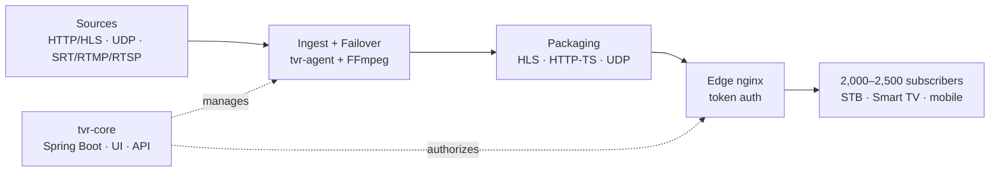

# TvRestream — Product & Technical Documentation

| Field | Value |
|---|---|
| Product | TvRestream — IPTV restreaming platform |
| Document version | 0.1 (concept) |
| Date | 2026-10-05 |
| Owner | Kostadin Dlagnekov |
| Status | Draft for review |
| Language | English · [Български](../bg/00-README.md) |

## Contents

| # | Document | Audience | Contents |
|---|---|---|---|
| 01 | [Vision & PRD](01-vision-prd.md) | Everyone | Problem, goals, scope, personas, success metrics |
| 02 | [Functional specification](02-functional-spec.md) | PM, Dev, QA | All modules and features with IDs, user stories, acceptance criteria |
| 03 | [Architecture](03-architecture.md) | Dev, DevOps | C4 diagrams, components, data flows, sequence diagrams |
| 04 | [Data model](04-data-model.md) | Dev | ERD, tables, fields, indexes |
| 05 | [API specification](05-api.md) | Dev, integrators | REST endpoints, auth, webhooks · [openapi.yaml](../api/openapi.yaml) |
| 06 | [UI/UX specification](06-ui-ux.md) | PM, Design, Frontend | Screen map, wireframes, prototype, states |
| 07 | [Non-functional requirements & security](07-nfr-security.md) | Dev, DevOps | Performance, capacity, availability, security |
| 08 | [Deployment & operations](08-deployment-ops.md) | DevOps | Hardware, network, Docker, monitoring, backup, runbooks |
| 09 | [Test strategy](09-testing-qa.md) | QA, Dev | Test levels, load, test scenarios |
| 10 | [Roadmap & backlog](10-roadmap-backlog.md) | PM | Milestones, sprints, epics, Definition of Done |
| 11 | [Risks, ADRs & glossary](11-risks-adr-glossary.md) | Everyone | Risks, architecture decisions, terms |
| 12 | [Development plan & tracking](12-development-plan.md) | Everyone | Process, stages, 109 tickets, progress board |

## 30-second summary

TvRestream ingests TV streams from providers and local sources (HTTP/HLS, UDP/Multicast, SRT/RTMP/RTSP, and later DVB-S/S2). It monitors their quality and automatically switches to a backup source when something fails. It delivers the channels to 2,000–2,500 subscribers as HLS and HTTP-TS, with protected personal links, channel packages and device limits.

It is similar to **Cesbo Astra** for ingest, analysis, redundancy and delivery, but **without DVR/archive**. It includes built-in subscriber management (middleware), which Astra does not have.

## Key decisions (summary)

1. **FFmpeg for stream I/O, Java for logic.** Video never passes through business logic. See ADR-001.
2. **Custom TS switcher and analyzer in Java (Netty)** for fast backup switching (under 3 s) without restarting packaging. See ADR-003.
3. **HLS is the primary output**, served by nginx from a RAM disk. HTTP-TS is served by a relay in the agent. See ADR-004.
4. **No transcoding in the MVP** (`-c copy` only). GPU transcoding is in Phase 3.
5. **Control plane / data plane split.** One `tvr-core` manages N `tvr-agent` servers.

## Conventions

- Requirement IDs: `FR-<MODULE>-<n>` (functional), `NFR-<n>` (non-functional).
- MoSCoW priority: **M** (Must), **S** (Should), **C** (Could), **W** (Won't, for now).
- Release: **MVP**, **R1** (production), **R2** (extensions), **R3** (future).
- Diagrams are in Mermaid and render directly in GitHub, GitLab and VS Code. Sources and SVG files are in [../diagrams](../diagrams).
