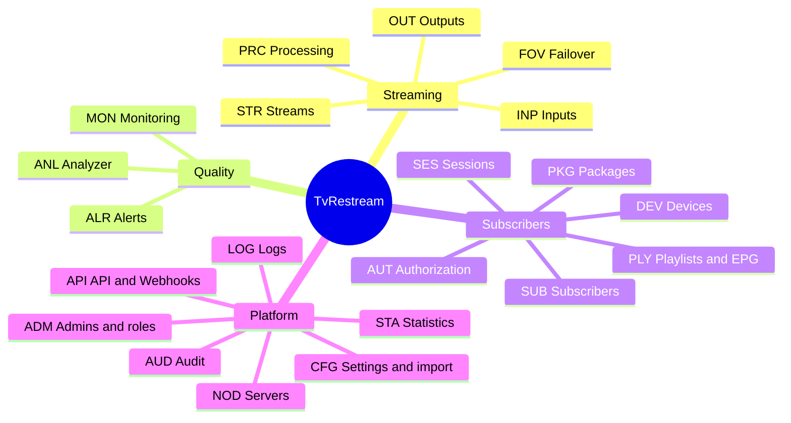
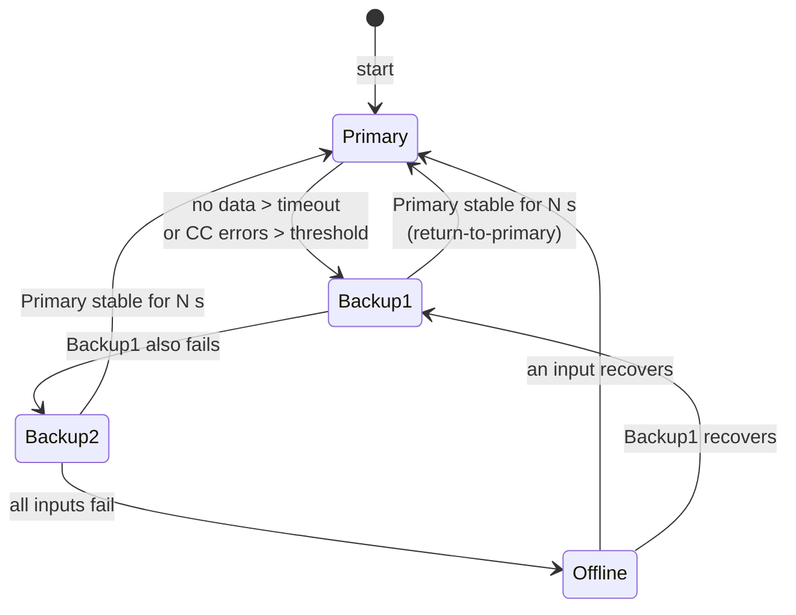
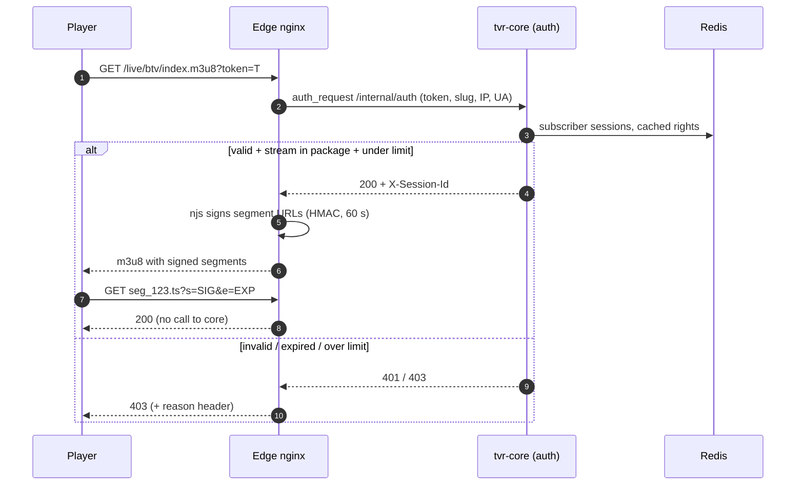
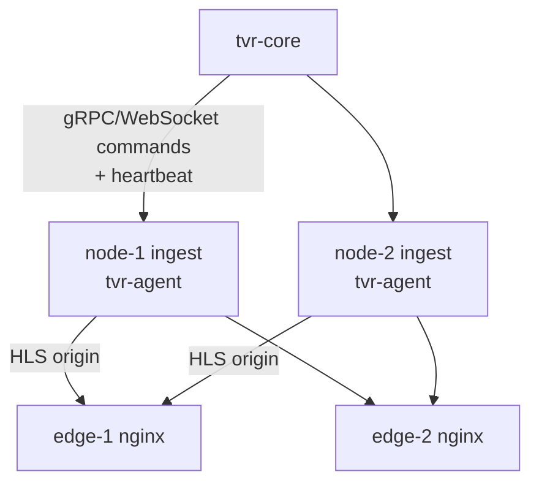

# 02 · Functional Specification

[← Index](00-README.md) · [Български](../bg/02-functional-spec.md)

## 1. Module map

| Code | Module | MVP | R1 | R2 | R3 |
|---|---|:-:|:-:|:-:|:-:|
| STR | Streams | ● | ● | | |
| INP | Inputs | ● HTTP/HLS/UDP | ● SRT/RTMP/RTSP | | DVB |
| FOV | Failover | ● cold | ● hot standby | | |
| PRC | Stream processing | | ● | ● | transcode |
| OUT | Outputs | ● HLS | ● HTTP-TS, UDP | ● SRT, RTMP | |
| ANL | Analyzer | ● basic | ● full | | |
| MON | Monitoring | ● | ● | | |
| ALR | Alerts | | ● | ● | |
| SUB/PKG/DEV | Subscribers, packages, devices | ● | ● | | |
| AUT | Playback authorization | ● | ● | ● geo | |
| PLY | Playlists and EPG | ● | ● | | |
| SES | Sessions | | ● | | |
| NOD | Servers (cluster) | ● 1 node | ● N nodes | | |
| ADM | Admins and roles | ● | ● 2FA | | |
| AUD | Audit log | | ● | | |
| API | REST API and Webhooks | ● | ● | ● webhooks | |
| CFG | Settings and import | ● | ● | | |
| STA | Statistics and reports | | ● | ● | |
| LOG | Logs | ● | ● | | |

---

## 2. STR · Streams

A stream is a logical unit. It has one or more **inputs** (by priority), optional **processing**, and one or more **outputs**. It runs on one server (node).

| ID | Requirement | Pr. | Release |
|---|---|:-:|:-:|
| FR-STR-01 | Create, edit, clone and delete a stream | M | MVP |
| FR-STR-02 | Fields: name, slug (unique, used in URLs), number (LCN), category, logo, EPG ID, language, description, tags | M | MVP |
| FR-STR-03 | Enable/disable. A disabled stream consumes no resources and is not in playlists | M | MVP |
| FR-STR-04 | **Always-on** mode or **On-demand** (starts on first viewer, stops after N s without viewers, default 60) | M | R1 |
| FR-STR-05 | Manual actions: Start, Stop, Restart, "Switch to input X" | M | MVP |
| FR-STR-06 | Stream list with filters (status, category, server, package), search, sorting, bulk actions (start, stop, move, add to package) | M | MVP |
| FR-STR-07 | Real-time status: `STOPPED`, `STARTING`, `ONLINE`, `DEGRADED` (on backup input or with errors), `OFFLINE` (no working input), `ERROR` | M | MVP |
| FR-STR-08 | In-browser stream preview (HLS player in UI) and a thumbnail every 60 s | S | R1 |
| FR-STR-09 | Assign a server (node) and move a stream between servers without losing configuration | M | R1 |
| FR-STR-10 | Stream change history (who, what, when) | S | R1 |

**Acceptance criteria (example FR-STR-01/05):**

- *Given* a valid HTTP-TS source, *when* the technician saves a new stream with enabled=true, *then* the status goes `STARTING → ONLINE` within ≤ 5 s and the HLS playlist is available at `/live/{slug}/index.m3u8`.
- *Given* an `ONLINE` stream, *when* Stop is pressed, *then* FFmpeg processes stop within ≤ 2 s and the status is `STOPPED`.
- The slug must contain only `[a-z0-9-]` and be unique. Otherwise an error is shown next to the field.

---

## 3. INP · Inputs

| ID | Requirement | Pr. | Release |
|---|---|:-:|:-:|
| FR-INP-01 | **HTTP(S) MPEG-TS** input with username/password, custom HTTP headers and User-Agent | M | MVP |
| FR-INP-02 | **HLS** input (master/media playlist), variant selection by bandwidth or resolution | M | MVP |
| FR-INP-03 | **UDP/RTP** unicast and multicast, network interface selection, SSM (source-specific multicast), buffer size | M | MVP |
| FR-INP-04 | **SRT** caller and listener, passphrase, latency, stream ID | M | R1 |
| FR-INP-05 | **RTMP** pull and push reception (with key) | S | R1 |
| FR-INP-06 | **RTSP** (TCP/UDP transport) | S | R1 |
| FR-INP-07 | Test an input before saving ("Test" button): shows codecs, resolution, bitrate and programs (ffprobe, up to 10 s) | M | MVP |
| FR-INP-08 | Input settings: no-data timeout (default 5 s), connection retries, delay between retries | M | MVP |
| FR-INP-09 | **Extensible driver model** (`InputDriver` SPI) so DVB-S/S2 (via dvblast/tsp) can be added without core changes | M | R1 (interface) / R3 (DVB) |
| FR-INP-10 | DVB-S/S2: adapter, frequency, polarization, symbol rate, LNB, DiSEqC, MPTS → multiple streams | C | R3 |

---

## 4. FOV · Failover

| ID | Requirement | Pr. | Release |
|---|---|:-:|:-:|
| FR-FOV-01 | Up to 8 inputs per stream, ordered by priority (drag & drop) | M | MVP |
| FR-FOV-02 | **Cold failover**: on failure the next input is started (target < 8 s) | M | MVP |
| FR-FOV-03 | **Hot standby**: the backup input is received in parallel and switching happens in the TS switcher (target < 3 s). Configurable per input | M | R1 |
| FR-FOV-04 | Triggers: no data > timeout, bitrate < threshold, CC errors > N/s, missing video or audio PID, scrambled stream | M | R1 |
| FR-FOV-05 | **Return to primary**: automatic return to a higher-priority input once it has been stable for N s (default 30). Can be disabled | M | R1 |
| FR-FOV-06 | Manually pin an input, which suspends automation until cleared | S | R1 |
| FR-FOV-07 | Every switch is recorded as an event (from, to, reason) and can trigger an alert | M | MVP |
| FR-FOV-08 | Fallback **slate** image/video when `OFFLINE`, e.g. "Channel temporarily unavailable", so players don't break | S | R2 |

---

## 5. PRC · Stream processing (no transcoding)

| ID | Requirement | Pr. | Release |
|---|---|:-:|:-:|
| FR-PRC-01 | Program (PNR/service ID) selection from an MPTS input | M | R1 |
| FR-PRC-02 | Audio track selection/filtering by language or PID, subtitle and teletext removal | S | R1 |
| FR-PRC-03 | SDT (service name, provider) and PMT (PNR) rewriting for UDP/HTTP-TS outputs | S | R2 |
| FR-PRC-04 | Timestamp normalization and discontinuity handling on input switch (HLS `#EXT-X-DISCONTINUITY`) | M | MVP |
| FR-PRC-05 | Transcoding with profiles (H.264, 1080/720/480, NVENC/QSV/CPU) | C | R3 |

---

## 6. OUT · Outputs

| ID | Requirement | Pr. | Release |
|---|---|:-:|:-:|
| FR-OUT-01 | **HLS**: segment duration (default 4 s), segments per playlist (6), written to RAM disk (tmpfs), old segments deleted automatically | M | MVP |
| FR-OUT-02 | **HTTP-TS** (MPEG-TS over HTTP) for STB/Enigma2/VLC, served by the agent's relay | M | R1 |
| FR-OUT-03 | **UDP/RTP multicast**: address, port, TTL, interface, pkt size 1316 | S | R1 |
| FR-OUT-04 | **SRT** listener (partners pull) and caller (push) | S | R2 |
| FR-OUT-05 | **RTMP push** to an external platform | C | R2 |
| FR-OUT-06 | Each output can be public (subscriber auth) or internal (trusted IPs only) | M | R1 |
| FR-OUT-07 | Uniform URL scheme: `https://{edge}/live/{slug}/index.m3u8` and `https://{edge}/ts/{slug}.ts`, with token | M | MVP |

---

## 7. ANL · Stream analyzer

Equivalent to the Astra analyzer. Runs continuously inside the agent's TS switcher, with no extra processes.

| ID | Requirement | Pr. | Release |
|---|---|:-:|:-:|
| FR-ANL-01 | Input bitrate (per second/minute), output bitrate | M | MVP |
| FR-ANL-02 | Per-PID **CC error** counter (continuity counter), **PES errors**, **PCR jitter/drift** | M | R1 |
| FR-ANL-03 | **Scrambled** PID detection | M | R1 |
| FR-ANL-04 | PID list: type, codec, language, per-PID bitrate (PAT/PMT/SDT parsing) | M | R1 |
| FR-ANL-05 | Video: codec, resolution, fps, profile. Audio: codec, channels, sample rate | M | MVP |
| FR-ANL-06 | "Frozen picture" and silence indicator (black/freeze/silence detection from thumbnail and audio levels) | C | R2 |
| FR-ANL-07 | Last-24h graphs (bitrate, errors, switches) in stream detail | S | R1 |

---

## 8. MON / ALR · Monitoring and alerts

| ID | Requirement | Pr. | Release |
|---|---|:-:|:-:|
| FR-MON-01 | Dashboard: streams by status, online viewers, total egress, server load (CPU, RAM, NIC) | M | MVP |
| FR-MON-02 | Real-time updates (WebSocket/SSE, ≤ 2 s delay) | M | MVP |
| FR-MON-03 | Prometheus metrics (`/metrics`) for core and agent, ready-made Grafana dashboards | S | R1 |
| FR-ALR-01 | Alert rules: stream OFFLINE > N s, failover switch, CC errors > threshold, node offline, CPU/NIC > threshold, subscriber over limit | M | R1 |
| FR-ALR-02 | Alert channels: **Telegram**, **email (SMTP)**, **webhook** | M | R1 |
| FR-ALR-03 | Grouping and muting (dedupe, mute per stream, quiet hours), recovery notification | S | R1 |
| FR-ALR-04 | Active and historical incidents with acknowledgement | S | R2 |

---

## 9. SUB / PKG / DEV · Subscribers, packages, devices

| ID | Requirement | Pr. | Release |
|---|---|:-:|:-:|
| FR-SUB-01 | Subscriber CRUD: username, password (for Xtream-style access), name, phone, email, note | M | MVP |
| FR-SUB-02 | Status: `ACTIVE`, `SUSPENDED`, `EXPIRED`, `BANNED`; expiry date; automatic expiry | M | MVP |
| FR-SUB-03 | One or more packages per subscriber | M | MVP |
| FR-SUB-04 | **Concurrent device/session limit** (default 1) | M | MVP |
| FR-SUB-05 | Personal playlist **token**; regeneration (old token invalid immediately) | M | MVP |
| FR-SUB-06 | IP/subnet restriction (allow list) and country restriction (GeoIP) | S | R2 |
| FR-SUB-07 | Bulk create, CSV import/export, bulk extension | S | R1 |
| FR-SUB-08 | Search by name, phone, token, IP of active session | M | MVP |
| FR-PKG-01 | Package (bouquet): name, description, set of streams, stream order within the package | M | MVP |
| FR-PKG-02 | A stream can belong to several packages; package changes update playlists immediately | M | MVP |
| FR-DEV-01 | Registered devices (by user-agent + IP + device ID if any) with "last seen"; manual device removal | S | R1 |
| FR-DEV-02 | "Lock to MAC/device" mode for STBs (MAG/Enigma2) | C | R2 |

---

## 10. AUT · Playback authorization

| ID | Requirement | Pr. | Release |
|---|---|:-:|:-:|
| FR-AUT-01 | Playlist request (`.m3u8`, `.ts` start) authorized via `auth_request` to core; 10 s cache | M | MVP |
| FR-AUT-02 | Segments protected by HMAC signature and expiry (nginx `secure_link`) without calling core | M | MVP |
| FR-AUT-03 | Checks: valid token, subscriber `ACTIVE`, not expired, stream in a subscriber package, sessions ≤ limit, IP allowed | M | MVP |
| FR-AUT-04 | Over-limit policy: **reject new** (default) or **kick oldest** session | S | R1 |
| FR-AUT-05 | Xtream Codes compatible API (`/get.php`, `/player_api.php`, `/live/{user}/{pass}/{id}.ts`) so popular players work (TiviMate, IPTV Smarters) | S | R1 |
| FR-AUT-06 | Optional token-to-IP binding (signature includes IP) | C | R2 |

---

## 11. PLY · Playlists and EPG

| ID | Requirement | Pr. | Release |
|---|---|:-:|:-:|
| FR-PLY-01 | Personal M3U: `https://{host}/pl/{token}.m3u` with `#EXTINF` (tvg-id, tvg-name, tvg-logo, group-title, tvg-chno) | M | MVP |
| FR-PLY-02 | Link format choice: HLS or HTTP-TS (`?type=hls\|ts`) | M | R1 |
| FR-PLY-03 | `url-tvg` to EPG (XMLTV). Core proxies and caches XMLTV from an external provider, filtered by the subscriber's streams | S | R1 |
| FR-PLY-04 | Logos: upload or external URL, served via CDN/edge | S | MVP |
| FR-PLY-05 | Categories (group-title) and LCN ordering | M | MVP |

---

## 12. SES · Sessions

| ID | Requirement | Pr. | Release |
|---|---|:-:|:-:|
| FR-SES-01 | Active session list: subscriber, stream, IP, country, user-agent, start, traffic, edge server | M | R1 |
| FR-SES-02 | Kick a session or all sessions of a subscriber | M | R1 |
| FR-SES-03 | A session is active if there was a playlist or segment request in the last 30 s (HLS), or an open connection (HTTP-TS) | M | MVP |
| FR-SES-04 | Session history for 90 days (statistics and disputes) | S | R1 |

---

## 13. NOD · Servers (cluster)

| ID | Requirement | Pr. | Release |
|---|---|:-:|:-:|
| FR-NOD-01 | Server enrollment via one-time key (enrollment token); roles: `INGEST`, `EDGE`, `ALL-IN-ONE` | M | MVP |
| FR-NOD-02 | Heartbeat every 5 s; `OFFLINE` after 15 s without heartbeat | M | MVP |
| FR-NOD-03 | Server metrics: CPU, RAM, disk, NIC in/out, process count, agent and FFmpeg versions | M | MVP |
| FR-NOD-04 | Maintenance (drain) mode: streams move to another ingest, edge stops accepting new sessions | S | R1 |
| FR-NOD-05 | Automatic stream relocation when an ingest server fails (if capacity allows) | S | R2 |
| FR-NOD-06 | Edge balancing: DNS round-robin or redirect from core to the least-loaded edge (`/pl` returns the chosen edge URL) | S | R1 |

---

## 14. ADM / AUD · Administrators, roles, audit

| Role | Streams | Subscribers | Servers | Settings | Audit |
|---|:-:|:-:|:-:|:-:|:-:|
| **Admin** | RW | RW | RW | RW | R |
| **Operator** | RW | R | R | — | — |
| **Support** | R | RW (no delete) | — | — | — |
| **Viewer** | R | R | R | — | — |

| ID | Requirement | Pr. | Release |
|---|---|:-:|:-:|
| FR-ADM-01 | Login with email and password (bcrypt/argon2), JWT access (15 min) + refresh token | M | MVP |
| FR-ADM-02 | Roles per the table above (RBAC) | M | MVP |
| FR-ADM-03 | 2FA (TOTP), mandatory for Admin | S | R1 |
| FR-ADM-04 | Lockout for 15 min after 5 failed attempts; list of the admin's active sessions | M | R1 |
| FR-AUD-01 | Audit log of every change: who, when, IP, object, before/after (JSON diff) | M | R1 |
| FR-AUD-02 | Audit log filtering and export; 1-year retention | S | R1 |

---

## 15. API · REST API and webhooks

| ID | Requirement | Pr. | Release |
|---|---|:-:|:-:|
| FR-API-01 | Every UI function is available via REST API `/api/v1` (the UI uses the same API) | M | MVP |
| FR-API-02 | API keys for integrations with scopes and expiry | M | R1 |
| FR-API-03 | OpenAPI 3.1 specification + Swagger UI | M | MVP |
| FR-API-04 | Webhooks: `stream.status_changed`, `stream.failover`, `subscriber.created/updated/expired`, `session.limit_exceeded`, `node.status_changed`; HMAC signature, retries | S | R2 |

---

## 16. CFG · Settings, import, backup

| ID | Requirement | Pr. | Release |
|---|---|:-:|:-:|
| FR-CFG-01 | Global settings: edge domains, default HLS parameters, timeouts, signing secrets | M | MVP |
| FR-CFG-02 | Stream import from **M3U** (field mapping and preview before saving) | M | MVP |
| FR-CFG-03 | Configuration import from **Astra** (JSON: `make_stream`, `input`, `output`) | S | R1 |
| FR-CFG-04 | Full configuration export/import (JSON) | S | R1 |
| FR-CFG-05 | Automatic daily database backup (pg_dump) with 14-day rotation | M | R1 |
| FR-CFG-06 | SMTP, Telegram bot, GeoIP database, EPG sources | M | R1 |

---

## 17. STA / LOG · Statistics and logs

| ID | Requirement | Pr. | Release |
|---|---|:-:|:-:|
| FR-STA-01 | Top streams by viewers (hour, day, week, month) | S | R1 |
| FR-STA-02 | Peak concurrent viewers and traffic per day | S | R1 |
| FR-STA-03 | Per-stream uptime report (% and incident count) for a period | S | R1 |
| FR-STA-04 | Subscribers: new, expiring in the next 7 days, expired | S | R1 |
| FR-STA-05 | CSV export of reports | C | R2 |
| FR-LOG-01 | Stream log (FFmpeg stderr + agent events) in the UI in real time, last 1,000 lines | M | MVP |
| FR-LOG-02 | Structured logs (JSON) for core and agent, rotation, optional Loki | S | R1 |

---

## 18. Business rules (summary)

| # | Rule |
|---|---|
| BR-01 | A subscriber past their expiry date automatically becomes `EXPIRED` at 00:00 (Europe/Sofia) and their sessions are terminated. |
| BR-02 | Deleting a stream that belongs to packages requires confirmation. Deletion is "soft" (30-day restore window). |
| BR-03 | A stream's slug cannot be changed while it has active sessions (URLs would break). Confirmation is required. |
| BR-04 | Regenerating a token terminates all of the subscriber's sessions. |
| BR-05 | An On-demand stream starts on the first request. The first request waits up to 6 s for the first segment. |
| BR-06 | Sessions are counted per unique (subscriber, device/IP+UA) pair. Zapping from the same device is not a new session. |
