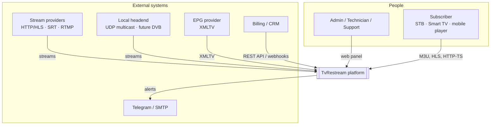
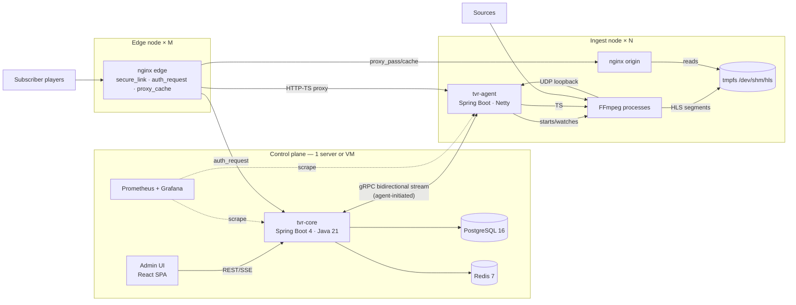
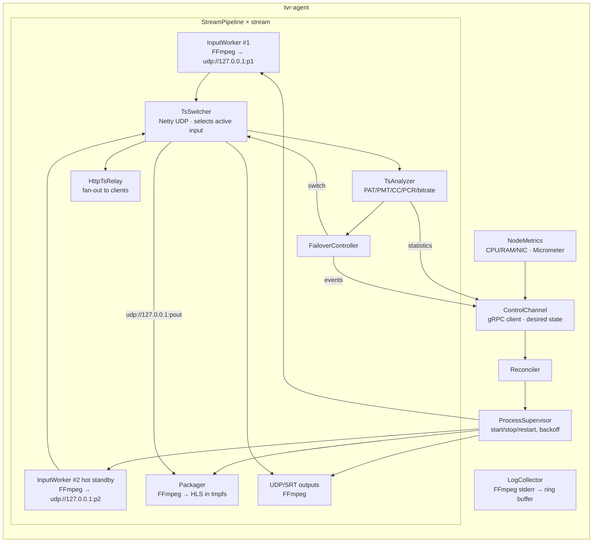
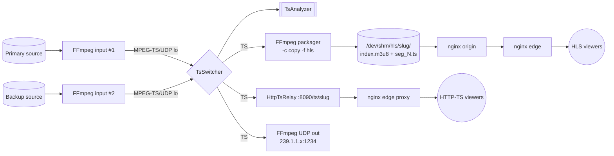
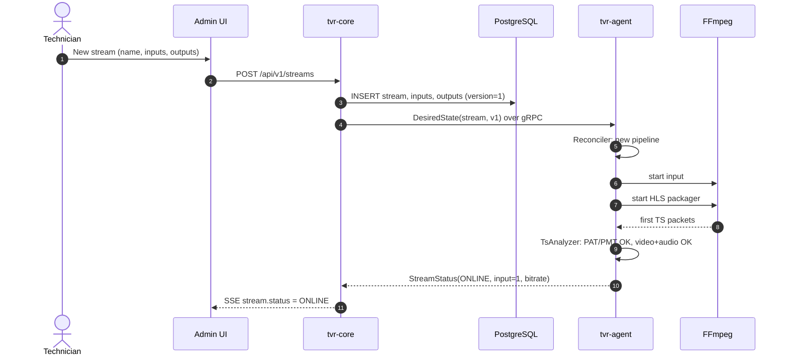
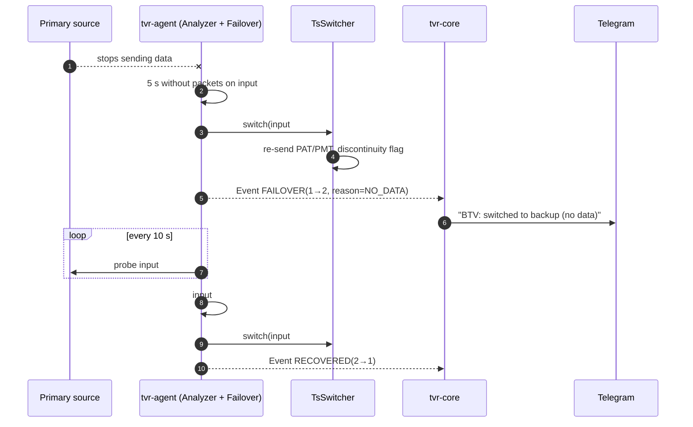
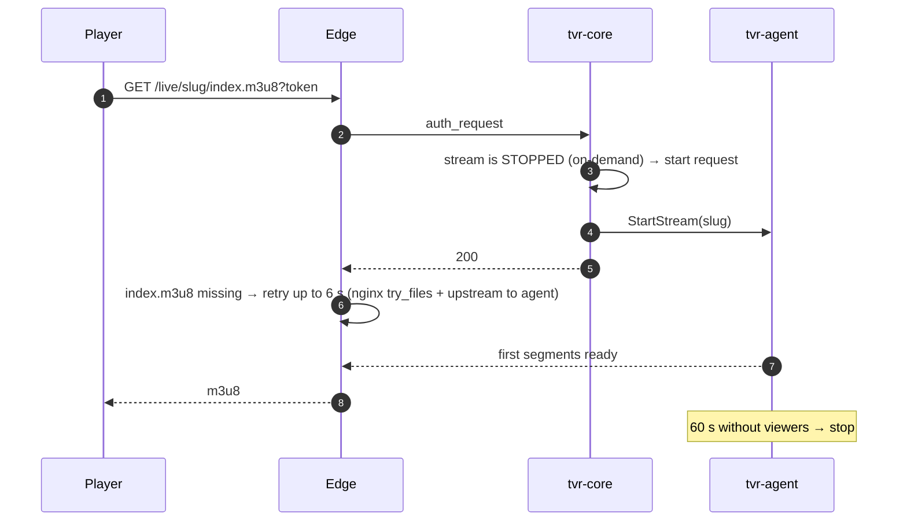

# 03 · Architecture

[← Index](00-README.md) · [Български](../bg/03-architecture.md)

## 1. Principles

1. **Control plane ≠ data plane.** `tvr-core` handles configuration, subscribers and authorization. `tvr-agent` and FFmpeg carry the video. If core goes down, running streams and already-authorized sessions keep going.
2. **Video never passes through business logic.** Bytes flow FFmpeg → TS switcher (Netty, zero-copy buffers) → FFmpeg/nginx.
3. **Desired state + reconciliation.** Core sends the agent the full desired state. The agent brings its processes in line on its own (Kubernetes-style), so lost commands and restarts do not cause drift.
4. **One FFmpeg process per input and per packager, never per viewer.**
5. **Stateless edge.** Edge servers are just nginx with cache and scale horizontally.

## 2. C4 · Level 1 — Context



## 3. C4 · Level 2 — Containers



| Container | Technology | Responsibility |
|---|---|---|
| **Admin UI** | React 18, TypeScript, Vite, Ant Design, TanStack Query, hls.js | Web panel |
| **tvr-core** | Java 21, Spring Boot 4.1, Spring Security, Spring Data JPA, Flyway, gRPC, Micrometer | REST API, subscriber authorization, playlists, agent orchestration, alerts, statistics |
| **PostgreSQL** | 16 | Configuration, subscribers, audit, history |
| **Redis** | 7 | Active sessions, auth cache, rate limiting, status pub/sub |
| **tvr-agent** | Java 21, Spring Boot (no web MVC), Netty, gRPC client | FFmpeg supervisor, TS switcher and analyzer, HTTP-TS relay, node metrics |
| **FFmpeg** | 7.x (+libsrt, openssl) | Input ingest, HLS packaging, UDP/SRT/RTMP outputs |
| **nginx origin** | 1.26 | Serves HLS from tmpfs to edge |
| **nginx edge** | 1.26 | TLS, authorization, cache, delivery to viewers |
| **Prometheus/Grafana** | — | Metrics and dashboards |

## 4. C4 · Level 3 — tvr-agent components



### 4.1 Why a custom TS switcher (TsSwitcher)

If FFmpeg ingests the input directly and produces HLS, failover means restarting the whole process. That causes a 5–10 s interruption and a "broken" playlist. With TsSwitcher:

- inputs are received by separate FFmpeg processes (`-c copy -f mpegts udp://127.0.0.1:PORT`);
- TsSwitcher reads all active inputs but forwards only the selected one to the packager;
- on switch it emits a clean TS (re-sending PAT/PMT), and the packager continues without restart. `EXT-X-DISCONTINUITY` is inserted when needed;
- the analyzer runs on the same packets with no extra copy.

## 5. Data flow for one stream



## 6. Key sequences

### 6.1 Creating and starting a stream



### 6.2 Automatic failover



### 6.3 On-demand stream



## 7. Core ↔ agent communication

| Aspect | Decision |
|---|---|
| Transport | gRPC bidirectional stream, **agent-initiated** (works behind NAT/firewall), mTLS |
| Enrollment | Enrollment token → core issues a client certificate for the agent |
| core→agent messages | `DesiredState` (full snapshot + version), `Command` (restart, switch input, kick HTTP-TS client) |
| agent→core messages | `Heartbeat` (5 s), `NodeMetrics` (5 s), `StreamStatus` (on change + every 5 s), `StreamEvent`, `LogLines` (on subscription) |
| On connection loss | The agent keeps running with the last known state and reconnects with exponential backoff |

## 8. Code structure (monorepo)

```
tvrestream/
├── settings.gradle, build.gradle # Gradle multi-project (Java 21)
├── tvr-common/                  # DTOs, proto (gRPC), shared utilities
│   └── src/main/proto/agent.proto
├── tvr-core/                    # Spring Boot application
│   └── src/main/java/io/tvr/core/
│       ├── stream/              # streams, inputs, outputs
│       ├── subscriber/          # subscribers, packages, devices
│       ├── auth/                # admin auth (JWT) + playback auth
│       ├── playlist/            # M3U, Xtream API, EPG
│       ├── session/             # sessions (Redis)
│       ├── node/                # agent enrollment and orchestration
│       ├── monitoring/          # statuses, SSE, alerts
│       ├── audit/               # audit
│       └── config/              # settings, import/export
├── tvr-agent/                   # Spring Boot (non-web) + Netty
│   └── src/main/java/io/tvr/agent/
│       ├── control/             # gRPC client, reconciler
│       ├── process/             # ProcessSupervisor, FfmpegCommandBuilder
│       ├── ts/                  # TsSwitcher, TsAnalyzer, TsPacket parser
│       ├── relay/               # HttpTsRelay (Netty HTTP)
│       └── metrics/
├── tvr-ui/                      # React + TypeScript
├── deploy/
│   ├── docker-compose.yml
│   ├── nginx/{origin,edge}.conf
│   └── ansible/                 # node installation
└── docs/                        # this documentation
```

## 9. Technology stack and versions

| Layer | Choice | Alternative (rejected) | Reason |
|---|---|---|---|
| Language/framework | Java 21 + Spring Boot 4.1 | Python/FastAPI, Go | Owner's choice; mature ecosystem; virtual threads |
| Media I/O | FFmpeg 7 | GStreamer | More widespread, easier to debug, all protocols |
| TS processing | Custom (Netty) | FFmpeg only | Fast failover without restart, analyzer |
| DB | PostgreSQL 16 | MySQL | JSONB, reliability |
| Cache/sessions | Redis 7 | Hazelcast | Simple, TTL keys, pub/sub |
| Edge | nginx | Varnish, custom Java server | `secure_link`, `auth_request`, efficient sendfile |
| UI | React + Ant Design | Vaadin, Thymeleaf | Rich admin UI, decoupled from backend |
| Monitoring | Micrometer + Prometheus + Grafana | Zabbix | Standard, ready dashboards |
| Deployment | Docker Compose + Ansible | Kubernetes | Enough for 3–6 servers, simpler operations |

## 10. Network ports

| Port | Service | Access |
|---|---|---|
| 443/80 | nginx edge (HLS, HTTP-TS, playlists) | Public |
| 443 | Admin UI + API (separate domain, e.g. `admin.`) | Restricted by IP / VPN |
| 9443 | gRPC core ↔ agent (mTLS) | Servers only |
| 8080 | tvr-core HTTP (internal, behind nginx) | localhost |
| 8090 | Agent HttpTsRelay | Edge only |
| 8081 | nginx origin (HLS) | Edge only |
| 9100/9464 | Prometheus exporters | Monitoring only |
| 20000–29999/udp | Loopback ports for TS between processes | 127.0.0.1 |
