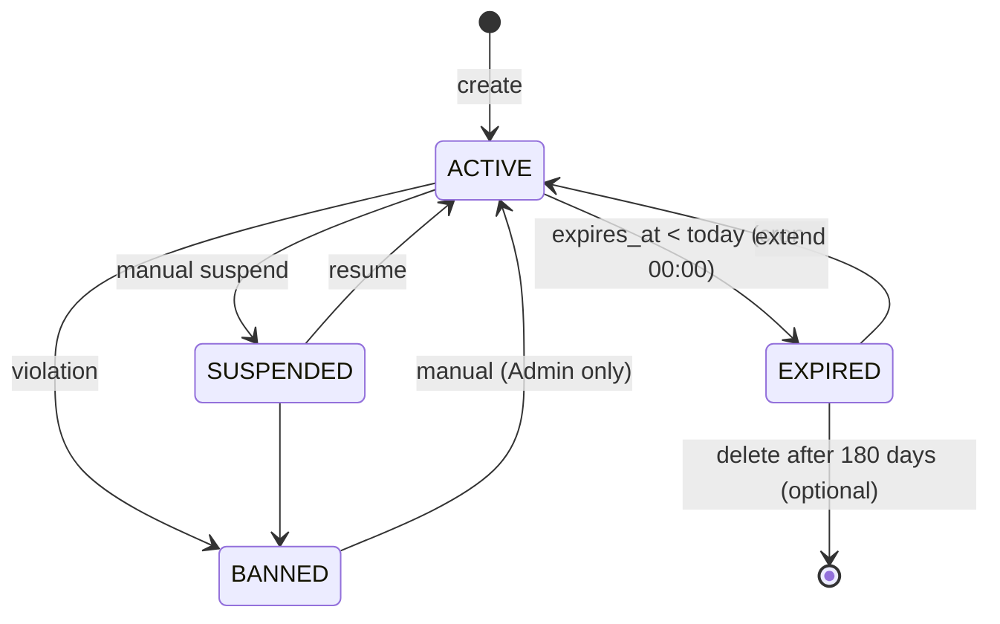
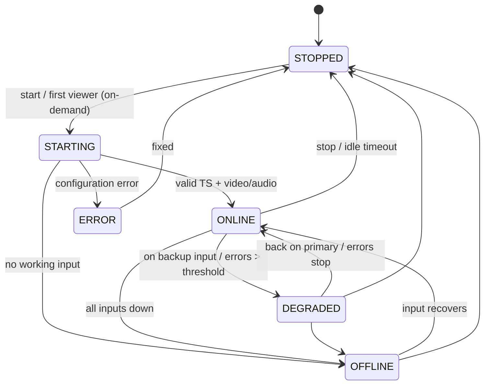

# 04 · Data Model

[← Index](00-README.md) · [Български](../bg/04-data-model.md)

## 1. ER diagram

```mermaid
erDiagram
    NODE ||--o{ STREAM : "runs"
    STREAM ||--|{ STREAM_INPUT : "has"
    STREAM ||--o{ STREAM_OUTPUT : "has"
    STREAM }o--|| CATEGORY : "in"
    STREAM ||--o{ PACKAGE_STREAM : ""
    PACKAGE ||--o{ PACKAGE_STREAM : ""
    PACKAGE ||--o{ SUBSCRIBER_PACKAGE : ""
    SUBSCRIBER ||--o{ SUBSCRIBER_PACKAGE : ""
    SUBSCRIBER ||--o{ DEVICE : "has"
    SUBSCRIBER ||--o{ SESSION_HISTORY : ""
    STREAM ||--o{ STREAM_EVENT : ""
    STREAM ||--o{ SESSION_HISTORY : ""
    ADMIN_USER ||--o{ AUDIT_LOG : "performs"
    ADMIN_USER ||--o{ API_KEY : "owns"
    ALERT_RULE ||--o{ ALERT_EVENT : "fires"
    NOTIFICATION_CHANNEL ||--o{ ALERT_RULE : "notifies via"

    NODE {
        uuid id PK
        string name
        string role "INGEST|EDGE|ALL_IN_ONE"
        string public_host
        string status "ONLINE|OFFLINE|DRAIN"
        int max_streams
        string agent_version
        timestamptz last_seen_at
    }
    STREAM {
        uuid id PK
        string name
        string slug UK
        int lcn
        uuid category_id FK
        uuid node_id FK
        string logo_url
        string epg_id
        bool enabled
        string mode "ALWAYS_ON|ON_DEMAND"
        jsonb processing
        int version
        timestamptz deleted_at
    }
    STREAM_INPUT {
        uuid id PK
        uuid stream_id FK
        int priority
        string type "HTTP_TS|HLS|UDP|SRT|RTMP|RTSP|DVB"
        string url
        jsonb options
        bool hot_standby
        int timeout_sec
        bool enabled
    }
    STREAM_OUTPUT {
        uuid id PK
        uuid stream_id FK
        string type "HLS|HTTP_TS|UDP|SRT|RTMP"
        jsonb options
        bool public
        bool enabled
    }
    CATEGORY {
        uuid id PK
        string name
        int sort_order
    }
    PACKAGE {
        uuid id PK
        string name
        string description
        bool active
    }
    PACKAGE_STREAM {
        uuid package_id FK
        uuid stream_id FK
        int sort_order
    }
    SUBSCRIBER {
        uuid id PK
        string username UK
        string password_hash
        string token UK
        string full_name
        string phone
        string email
        string status "ACTIVE|SUSPENDED|EXPIRED|BANNED"
        date expires_at
        int max_connections
        string limit_policy "REJECT_NEW|KICK_OLDEST"
        cidr[] allowed_ips
        string[] allowed_countries
        text note
    }
    SUBSCRIBER_PACKAGE {
        uuid subscriber_id FK
        uuid package_id FK
    }
    DEVICE {
        uuid id PK
        uuid subscriber_id FK
        string fingerprint
        string user_agent
        inet last_ip
        timestamptz last_seen_at
    }
    SESSION_HISTORY {
        bigint id PK
        uuid subscriber_id FK
        uuid stream_id FK
        uuid edge_node_id FK
        inet ip
        string country
        string user_agent
        timestamptz started_at
        timestamptz ended_at
        bigint bytes_sent
        string end_reason
    }
    STREAM_EVENT {
        bigint id PK
        uuid stream_id FK
        timestamptz ts
        string type "STATUS|FAILOVER|RECOVERED|ERROR"
        jsonb data
    }
    ADMIN_USER {
        uuid id PK
        string email UK
        string password_hash
        string role "ADMIN|OPERATOR|SUPPORT|VIEWER"
        string totp_secret
        bool active
    }
    API_KEY {
        uuid id PK
        uuid owner_id FK
        string prefix
        string hash
        string[] scopes
        timestamptz expires_at
    }
    AUDIT_LOG {
        bigint id PK
        uuid actor_id FK
        inet ip
        string action
        string entity_type
        string entity_id
        jsonb diff
        timestamptz ts
    }
    ALERT_RULE {
        uuid id PK
        string name
        string condition
        jsonb params
        uuid channel_id FK
        bool enabled
    }
    ALERT_EVENT {
        bigint id PK
        uuid rule_id FK
        string severity
        string state "FIRING|RESOLVED|ACK"
        jsonb data
        timestamptz ts
    }
    NOTIFICATION_CHANNEL {
        uuid id PK
        string type "TELEGRAM|EMAIL|WEBHOOK"
        jsonb config
    }
```

## 2. Table notes

| Table | Notes |
|---|---|
| `stream` | `version` increments on every change and is sent to the agent (desired state). `deleted_at` enables soft delete (BR-02). Indexes: `slug` (unique), `node_id`, `enabled`. |
| `stream_input.options` | Type-specific JSON, e.g. `{"headers":{"User-Agent":"..."}, "iface":"eth1", "ssm_source":"10.0.0.1", "srt":{"mode":"caller","latency":200,"passphrase":"***"}, "analyzeduration":1.5}` (`analyzeduration` — seconds FFmpeg probes the input, 0.5–30, default 1.5; TVR-021). Secrets are encrypted (AES-GCM, key from env). |
| `stream.processing` | `{"pnr":101, "audio":{"keep_langs":["bul","eng"]}, "drop_subtitles":true, "service_name":"BTV HD"}` |
| `stream_output.options` | HLS: `{"segment_sec":4, "list_size":6}`; UDP: `{"addr":"239.1.1.10","port":1234,"ttl":4,"iface":"eth1"}` |
| `subscriber.token` | 32-character base62, generated with `SecureRandom`. Unique index. |
| `session_history` | Monthly partitioning (`PARTITION BY RANGE (started_at)`), 90-day retention. |
| `stream_event` | Monthly partitioning, 180-day retention. |
| `audit_log` | Append-only, 1-year retention. |

## 3. Data in Redis

| Key | Type | TTL | Contents |
|---|---|---|---|
| `sess:{subscriberId}` | HASH | — | `{sessionKey → JSON(stream, ip, ua, edge, started, last_seen)}` |
| `sess:last:{sessionKey}` | STRING | 30 s | Session heartbeat (refreshed on every playlist request) |
| `auth:{token}` | STRING (JSON) | 10 s | Cached subscriber rights (status, expiry, slugs, limit) |
| `stream:status:{id}` | STRING (JSON) | 30 s | Last status from the agent: state, activeInputId, bitrateIn, since, lastError, nodeId, at (TVR-020) |
| `rl:auth:{ip}` | STRING | 60 s | Rate limit for failed attempts |
| channel `events` | PUB/SUB | — | Events for UI SSE clients |

## 4. Subscriber lifecycle

## 5. Stream lifecycle

## 6. Migrations

- Flyway, files `V{n}__{description}.sql` in `tvr-core/src/main/resources/db/migration`.
- Enumerated values are `varchar` + `CHECK` (not PostgreSQL `ENUM`) — a new value is added by a migration without locking the type.
- Tables have `created_at`/`updated_at` (trigger `tvr_touch_updated_at`).

| Version | Ticket | Contents |
|---|---|---|
| V1 | TVR-005 | `node`, `category`, `stream` (slug unique among non-deleted rows, soft delete), `stream_input` (priority 1–8, network URLs only — SEC-07), `stream_output` |
| V2 | TVR-006 | `admin_user` (case-insensitive unique email, roles ADMIN/OPERATOR/SUPPORT/VIEWER), `admin_refresh_token` (SHA-256 hash only, rotation) |
- Every migration must be backward compatible with at least the previous code version (zero-downtime deploy).
