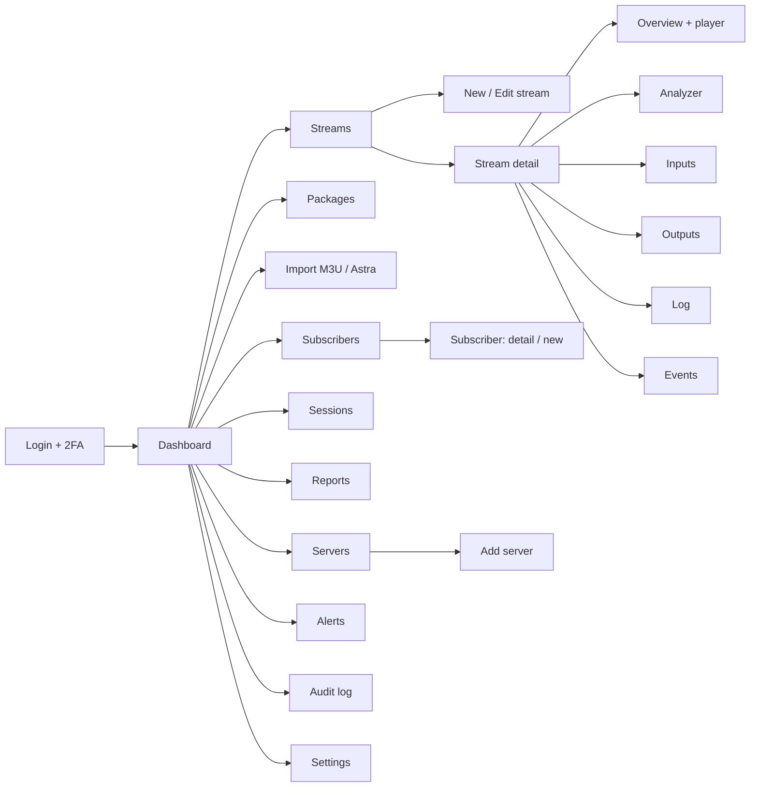
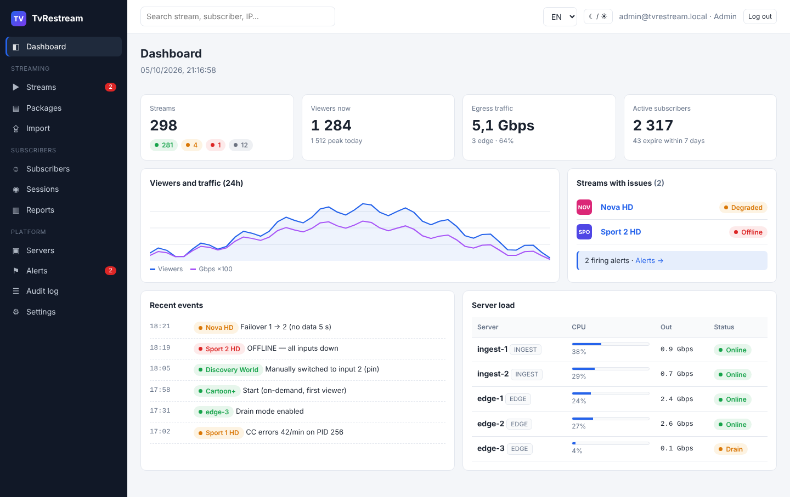
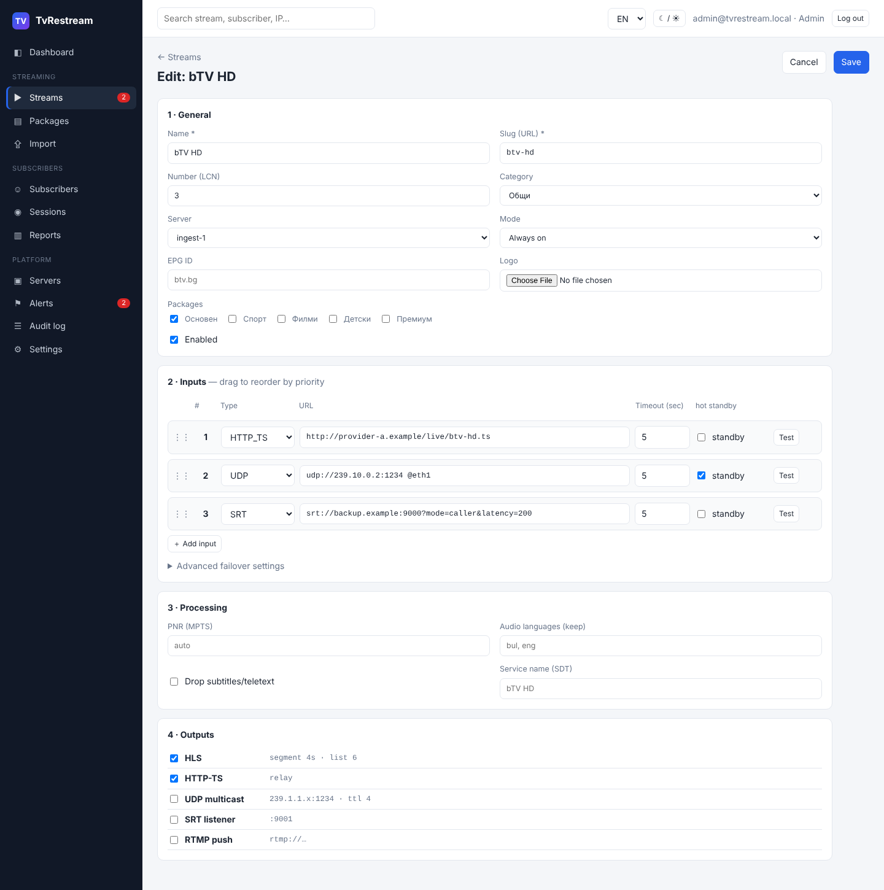
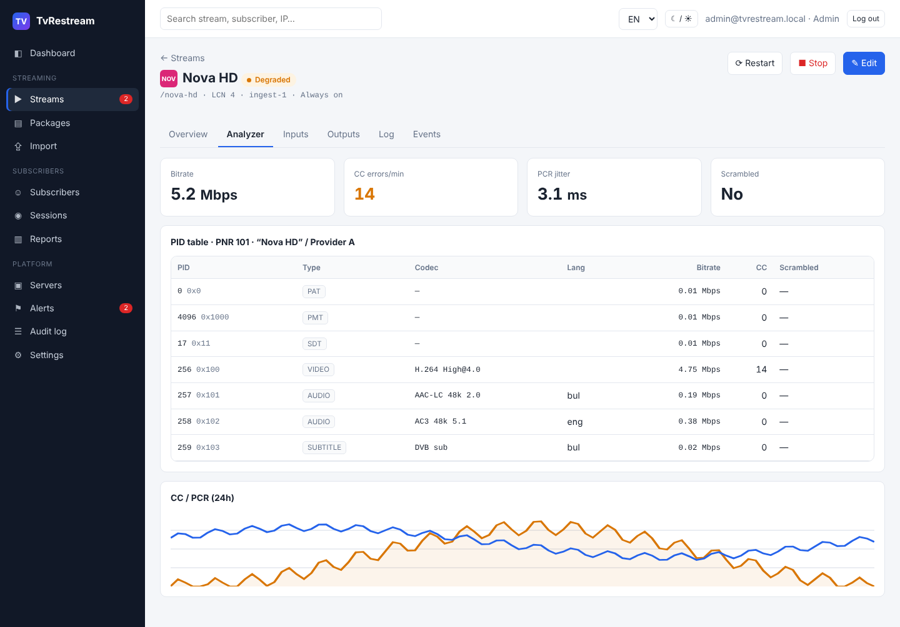
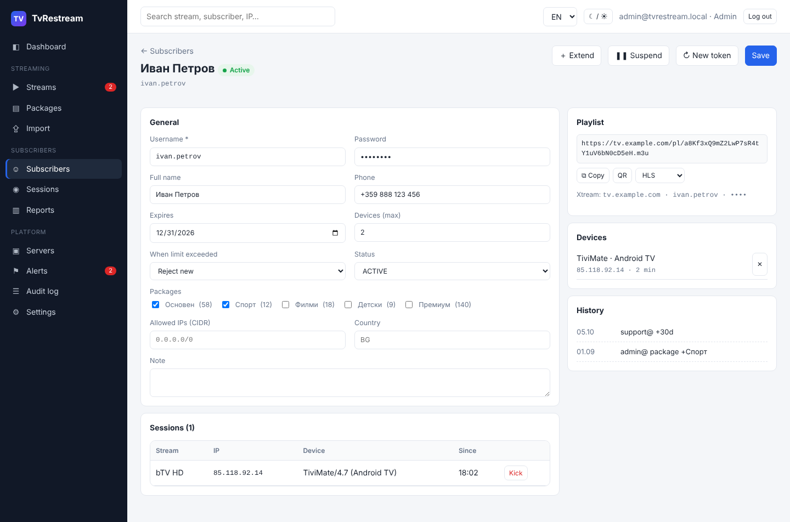

# 06 · UI/UX Specification

[← Index](00-README.md) · [Български](../bg/06-ui-ux.md)

> **Clickable prototype:** [ui-prototype/index.html](../../ui-prototype/index.html). Open it in a browser. It has a BG/EN switch and light/dark themes. The data is sample data.
> URL parameters: `?lang=en`, `?theme=dark`; screens are selected with e.g. `#/streams/3/analyzer`.

## 1. Design principles

1. **Problems first.** The dashboard and lists surface what is broken first (OFFLINE, DEGRADED, incidents).
2. **One color = one meaning** everywhere: 🟢 ONLINE/ACTIVE · 🟠 DEGRADED/SUSPENDED/DRAIN · 🔴 OFFLINE/ERROR/BANNED · ⚪ STOPPED/EXPIRED · 🔵 STARTING.
3. **Real time without reloads.** Statuses, bitrate and viewers update via SSE.
4. **Quick actions from lists** (start, stop, +30 days) without opening the detail view.
5. **Safety:** dangerous actions (delete, new token, key rotation) require confirmation and are audited.
6. **Bilingual interface** (i18n keys, no text in code), date and number formats per language.
7. **Accessibility:** contrast ≥ 4.5:1, keyboard navigation, status is text + color (never color alone).

## 2. Screen map

## 3. Screens

| # | Screen | Roles | Key elements | Screenshot |
|---|---|---|---|---|
| 1 | **Login** | All | Email, password, 2FA code, lockout after 5 attempts | [en-01](../ui/screens/en-01-login.png) |
| 2 | **Dashboard** | All | KPIs (streams by status, viewers, traffic, subscribers), 24h chart, streams with issues, recent events, server load | [en-02](../ui/screens/en-02-dashboard.png) · [dark](../ui/screens/bg-02-dashboard-dark.png) |
| 3 | **Streams — list** | Viewer+ | Filters (status, category, server, package), search, bulk actions, status, active input, bitrate, viewers | [en-03](../ui/screens/en-03-streams.png) |
| 4 | **Stream — overview** | Viewer+ | HLS player, status, uptime, video/audio, URLs, packages, bitrate/viewer chart | [en-04](../ui/screens/en-04-stream-overview.png) |
| 5 | **Stream — analyzer** | Viewer+ | Bitrate, CC errors, PCR jitter, scrambled, PID table, 24h chart | [en-05](../ui/screens/en-05-stream-analyzer.png) |
| 6 | **Stream — inputs** | Operator+ | Inputs by priority, status (active, ready, offline), manual switch, test | [en-06](../ui/screens/en-06-stream-inputs.png) |
| 7 | **Stream — log** | Operator+ | Live log (FFmpeg + agent), filter by process, colored by level | [en-07](../ui/screens/en-07-stream-log.png) |
| 8 | **Stream — new/edit** | Operator+ | 4 sections: General → Inputs (drag & drop, test, hot standby) → Processing → Outputs; advanced failover settings | [en-08](../ui/screens/en-08-stream-edit.png) |
| 9 | **Packages** | Operator+ | Package list, streams in package with ordering | [en-09](../ui/screens/en-09-packages.png) |
| 10 | **Subscribers — list** | Support+ | Filters (status, package, expiry), CSV import/export, quick +30 days, expiring highlighted | [en-10](../ui/screens/en-10-subscribers.png) |
| 11 | **Subscriber — detail** | Support+ | Details, packages, limit and policy, IP/country, playlist link (copy/QR), Xtream credentials, devices, active sessions, history | [en-11](../ui/screens/en-11-subscriber.png) |
| 12 | **Sessions** | Support+ | Active sessions, protocol, edge, traffic, kick | [en-12](../ui/screens/en-12-sessions.png) |
| 13 | **Servers** | Viewer+ | Cards with CPU/RAM/NIC, role, version, heartbeat, drain; "Add server" modal with install command | [en-13](../ui/screens/en-13-nodes.png) |
| 14 | **Alerts** | Operator+ | Active incidents + ack, rules, channels (Telegram, email, webhook) with test | [en-14](../ui/screens/en-14-alerts.png) |
| 15 | **Audit log** | Admin | Filters, before/after diff, CSV | [en-15](../ui/screens/en-15-audit.png) |
| 16 | **Settings** | Admin | General, HLS defaults, security (signature TTL, admin panel IPs, 2FA, key rotation), alerts, EPG, backup | [en-16](../ui/screens/en-16-settings.png) |
| 17 | **Import** | Operator+ | M3U/Astra, preview, mapping, duplicate-slug behavior | [en-17](../ui/screens/en-17-import.png) |
| 18 | **Reports** | Admin, Viewer | Top streams, peak viewers, uptime, subscribers | [en-18](../ui/screens/en-18-reports.png) |

### Sample screens

| Dashboard | Stream edit |
|---|---|
|  |  |
| **Analyzer** | **Subscriber** |
|  |  |

## 4. Screen states

| State | Behavior |
|---|---|
| Loading | Skeleton rows in tables, not a full-screen spinner |
| Empty | Explanation + primary action ("No streams yet" → "New stream" / "Import") |
| Error (API) | Banner above content with "Retry"; on 401 → login |
| SSE connection lost | Yellow indicator "Real-time connection lost, reconnecting…" |
| Save conflict (409) | "The stream was changed by another user" → show diff / reload |
| No permission (403) | Action buttons hidden or disabled with a hint |

## 5. "Stream" form validation

| Field | Rule | Message |
|---|---|---|
| Name | 1–120 characters | "Enter a name" |
| Slug | `^[a-z0-9-]{2,64}$`, unique | "Lowercase Latin letters, digits and dashes only" / "Already used by …" |
| LCN | 1–9999, warning on duplicate | "Number 3 is already bTV HD" (warning, not an error) |
| Input URL | Allowed schemes (SEC-07), valid host and port | "Unsupported protocol" |
| Inputs | At least 1 enabled | "Add at least one input" |
| Outputs | At least 1 enabled | "Select at least one output" |

## 6. Design tokens

| Token | Light | Dark | Use |
|---|---|---|---|
| `--accent` | `#2563eb` | `#5b8def` | Primary buttons, links, focus |
| `--ok` | `#16a34a` | `#34c26b` | ONLINE, ACTIVE |
| `--warn` | `#d97706` | `#f0a43a` | DEGRADED, SUSPENDED, DRAIN |
| `--err` | `#dc2626` | `#f06262` | OFFLINE, ERROR, BANNED |
| `--off` | `#6b7280` | `#8b95a5` | STOPPED, EXPIRED |
| `--side` | `#111827` | `#0a0e14` | Side navigation |
| Font | system-ui 14 px; monospace for URLs, IPs, PIDs, slugs | | |
| Radius | 7 px (controls), 10 px (cards) | | |

Implementation: **React + Ant Design** themed with these tokens (ConfigProvider), **TanStack Table** for large tables, and **hls.js** for the player.
