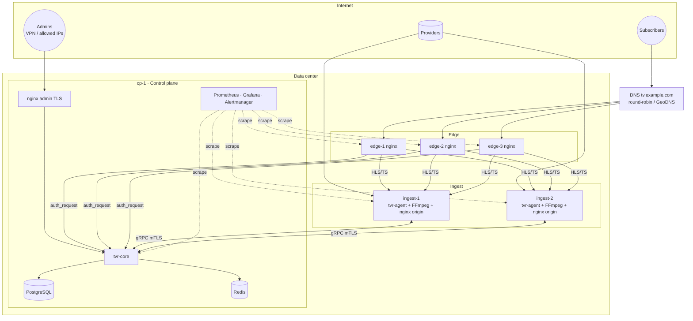
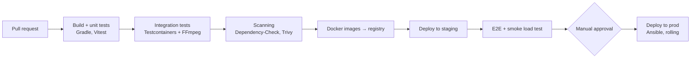

# 08 · Deployment and Operations

[← Index](00-README.md) · [Български](../bg/08-deployment-ops.md)

## 1. Deployment topology



## 2. Packaging and delivery

| Component | Artifact | How it is installed |
|---|---|---|
| tvr-core | Docker image `tvrestream/core:<ver>` | Docker Compose on the control plane |
| tvr-ui | Static files in the core image (or nginx) | Together with core |
| tvr-agent | Docker image `tvrestream/agent:<ver>` (with static FFmpeg 7) **or** `.deb` + systemd | `curl https://admin/install-agent.sh \| sudo bash -s -- --token <ENROLL>` |
| nginx edge/origin | Docker image `tvrestream/edge:<ver>` with ready configuration | Ansible role `edge` |
| Monitoring | Prometheus, Grafana, node_exporter, nginx-exporter | Docker Compose |

> The agent uses `network_mode: host` so multicast and high throughput work without NAT overhead.

### 2.1 docker-compose (control plane) — skeleton

```yaml
services:
  postgres:
    image: postgres:16
    volumes: [pgdata:/var/lib/postgresql/data]
    environment: {POSTGRES_DB: tvr, POSTGRES_USER: tvr, POSTGRES_PASSWORD_FILE: /run/secrets/pg}
  redis:
    image: redis:7
    command: ["redis-server", "--save", "", "--appendonly", "no"]
  core:
    image: tvrestream/core:0.1.0
    depends_on: [postgres, redis]
    environment:
      SPRING_PROFILES_ACTIVE: prod
      TVR_SECRET_KEY_FILE: /run/secrets/master_key
      TVR_SIGNING_KEY_FILE: /run/secrets/signing_key
    ports: ["127.0.0.1:8080:8080", "9443:9443"]
  admin-nginx:
    image: nginx:1.26
    ports: ["443:443"]
    volumes: ["./nginx/admin.conf:/etc/nginx/conf.d/default.conf:ro"]
volumes: {pgdata: {}}
```

### 2.2 nginx edge — key parts

```nginx
# Playlist authorization through core (cached)
location ~ ^/live/(?<slug>[a-z0-9-]+)/index\.m3u8$ {
    auth_request /_auth;
    auth_request_set $sess $upstream_http_x_session_id;
    # njs fetches the m3u8 from origin and appends ?s=<HMAC>&e=<expires> to every segment
    js_content hls.signPlaylist;                  # upstream: origin_$slug_node (map slug → ingest)
}
location = /_auth {
    internal;
    proxy_pass http://core/internal/auth;
    proxy_pass_request_body off;
    proxy_set_header X-Original-URI $request_uri;
    proxy_set_header X-Real-IP $remote_addr;
    proxy_cache auth_cache;
    proxy_cache_key "$arg_token$slug$remote_addr";
    proxy_cache_valid 200 10s;
}
# Segments — secure_link only, no call to core
location ~ ^/live/(?<slug>[a-z0-9-]+)/(?<seg>[^/]+\.ts)$ {
    secure_link $arg_s,$arg_e;
    secure_link_md5 "$secure_link_expires$slug$tvr_signing_secret";
    if ($secure_link = "")  { return 403; }
    if ($secure_link = "0") { return 410; }
    proxy_cache hls_cache;
    proxy_cache_valid 200 30s;
    proxy_cache_lock on;                          # 1 origin request per segment
    proxy_pass http://origin_$slug_node;
}
```

> Playlist signing happens on the edge (nginx njs), not in core. So if core goes down, viewing continues until the auth cache expires, and in "grace" mode for up to 1 h (NFR-13).
>
> `proxy_cache_lock on` ensures that with 500 viewers on one stream, the edge fetches each segment from origin only once.

## 3. Server preparation (checklist)

- [ ] Ubuntu 24.04 LTS, latest updates, NTP (chrony)
- [ ] `sysctl`: `net.core.rmem_max=268435456`, `net.core.wmem_max=268435456`, `net.ipv4.udp_mem`, `fs.file-max=2000000`, `net.core.somaxconn=65535`, BBR congestion control
- [ ] `ulimit -n 1048576` for nginx and the agent
- [ ] tmpfs: `/dev/shm/hls` sized 16 GB (ingest)
- [ ] IRQ affinity and `ethtool -G` (ring buffers) for the 10G NICs
- [ ] Firewall (nftables): only the ports listed in [03 §10](03-architecture.md#10-network-ports)
- [ ] For multicast: IGMP on the right interface, `rp_filter=0/2` on the ingress interface

## 4. Infrastructure monitoring and alerting

| Metric | Threshold | Action |
|---|---|---|
| `tvr_stream_state{state="OFFLINE"}` | > 0 for 60 s | Telegram to technician |
| `tvr_failover_total` rate | > 5 in 10 min per stream | "Unstable source" alert |
| Edge NIC egress | > 80% for 5 min | Add an edge |
| Ingest CPU | > 80% for 10 min | Rebalance streams |
| `tvr_auth_latency_seconds` p99 | > 50 ms | Check core/Redis |
| Free tmpfs | < 20% | Check HLS cleanup |
| PostgreSQL backup | failed | Email to Admin |

Ready-made Grafana dashboards: **Overview**, **Streams**, **Node**, **Edge/nginx**, **Auth & Sessions**.

## 5. Backup and recovery

| What | How | Frequency | Retention |
|---|---|---|---|
| PostgreSQL | `pg_dump -Fc` → encrypted (age) → S3/off-site server | Daily 03:00 + WAL archive (R2) | 14 daily, 8 weekly |
| Configuration (JSON export) | `/config/export` | On every change (5 min debounce) | 30 versions |
| Secret keys | Offline copy (password manager) | On rotation | — |

**RPO** ≤ 24 h (R1), ≤ 5 min with WAL (R2). **RTO** ≤ 1 h for the control plane. Ingest and edge are stateless and restored in ≤ 15 min with Ansible.

## 6. Runbooks (excerpt)

### RB-01 · A stream is OFFLINE

1. Open the stream → **Analyzer** and **Log** tabs. Check the last FFmpeg error (HTTP 403/404, timeout, `Connection refused`).
2. Press **Test** on each input. If all fail, the problem is at the provider: contact them.
3. If only the primary fails and the backup is disabled, enable the backup input or add a new one.
4. If inputs are OK but the stream is OFFLINE, restart the stream. If that does not help, check the server's tmpfs and CPU.

### RB-02 · An ingest server went down

1. The dashboard shows the node `OFFLINE` and its streams `OFFLINE`.
2. R1: select the streams → **Bulk move** to ingest-2. R2: automatic.
3. Check the server (iDRAC/IPMI) and agent logs: `journalctl -u tvr-agent`.

### RB-03 · New version (zero-downtime)

1. DB migrations are backward compatible → `docker compose pull core && docker compose up -d core`. Edge caches auth for 10 s, and active HLS sessions continue.
2. Agents are updated one at a time (drain → update → undrain). Streams keep running during the agent restart (FFmpeg processes live in a separate cgroup), and the agent "adopts" them on start.

## 7. Environments

| Environment | Purpose | Contents |
|---|---|---|
| **dev** | Local development | Docker Compose on a laptop; FFmpeg test streams (`testsrc`, looped files) |
| **staging** | Integration and load testing | 1 ALL_IN_ONE server + 1 edge, real test streams |
| **prod** | Production | The topology above |

## 8. CI/CD


