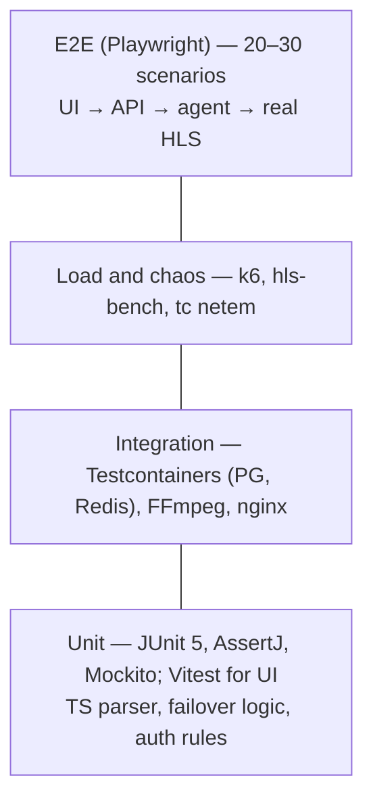

# 09 · Test Strategy

[← Index](00-README.md) · [Български](../bg/09-testing-qa.md)

## 1. Test pyramid

| Level | Scope | Tools | When |
|---|---|---|---|
| Unit | Domain logic, TS parser (PAT/PMT/CC/PCR), FailoverController (state machine), authorization rules, FfmpegCommandBuilder | JUnit 5, AssertJ, Mockito, jqwik (property-based for TS) | Every commit |
| Integration | Repositories, Flyway migrations, Redis sessions, gRPC core↔agent, real FFmpeg with test streams | Testcontainers, FFmpeg `testsrc`/`sine`, test .ts files | Every PR |
| Contract | Admin API against `openapi.yaml` | springdoc + schemathesis | Every PR |
| E2E | Key user journeys through the UI | Playwright | Nightly + before release |
| Load | Auth RPS, concurrent viewers, streams per ingest | k6, custom HLS simulator (Go/Java), `wrk` | Before R1 and every major release |
| Chaos | Source, agent, core, edge failure, network loss | `tc netem`, `iptables DROP`, `kill -9` | Before R1 |
| Security | OWASP Top 10, RBAC matrix, command injection via URL | OWASP ZAP, manual tests | Before R1 |

## 2. Test streams (fixtures)

| Name | Generation | Purpose |
|---|---|---|
| `clean-h264-aac.ts` | `ffmpeg -f lavfi -i testsrc2 -f lavfi -i sine -c:v libx264 -c:a aac` | Baseline stream |
| `mpts-3prog.ts` | 3 multiplexed programs | PNR selection |
| `cc-errors.ts` | Stream with dropped packets | CC error counter |
| `scrambled.ts` | TS with scrambling flag set | Scrambled detection |
| `multi-audio.ts` | bul + eng + subtitles | Audio filtering |
| `hevc-ac3.ts` | H.265 + AC3 | Codec analyzer |
| Live HTTP server | `ffmpeg -re ... -f mpegts -listen 1 http://0.0.0.0:9000` | HTTP-TS input, failure on demand |

## 3. Key test scenarios (excerpt)

| ID | Scenario | Expected result | Covers |
|---|---|---|---|
| TC-01 | Create a stream with HTTP-TS input, HLS output | ONLINE ≤ 5 s, valid m3u8 (`mediastreamvalidator`/hls.js) | FR-STR-01, FR-OUT-01 |
| TC-02 | Stop the primary source (hot standby) | Switch ≤ 3 s, player does not stall > 3 s, FAILOVER event | FR-FOV-03 |
| TC-03 | Primary source returns | Return after 30 s stable, RECOVERED event | FR-FOV-05 |
| TC-04 | All inputs fail | OFFLINE, alert ≤ 30 s | FR-FOV, FR-ALR |
| TC-05 | Subscriber with limit 1 opens a 2nd device | 403 `LIMIT` (REJECT_NEW) or the first is kicked (KICK_OLDEST) | FR-AUT-04 |
| TC-06 | Subscriber expires at 00:00 | Status EXPIRED, sessions terminated ≤ 60 s | BR-01 |
| TC-07 | Request for a stream outside the package | 403 `NOT_IN_PACKAGE` | FR-AUT-03 |
| TC-08 | Forged or expired segment signature | 403 / 410 | FR-AUT-02 |
| TC-09 | Input URL `file:///etc/passwd` | Validation error 400 | SEC-07 |
| TC-10 | Core stopped for 10 min | Active viewers continue | NFR-13 |
| TC-11 | Import an M3U with 300 streams | Preview; after commit 300 streams, no duplicate slugs | FR-CFG-02 |
| TC-12 | Support tries to delete a subscriber | 403 | FR-ADM-02 |
| TC-13 | 2,000 concurrent HLS viewers on 3 edges | 0% errors, p95 segment time < 500 ms, edge CPU < 60% | NFR-02 |
| TC-14 | 250 streams on 1 ingest for 24 h | No memory leak, CPU < 70%, 0 unwanted restarts | NFR-03, NFR-16 |
| TC-15 | 5% packet loss on a UDP input | CC errors counted, no failover below threshold | FR-ANL-02, FR-FOV-04 |

## 4. Release acceptance criteria

- 0 open **Blocker/Critical** bugs; ≤ 5 **Major** with a known workaround.
- All TCs for the modules in the release have passed.
- Load tests (TC-13, TC-14) passed on staging.
- Chaos tests (TC-02, TC-04, TC-10) passed.
- Release notes and updated documentation.

## 5. Defect classification

| Level | Definition | Fix SLA |
|---|---|---|
| Blocker | Viewing stops for everyone, or data loss | Immediately (hotfix) |
| Critical | A stream/feature does not work, no workaround | ≤ 24 h |
| Major | Feature partly works, workaround exists | Next sprint |
| Minor | Cosmetic, text | Backlog |
