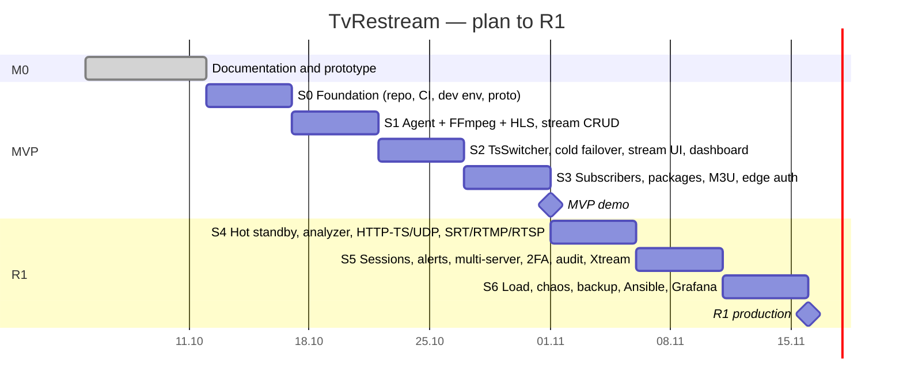

# 10 · Roadmap and Backlog

[← Index](00-README.md) · [Български](../bg/10-roadmap-backlog.md)

## 1. Milestones

| Milestone | Goal | Duration (approx.) | Outcome |
|---|---|---|---|
| **M0 · Concept** | Documentation, architecture, UI prototype | 1 week | This document set |
| **MVP** | Streams with HTTP/HLS/UDP input, HLS output, cold failover, subscribers, packages, M3U, tokens, 1 server | Sprints 0–3 (4 weeks) | Internal demo, 10–20 test subscribers |
| **R1 · Production** | Hot standby, full analyzer, HTTP-TS/UDP outputs, SRT/RTMP/RTSP, sessions, alerts, multiple servers, 2FA, audit, Xtream API, load testing | Sprints 4–6 (3 weeks) | Launch for 2,000–2,500 subscribers |
| **R2 · Extensions** | Webhooks, SRT/RTMP outputs, geo/IP, slate, automatic relocation on failure, reports, control plane HA | +4 weeks | — |
| **R3 · Future** | DVB-S/S2, GPU transcoding, billing, CAS, resellers | On demand | — |

## 2. Sprint plan (1 sprint = 1 week, 1 developer + Claude)

### Sprint details

| Sprint | Sprint goal | Main tasks | Demo criterion |
|---|---|---|---|
| **S0** | An "empty" product that builds and deploys | Gradle multi-project, React skeleton, dev Docker Compose, GitHub Actions, Flyway V1, `agent.proto`, ADRs | `docker compose up` → login page |
| **S1** | One stream from HTTP-TS → HLS | ProcessSupervisor (start/stop/restart/backoff), FfmpegCommandBuilder, gRPC link + desired state, stream CRUD (API), ffprobe test | `curl` on m3u8 works, VLC plays the stream |
| **S2** | The stream "survives" | TsSwitcher (Netty UDP), basic TsAnalyzer (bitrate, PAT/PMT), cold failover, UI: stream list/edit/detail, dashboard + SSE, stream log | Stop the source → stream on backup |
| **S3** | A subscriber watches via a protected link | Subscribers, packages, categories, M3U, `/internal/auth`, nginx edge (auth_request + njs + secure_link), session limit, admin login + RBAC | TiviMate with M3U link; 2nd device refused |
| **S4** | Astra-level streaming | Hot standby, return-to-primary, CC/PCR/scrambled, PID table, HTTP-TS relay, UDP output, SRT/RTMP/RTSP inputs, MPTS PNR, audio filter | Chaos test TC-02 ≤ 3 s |
| **S5** | Ready for operators | Sessions + kick, Telegram/email alerts, multiple nodes + enrollment, audit, 2FA, Xtream API, M3U/Astra import, statistics | 2 ingest + 2 edge on staging |
| **S6** | Ready for production | Load test 2,000 viewers, 24 h soak, chaos tests, backup, Ansible roles, Grafana dashboards, runbooks, security review | All criteria from [09 §4](09-testing-qa.md) |

> The detailed plan with all tickets and the tracking board is in [12 · Development plan](12-development-plan.md).

## 3. Epics and user stories (product backlog)

| Epic | User story (examples) | Modules | SP | Release |
|---|---|---|:-:|:-:|
| **E1 Foundation** | As a developer I want CI and a dev environment so I can ship fast | — | 8 | MVP |
| **E2 Streams** | As a technician I want to add a stream in < 1 min | STR, INP, OUT | 21 | MVP |
| **E3 Failover** | As a technician I want the stream to switch to a backup source by itself | FOV | 13 (+13 R1) | MVP/R1 |
| **E4 Analyzer** | As a technician I want to see CC errors and PIDs to diagnose problems | ANL | 13 | R1 |
| **E5 Subscribers & packages** | As support I want to create a subscriber and assign a package | SUB, PKG | 13 | MVP |
| **E6 Protected playback** | As the owner I want links that cannot be shared | AUT, SES, DEV | 21 | MVP/R1 |
| **E7 Playlists & EPG** | As a subscriber I want one M3U link with logos and a guide | PLY | 8 | MVP/R1 |
| **E8 Dashboard & monitoring** | As a technician I want one screen showing what is broken | MON | 13 | MVP |
| **E9 Alerts** | As a technician I want a Telegram message when a stream goes down | ALR | 8 | R1 |
| **E10 Cluster** | As the owner I want to add servers as we grow | NOD | 13 | R1 |
| **E11 Admins & audit** | As the owner I want to know who changed what | ADM, AUD | 8 | R1 |
| **E12 Integrations** | As an integrator I want an API and webhooks | API | 8 | MVP/R2 |
| **E13 Import & settings** | As a technician I want to import my streams from Astra/M3U | CFG | 8 | MVP/R1 |
| **E14 Statistics** | As the owner I want a viewership and uptime report | STA | 8 | R1 |
| **E15 Operations** | As DevOps I want backups, monitoring and easy installation | — | 13 | R1 |

## 4. Definition of Ready (DoR)

- The story has a clear goal ("As a… I want… so that…") and acceptance criteria (Given/When/Then).
- Dependencies are known; there is a mockup for UI changes.
- It is estimated (story points) and fits in one sprint.

## 5. Definition of Done (DoD)

- [ ] Code is in `main` via a reviewed PR.
- [ ] Unit and integration tests, CI is green, coverage ≥ target (NFR-18).
- [ ] API changes are reflected in `openapi.yaml`.
- [ ] UI is translated to BG and EN.
- [ ] Metrics and logs for the new feature.
- [ ] Documentation (this folder) is updated.
- [ ] Demonstrated on staging.

## 6. RACI

| Activity | Owner (PO) | Developer | Claude | QA/Tester |
|---|:-:|:-:|:-:|:-:|
| Priorities and scope | **A/R** | C | C | I |
| Architecture | A | R | **R** | I |
| Writing code | I | **A/R** | R | I |
| Testing | I | A | R | **R** |
| Test environment, real streams | **A/R** | R | I | C |
| Production deployment | A | **R** | C | I |
