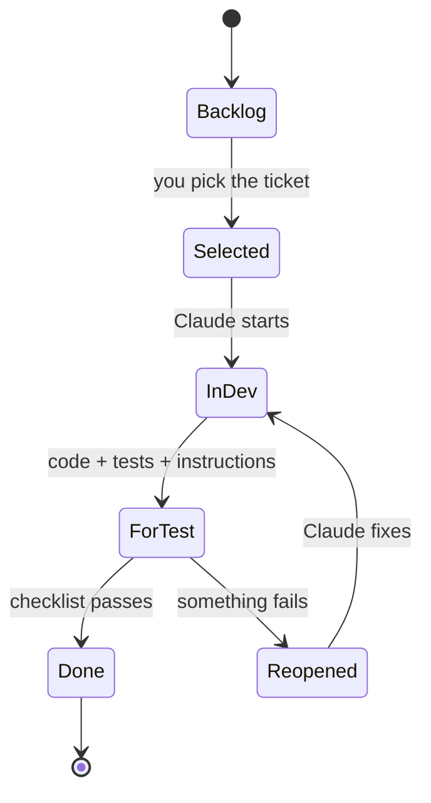
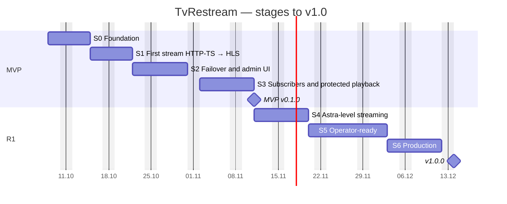
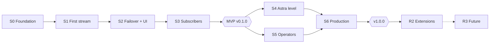

# 12 · Development Plan and Tracking

[← Index](00-README.md) · [Български](../bg/12-development-plan.md)

> **Tracking board:** [TvRestream Board](https://claude.ai/artifact/URXdaur2HqQf2g5okUWsy5) — all 109 tickets, statuses, test checklists and notes. The board is the source of truth for status; this document describes the plan and the process.

## 1. How we work

| Role | Who | Responsibilities |
|---|---|---|
| Owner and tester (PO/QA) | Kostadin | Picks the next ticket, tests by the checklist, accepts or reopens, provides the test environment and real streams |
| Developer | Claude | Writes the code, tests and docs for the ticket, explains how to test it, fixes reopened tickets |

### 1.1 Ticket lifecycle

### 1.2 Step by step

1. **Pick.** On the board open a ticket labelled “ready” (all dependencies done) and press **“Pick and copy”**. The ticket moves to “Selected”.
2. **Request.** Paste into the chat: `Имплементирай TVR-012` (“implement TVR-012”). Several at once also work.
3. **Development.** Claude reads the ticket from the board, moves it to “In development”, writes the code in `TVRestreamer_Code` (branch `feature/TVR-012`) and runs the tests.
4. **Hand-over.** Claude moves the ticket to “For test” and adds a note: what was done, which files, how to run it, extra checks.
5. **Test.** You run the “How to test” checklist and tick the steps.
6. **Decision.** All good → **Done**. Something fails → **Reopened** + a note (what you did, expected, actual, log). A new problem outside the ticket → **“+ Bug”**.
7. **Fix.** Write `Поправи TVR-012` (“fix TVR-012”) — Claude reads the notes and fixes it.

### 1.3 Rules

- Tickets are **small**: S ≈ half a work session, M ≈ one session, L ≈ two sessions (code + test). If one grows, Claude splits it.
- **Dependencies** are respected. The board shows “waits N” on a ticket with unfinished dependencies.
- At most **2 tickets in development** at a time, so untested work does not pile up.
- A ticket is **Done** only after your test — Claude never moves tickets to Done.
- Every ticket leaves a **working product** (main always builds and runs).

### 1.4 Definition of Done (per ticket)

- [ ] Code is on branch `feature/TVR-xxx`, merged into `main` after your acceptance.
- [ ] Automated tests pass (`./gradlew build`, `npm test`).
- [ ] The board note explains how to test and what changed.
- [ ] You have run the “How to test” checklist.
- [ ] Affected docs (`docs/`) and `openapi.yaml` are updated.
- [ ] UI strings exist in BG and EN.

## 2. Development and test environment

| What | Where | Note |
|---|---|---|
| Code | Subfolder `TVRestreamer_Code` (IntelliJ/Gradle project, Git) | Claude writes there directly; IntelliJ for review |
| Tools | Java 21, Docker Desktop, FFmpeg 7 (`brew install ffmpeg`), Node 20 | Check: `scripts/dev-check.sh` (TVR-002) |
| Local services | PostgreSQL, Redis, Adminer, nginx in Docker Compose | TVR-003 |
| Test streams | `scripts/test-streams.sh` (FFmpeg testsrc) | TVR-009; later real provider streams |
| Players | VLC, TiviMate/IPTV Smarters on phone/TV | For manual tests |
| Staging (from S5) | 1–2 Linux servers (Ubuntu 24.04) | Needed for cluster, multicast and load |

> **Decision (ADR-009):** we use **Gradle** (your existing project) instead of Maven. The docs are updated.

## 3. Stages

| Stage | Name | Goal | Tickets | Effort* | Weeks |
|---|---|---|:-:|:-:|:-:|
| **S0** · MVP | Foundation | The project builds, runs locally and has an admin login. | 10 | 7 | 1 |
| **S1** · MVP | First stream: HTTP-TS → HLS | A stream created via the API runs on the agent and plays in VLC. | 13 | 11 | 1 |
| **S2** · MVP | Failover and admin UI | The stream switches to a backup input on its own; streams are managed in the web panel. | 13 | 16 | 1–1,5 |
| **S3** · MVP | Subscribers and protected playback | A subscriber watches via a personal M3U link; a device over the limit is refused. | 14 | 13.5 | 1–1,5 |
| **S4** · R1 | Astra-level streaming | Hot standby < 3 s, full analyzer, all inputs and outputs. | 15 | 16 | 1,5 |
| **S5** · R1 | Operator-ready | Sessions, alerts, multiple servers, 2FA, audit, Xtream API, statistics. | 18 | 18 | 1,5–2 |
| **S6** · R1 | Production | Load and chaos tests pass; Ansible install; go-live. | 11 | 13 | 1–1,5 |
| **R2** · R2 | Extensions | Webhooks, geo/IP, slate, automatic relocation, HA. | 10 | 11 | 3–4 |
| **R3** · R3 | Future | DVB-S/S2, transcoding, billing — on demand. | 5 | 10 | — |

\* Effort in “sessions” (S = 0.5, M = 1, L = 2). Real pace depends mainly on testing speed: at 3–5 tickets a day S0–S6 (94 tickets) take **≈ 5–7 weeks**, matching the estimate in document 10.

## 4. Tickets by stage

### 4.1 S0 · Foundation

**Goal:** The project builds, runs locally and has an admin login.

| ID | Task | Type | Пр. | Size | Depends on |
|---|---|---|:-:|:-:|---|
| `TVR-001` | Gradle multi-project: tvr-common, tvr-core, tvr-agent (Java 21) | Infra | M | M | — |
| `TVR-002` | Mac dev environment: tooling check | Infra | M | S | — |
| `TVR-003` | Dev Docker Compose: PostgreSQL 16, Redis 7, Adminer | Infra | M | S | TVR-002 |
| `TVR-004` | tvr-core: Spring Boot skeleton, health, profiles, JSON logs | Infra | M | M | TVR-001, TVR-003 |
| `TVR-005` | Flyway V1: nodes, streams, inputs, outputs, categories schema | Infra | M | S | TVR-004 |
| `TVR-006` | Admin login: JWT, initial admin, /auth/me | Feature | M | M | TVR-005 |
| `TVR-007` | tvr-ui: React + TypeScript + Ant Design, layout, login, BG/EN | Feature | M | M | TVR-006 |
| `TVR-008` | gRPC contract agent.proto in tvr-common | Infra | M | S | TVR-001 |
| `TVR-009` | Test streams: local HTTP-TS / UDP / HLS generator | Infra | M | S | TVR-002 |
| `TVR-010` | Git conventions, CI (optional GitHub Actions) | Docs | S | S | TVR-001 |

### 4.2 S1 · First stream: HTTP-TS → HLS

**Goal:** A stream created via the API runs on the agent and plays in VLC.

| ID | Task | Type | Пр. | Size | Depends on |
|---|---|---|:-:|:-:|---|
| `TVR-011` | Stream domain: JPA entities and repositories | Feature | M | M | TVR-005 |
| `TVR-012` | Streams REST API (CRUD) with validation | Feature | M | M | TVR-011, TVR-006 |
| `TVR-013` | Categories API | Feature | M | S | TVR-011 |
| `TVR-014` | tvr-agent: skeleton and configuration | Infra | M | S | TVR-001 |
| `TVR-015` | FfmpegCommandBuilder: inputs, packager, outputs | Feature | M | M | TVR-014 |
| `TVR-016` | ProcessSupervisor: start, stop, restart with backoff | Feature | M | M | TVR-015 |
| `TVR-017` | Agent ↔ core gRPC link: enrollment and heartbeat | Feature | M | M | TVR-008, TVR-014, TVR-004 |
| `TVR-018` | Desired state + reconciler: core drives agent streams | Feature | M | L | TVR-017, TVR-016, TVR-012 |
| `TVR-019` | HLS output and nginx origin in dev | Feature | M | M | TVR-018 |
| `TVR-020` | Stream status from agent to core | Feature | M | S | TVR-018 |
| `TVR-021` | Start / Stop / Restart actions | Feature | M | S | TVR-018 |
| `TVR-022` | Input probe (ffprobe) | Feature | M | S | TVR-012 |
| `TVR-023` | Stream log via API | Feature | M | S | TVR-016, TVR-017 |

### 4.3 S2 · Failover and admin UI

**Goal:** The stream switches to a backup input on its own; streams are managed in the web panel.

| ID | Task | Type | Пр. | Size | Depends on |
|---|---|---|:-:|:-:|---|
| `TVR-024` | MPEG-TS parser: packets, PAT/PMT, CC | Feature | M | L | TVR-014 |
| `TVR-025` | TsSwitcher: Netty receive and forward of the active input | Feature | M | L | TVR-024, TVR-018 |
| `TVR-026` | Basic analyzer: bitrate, codecs, video/audio | Feature | M | M | TVR-025 |
| `TVR-027` | Cold failover: switch on no data | Feature | M | M | TVR-025 |
| `TVR-028` | HLS discontinuity on input switch | Feature | M | M | TVR-027 |
| `TVR-029` | Stream events: storage and API | Feature | M | S | TVR-027 |
| `TVR-030` | Real time: SSE /api/v1/events | Feature | M | M | TVR-020 |
| `TVR-031` | UI: streams list | Feature | M | M | TVR-007, TVR-012, TVR-030 |
| `TVR-032` | UI: new / edit stream | Feature | M | L | TVR-031, TVR-022, TVR-013 |
| `TVR-033` | UI: stream detail (overview, inputs, log, events) | Feature | M | L | TVR-031, TVR-023, TVR-029, TVR-026 |
| `TVR-034` | UI: dashboard | Feature | M | M | TVR-031 |
| `TVR-035` | Node metrics and Servers UI | Feature | M | M | TVR-017, TVR-007 |
| `TVR-036` | Manual input switch (switch / pin) | Feature | M | S | TVR-027, TVR-033 |

### 4.4 S3 · Subscribers and protected playback

**Goal:** A subscriber watches via a personal M3U link; a device over the limit is refused.

| ID | Task | Type | Пр. | Size | Depends on |
|---|---|---|:-:|:-:|---|
| `TVR-037` | Flyway: subscribers, packages, devices | Infra | M | S | TVR-005 |
| `TVR-038` | Packages: API and UI with stream ordering | Feature | M | M | TVR-037, TVR-031 |
| `TVR-039` | Subscribers: API (CRUD, status, extend, new token) | Feature | M | M | TVR-037 |
| `TVR-040` | UI: subscribers (list and detail) | Feature | M | L | TVR-039, TVR-038, TVR-007 |
| `TVR-041` | Personal M3U playlist | Feature | M | M | TVR-039, TVR-038 |
| `TVR-042` | /internal/auth: access check | Feature | M | M | TVR-039 |
| `TVR-043` | Dev nginx edge: auth_request for playlists | Infra | M | M | TVR-042, TVR-019 |
| `TVR-044` | Signed segments: njs + secure_link | Feature | M | M | TVR-043 |
| `TVR-045` | Concurrent device limit | Feature | M | M | TVR-042 |
| `TVR-046` | Automatic subscriber expiry at 00:00 | Feature | M | S | TVR-039, TVR-045 |
| `TVR-047` | Stream logos: upload and serving | Feature | S | S | TVR-032 |
| `TVR-048` | Roles and permissions (Admin, Operator, Support, Viewer) | Feature | M | M | TVR-006, TVR-040 |
| `TVR-049` | Stream import from M3U | Feature | M | M | TVR-012, TVR-038 |
| `TVR-050` | MVP demo: v0.1.0 | Milestone | M | M | TVR-041, TVR-044, TVR-045, TVR-046, TVR-034, TVR-036, TVR-048, TVR-049 |

### 4.5 S4 · Astra-level streaming

**Goal:** Hot standby < 3 s, full analyzer, all inputs and outputs.

| ID | Task | Type | Пр. | Size | Depends on |
|---|---|---|:-:|:-:|---|
| `TVR-051` | Hot-standby inputs (switch < 3 s) | Feature | M | L | TVR-027 |
| `TVR-052` | Return to primary input | Feature | M | M | TVR-051 |
| `TVR-053` | Full analyzer: per-PID CC, PCR, scrambled, PID table | Feature | M | L | TVR-026 |
| `TVR-054` | Failover triggers: CC errors, bitrate, missing A/V, scrambled | Feature | M | M | TVR-051, TVR-053 |
| `TVR-055` | 24h charts: bitrate, CC, viewers | Feature | S | M | TVR-053 |
| `TVR-056` | HTTP-TS output (agent relay) via edge | Feature | M | L | TVR-025, TVR-044 |
| `TVR-057` | UDP multicast output | Feature | S | M | TVR-025 |
| `TVR-058` | SRT input (caller/listener) | Feature | M | M | TVR-015 |
| `TVR-059` | RTMP input (pull and push with key) | Feature | S | S | TVR-015 |
| `TVR-060` | RTSP input | Feature | S | S | TVR-015 |
| `TVR-061` | MPTS: program (PNR) selection | Feature | M | M | TVR-053 |
| `TVR-062` | Audio language and subtitle filter | Feature | S | S | TVR-053 |
| `TVR-063` | On-demand mode | Feature | M | M | TVR-043, TVR-018 |
| `TVR-064` | Stream thumbnail | Feature | S | S | TVR-033 |
| `TVR-065` | Failover chaos test (TC-02/03/04) | Test | M | M | TVR-051, TVR-052, TVR-054 |

### 4.6 S5 · Operator-ready

**Goal:** Sessions, alerts, multiple servers, 2FA, audit, Xtream API, statistics.

| ID | Task | Type | Пр. | Size | Depends on |
|---|---|---|:-:|:-:|---|
| `TVR-066` | Sessions: active, kick, 90-day history | Feature | M | M | TVR-045 |
| `TVR-067` | Devices and kick-oldest policy | Feature | S | M | TVR-066 |
| `TVR-068` | Alerts: rules, Telegram and email | Feature | M | M | TVR-029 |
| `TVR-069` | Incidents: active, history, acknowledge | Feature | S | M | TVR-068 |
| `TVR-070` | Cluster: node enrollment, mTLS, install-agent.sh | Feature | M | L | TVR-017 |
| `TVR-071` | Move streams between nodes and drain mode | Feature | M | M | TVR-070 |
| `TVR-072` | Edge load balancing | Feature | S | M | TVR-070, TVR-041 |
| `TVR-073` | 2FA (TOTP) and account lockout | Feature | M | M | TVR-006, TVR-007 |
| `TVR-074` | Audit log | Feature | M | M | TVR-048 |
| `TVR-075` | API keys with scopes | Feature | S | S | TVR-048 |
| `TVR-076` | Xtream Codes API compatibility | Feature | M | L | TVR-041, TVR-056 |
| `TVR-077` | EPG: XMLTV proxy and per-subscriber filter | Feature | S | M | TVR-041 |
| `TVR-078` | Import from Astra JSON | Feature | S | M | TVR-049 |
| `TVR-079` | Full configuration export and import | Feature | S | S | TVR-038 |
| `TVR-080` | Statistics and reports | Feature | S | M | TVR-066 |
| `TVR-081` | Prometheus metrics | Feature | S | S | TVR-017 |
| `TVR-082` | UI: Settings | Feature | M | M | TVR-068 |
| `TVR-083` | Subscriber CSV import/export and bulk extend | Feature | S | S | TVR-040 |

### 4.7 S6 · Production

**Goal:** Load and chaos tests pass; Ansible install; go-live.

| ID | Task | Type | Пр. | Size | Depends on |
|---|---|---|:-:|:-:|---|
| `TVR-084` | Production Docker images (core, agent, edge) | Infra | M | M | TVR-050 |
| `TVR-085` | Ansible roles: common, control-plane, agent, edge | Infra | M | L | TVR-084, TVR-070 |
| `TVR-086` | Grafana dashboards and Alertmanager | Infra | S | M | TVR-081 |
| `TVR-087` | Database backup and restore test | Infra | M | M | TVR-084 |
| `TVR-088` | Load test: 2,000 viewers | Test | M | L | TVR-085 |
| `TVR-089` | 24h soak test: 250 streams on one node | Test | M | M | TVR-085 |
| `TVR-090` | Chaos tests: core, edge, ingest | Test | M | M | TVR-085 |
| `TVR-091` | Security review | Test | M | M | TVR-084 |
| `TVR-092` | Real player and device tests | Test | M | M | TVR-056, TVR-076 |
| `TVR-093` | Admin guide and runbooks | Docs | M | M | TVR-085 |
| `TVR-094` | Go-live: v1.0.0 | Milestone | M | M | TVR-086, TVR-087, TVR-088, TVR-089, TVR-090, TVR-091, TVR-092, TVR-093 |

### 4.8 R2 · Extensions

**Goal:** Webhooks, geo/IP, slate, automatic relocation, HA.

| ID | Task | Type | Пр. | Size | Depends on |
|---|---|---|:-:|:-:|---|
| `TVR-095` | Webhooks with HMAC signature and retries | Feature | S | M | TVR-074 |
| `TVR-096` | SRT output and RTMP push | Feature | S | M | TVR-058 |
| `TVR-097` | Per-subscriber IP and geo restrictions | Feature | S | M | TVR-042 |
| `TVR-098` | Token-to-IP binding | Feature | C | S | TVR-044 |
| `TVR-099` | Fallback slate when OFFLINE | Feature | S | M | TVR-051 |
| `TVR-100` | Automatic relocation on ingest failure | Feature | S | L | TVR-071 |
| `TVR-101` | Freeze, black and silence detection | Feature | C | M | TVR-064 |
| `TVR-102` | SDT/PMT rewriting | Feature | S | S | TVR-061 |
| `TVR-103` | Control plane high availability | Infra | S | L | TVR-094 |
| `TVR-104` | MAC lock (MAG/Enigma2) | Feature | C | M | TVR-067 |

### 4.9 R3 · Future

**Goal:** DVB-S/S2, transcoding, billing — on demand.

| ID | Task | Type | Пр. | Size | Depends on |
|---|---|---|:-:|:-:|---|
| `TVR-105` | DVB-S/S2 input (driver) | Feature | C | L | TVR-015 |
| `TVR-106` | GPU transcoding profiles | Feature | C | L | TVR-051 |
| `TVR-107` | Billing integration | Feature | C | L | TVR-075 |
| `TVR-108` | Reseller panel | Feature | C | L | TVR-040 |
| `TVR-109` | CAS/BISS descrambling (to be decided) | Feature | C | L | TVR-053 |

## 5. Epics

| Epic | Name | Tickets | Stages |
|---|---|:-:|---|
| E1 | Foundation | 8 | S0, S3, S6 |
| E2 | Streams | 28 | S0, S1, S2, S4, R2, R3 |
| E3 | Failover | 9 | S2, S4, R2 |
| E4 | Analyzer | 5 | S2, S4, R2 |
| E5 | Subscribers & packages | 7 | S3, S5, R3 |
| E6 | Protected playback | 9 | S3, S5, R2 |
| E7 | Playlists & EPG | 5 | S3, S5, S6 |
| E8 | Dashboard & monitoring | 5 | S0, S2, S5 |
| E9 | Alerts | 2 | S5 |
| E10 | Cluster | 9 | S0, S1, S2, S5, R2 |
| E11 | Admins & audit | 5 | S0, S3, S5, S6 |
| E12 | Integrations | 3 | S5, R2, R3 |
| E13 | Import & settings | 4 | S3, S5 |
| E14 | Statistics | 1 | S5 |
| E15 | Operations | 9 | S6, R2 |

## 6. Bugs and changes

- A **bug** is created on the board with “+ Bug” (ID `BUG-001`…), linked to the ticket where it was found, and goes straight to “Selected”.
- Bug priority: **Must** = blocks testing or viewing (fixed before the next ticket), **Should** = within the current stage, **Could** = backlog.
- **A new idea or scope change**: write it in the chat — Claude adds a ticket to the board and to `Context/plan/tickets.py`.
- After each stage: a short review (what passed, what was reopened, new tickets) and an update of this document.

## 7. Plan risks

| Risk | Mitigation |
|---|---|
| Testing is slower than development and tickets pile up in “For test” | Limit of 2 tickets in development; small tickets; automated tests cover the routine |
| A Mac does not cover Linux specifics (multicast, tmpfs, host network) | A Ubuntu 24.04 staging server from S4/S5 |
| No real defective streams for failover/analyzer | `test-streams.sh` with artificial loss, stops, MPTS; get provider test streams early |
| TsSwitcher (TVR-024/025) is harder | Cold failover works without it; spike at the start of S2 |
| Context lost between sessions | The `Context/` folder, the board and ticket notes are the project's memory |

## 8. Ticket details

Descriptions and test steps for every ticket are on the [board](https://claude.ai/artifact/URXdaur2HqQf2g5okUWsy5) and in the Bulgarian version of this document (§8).

